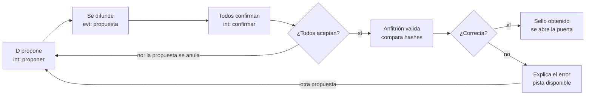

# La Última Prueba — Especificación técnica

5 de noviembre de 2026 · Versión 1.1 · Documento vivo: https://claude.ai/artifact/HqKa6YbWbcB8g8ryk55ixB

**Versión 1.1** (enmienda del 5 de noviembre de 2026): agrega el laboratorio de assets, el modo `?lab=1`, el panel de métricas y la prueba de estrés, el registro de créditos, las reglas de audio y los riesgos de licencia, con base en `docs/investigacion-assets.md`. El diseño, las salas, el presupuesto, el protocolo y la numeración T01–T102 no cambian; las tareas nuevas son T11a–T11z.

## Alcance y decisiones de arquitectura

El juego es un sitio estático en Astro con una sola isla de juego a pantalla completa: Three.js dibuja el mundo, Preact con Signals dibuja HUD y menús, y Supabase Realtime solo entra en el modo cooperativo. La meta es 30 fps estables en un Android de gama baja con 2 GB de RAM y 60 fps en gama alta.

| Decisión | Elección | Motivo |
| --- | --- | --- |
| Páginas | Astro estático: `/`, `/jugar`, `/creditos`, `/docentes` | Cloudflare Pages sin servidor; el juego es una isla `client:only` |
| Unirse a partida | `/jugar?codigo=K7MP` (parámetro, no ruta dinámica) | Un sitio estático no puede pre-generar rutas para códigos arbitrarios |
| Lógica de juego | Módulo TypeScript puro, sin DOM ni Three | Se prueba con tests unitarios y la usan igual el modo individual y el anfitrión del cooperativo |
| Puente motor ↔ interfaz | Signals de Preact como único estado observable | El HUD y la escena reaccionan al mismo estado sin acoplarse |
| Render | Three.js con WebGL2 obligatorio | Three.js actual ya no soporta WebGL1; se muestra aviso en equipos sin WebGL2 |
| Contenido | Salas, preguntas, diálogos y finales en JSON validado en build | El equipo pedagógico edita datos sin tocar código |
| Lectura de datos | Al inspeccionar un objeto con datos, se abre una vista 2D nítida en el HUD | Texto legible en pantallas pequeñas, compatible con lector de pantalla y sin texturas grandes |
| Mecanismos de respuesta | Entrada en un panel 2D (Preact); el objeto 3D solo anima | Tocar ruedas o teclas 3D pequeñas es impreciso en celular |
| Cooperativo | Anfitrión autoritativo sobre Broadcast + Presence; sin servidor de juego | Encaja con hosting estático y con partidas de 2 a 4 jugadores |
| Comunicación entre jugadores | Señalar (ping) y frases rápidas; sin chat libre ni voz | Usuarios menores de edad, normalmente en la misma aula |

Controles táctiles: joystick virtual en la mitad izquierda, arrastre para mirar en la mitad derecha, toque sobre un objeto para seleccionarlo y un botón contextual «Usar». Hay modo zurdo que invierte los lados. Teclado y ratón (WASD + bloqueo de puntero) quedan como soporte secundario en escritorio.

Supuesto clave: el dispositivo de referencia es un Android de 2 GB de RAM (a menudo con Android Go), GPU de la clase Mali-G52 MC2 / PowerVR GE8320 y Chrome actualizado. Con tan poca memoria, el límite de memoria manda sobre la calidad visual.

## 0) Presupuesto 3D para celular

Cada sala cabe en 60.000 triángulos visibles, 40 draw calls, 16 MB de texturas en GPU y 2 MB descargados; la primera sala jugable llega con menos de 3 MB en total. Un script de build rechaza cualquier sala que se pase (tarea T09).

### Por cuadro (lo que se dibuja a la vez)

| Métrica | Límite | Objetivo | Cómo se logra |
| --- | --- | --- | --- |
| Triángulos visibles | 60.000 | 40.000 | Salas cerradas, LOD en props, sin geometría fuera de cámara |
| Draw calls | 40 | 30 | Atlas de materiales, `InstancedMesh` para sillas, libros y fichas |
| Luces dinámicas | 2 | 2 | Hemisférica + linterna (`SpotLight`); el resto, horneado en lightmap |
| Sombras en tiempo real | 0 | 0 | Sombras horneadas; las «sombras misteriosas» son planos con textura alfa animada |
| Materiales | Lambert + lightmap en entorno; Standard solo en objetos interactivos | — | Menos costo de shader en GPU móvil |
| Resolución interna | DPR máx. 1,25; escala dinámica 0,5–1,0 | 30 fps sostenidos | Se ajusta según los fps medidos cada 2 s |
| Post-proceso | Ninguno en calidad baja y media | — | FXAA solo en calidad alta |

### Por sala

| Recurso | Límite | Notas |
| --- | --- | --- |
| Triángulos en escena | 90.000 | Arquitectura 15k · ambientación 35k · objetos interactivos 20k (máx. 6k c/u) · avatares 4 × 2k · margen 12k |
| Texturas (cantidad) | 1 lightmap 1024² + hasta 2 atlas 1024² + texturas de objetos 512² | Lightmap de 2048² solo en calidad alta |
| Texturas en GPU | 16 MB con mipmaps | KTX2: ETC1S para color y lightmap; UASTC solo para mapas normales de objetos clave, que se omiten en calidad baja |
| Peso descargado | 2 MB | GLB con `EXT_meshopt_compression` + KTX2; audio aparte |
| Audio de la sala | 0,6 MB | AAC mono 48 kbps para voz, 64 kbps para ambiente en bucle |

### Carga total

| Paquete | Límite (gzip/brotli) | Cuándo se descarga |
| --- | --- | --- |
| Página de inicio y menús (Astro + Preact + Signals) | 100 KB | Al abrir el sitio |
| Núcleo de juego (Three.js recortado, cargadores, lógica) | 250 KB | Al tocar «Jugar» |
| Decodificadores meshopt y Basis (wasm) | 300 KB | Junto con el núcleo; caché inmutable |
| Portería + sala 1 + audio inicial | 2,3 MB | Antes del primer control |
| **Primera sala jugable, total** | **3 MB** | Unos 5 s en 4G de 5 Mbps |
| Salas 2 a 5 | 4 × 2,6 MB | La siguiente se descarga a la caché mientras se juega la actual; no sube a la GPU hasta entrar |
| **Juego completo** | **14 MB** | Queda en caché del service worker para volver a salas anteriores |

Memoria: la pestaña no debe superar unos 180 MB entre JavaScript y GPU. En GPU solo quedan la portería y la sala actual; la siguiente espera descargada en la caché, sin decodificar. Al volver a una sala anterior se recarga desde la caché local, sin red.

Pipeline de compresión (glTF-Transform + meshoptimizer), ajustado en v1.1: perfil de limpieza por fuente, con `simplify` si hace falta → rehorneado en Blender → `dedup` → `prune` → `weld` → `quantize` → `meshopt` → `ktx2` (requiere KTX-Software 4.4.0 o superior en la máquina de build) → `asset.copyright` → informe de triángulos, draw calls estimados y bytes por sala. `instance` y el LOD al 50 % se aplican solo a props instanciados, que no usan lightmap. El detalle está en «Laboratorio de assets».

## Laboratorio de assets (v1.1)

Cada sala prueba una fuente de modelos distinta. Todas terminan en el mismo GLB con meshopt y KTX2 de 1024 px y cumplen el mismo presupuesto; lo que cambia es la limpieza previa y el registro de licencia. Paredes, piso y techo usan las mismas texturas CC0 de ambientCG en todas las salas, como control: cualquier diferencia entre salas viene de los modelos.

| Sala | Fuente | Qué aporta | Qué medimos sobre todo |
| --- | --- | --- | --- |
| 1 · Cooperativa | Kenney (CC0) | Mostrador, estanterías, cajas, registradora modular | Draw calls antes y después de `join`, `instance` y `palette` |
| 2 · Laboratorio | Meshy, plan gratis (CC BY 4.0 con crédito a Meshy) | Termómetro, mesones, instrumentos | Triángulos tras el límite de caras; luz horneada que choca con la de la sala |
| 3 · Gimnasio | Sketchfab, solo CC BY | Graderas, maqueta, tablero | Cuánto hay que simplificar; tiempo de carga |
| 4 · Biblioteca | Poly Haven (CC0), descarga manual en la web; nunca su API | Muebles, lámpara, globo terráqueo | Memoria de texturas: varios mapas por material |
| 5 · Rectoría | Geometría por código + imágenes de IA + audio | Urna, fichas y ruedas generadas en Three.js; cuadros y carteles generados con IA; efectos con Web Audio | Costo cero de descarga en geometría; calidad de imágenes de IA tras KTX2 |

El presupuesto de la sección 0 manda sobre las cifras de la investigación (100.000 triángulos, 15 MB, \~100 draw calls), que quedan descartadas para este juego.

### Limpieza por fuente en `optimize-models`

El script lee la `fuente` de cada archivo en `art/credits.json` y aplica su perfil antes de la etapa común. Ningún perfil sube un límite: si un asset no cabe, se simplifica o se cambia.

| Perfil | Pasos específicos | Trampa principal |
| --- | --- | --- |
| `kenney` | Factor de escala por pack a metros; `join` de piezas que comparten material; `instance` de repetidos; `palette` para fundir materiales planos en una textura | Muchas piezas sueltas = muchas draw calls |
| `meshy` | Límite de caras pedido al generar (6k por objeto); pivote en el centro de la base; escala a metros; `simplify` si aún se pasa; texturas 2048 → 1024; revisar luz horneada y regenerar con PBR si la trae | Geometría densa y desordenada; iluminación falsa en la textura |
| `sketchfab` | Descargar el GLB con texturas de 1k; quitar cámaras, luces y nodos vacíos (`prune`, `flatten`); corregir eje +Y, escala y pivote; `simplify` hasta 6k por objeto | Modelos sobredimensionados; materiales que glTF no soporta se pierden |
| `polyhaven` | Versión glTF de 1k bajada a mano; en el entorno solo se conserva el color (Lambert + lightmap); normal y rugosidad solo en objetos interactivos | Peso de texturas: 4 o más mapas por material |
| `ambientcg` | Material a 1K; solo color para paredes y piso; `repeat` ajustado en Three.js | Repetición visible de la textura |
| `ia-imagen` | Redimensionar a potencia de 2 (1024² máx.); KTX2 ETC1S | Logos, texto o caras que no deben aparecer |
| `codigo` | Sin archivo: la geometría se crea al cargar la sala y se mide en el panel de métricas | Triángulos que no ve `check-budget` |

Después del perfil, la etapa común es la misma para todos: `dedup` → `prune` → `weld` → `quantize` → `meshopt` → `ktx2` → escribir `asset.copyright` → informe.

### Rehorneado en Blender con el lightmap de la sala

Los modelos externos traen iluminación propia o ninguna; para que encajen, se rehornean con la luz de su sala. El orden importa: simplificar después de hornear deforma las UV del lightmap.

1. `optimize-models --etapa limpieza` produce un GLB limpio sin comprimir en `art/<sala>/limpios/`.
2. La plantilla `art/plantilla-horneado.blend` lo importa como colección enlazada dentro de `escena.blend` de la sala.
3. Se genera una segunda capa de UV (Lightmap Pack) y se ubica en el atlas de lightmap de la sala (1024²).
4. Se hornea con Cycles la luz difusa (directa + indirecta, sin color) de toda la sala en un solo lightmap.
5. Se exporta el GLB de la sala con las dos capas de UV y se pasa por la etapa común, sin `simplify`.

Los objetos que se recogen o se mueven (linterna, fichas, lupa) y los props instanciados (sillas, libros) no van en el lightmap: usan luz hemisférica, la linterna y una sombra falsa bajo su base. Las tareas de lightmap ya existentes (T48, T55, T61, T67, T73) hornean con los assets externos incluidos.

### Modo `?lab=1`

Carga el asset original y su versión optimizada en la misma escena y con la misma cámara, para compararlos. Es la única parte del proyecto donde se permite pasar el presupuesto.

- **Dónde existe:** en `astro dev` y en la rama `lab` de Cloudflare Pages (`npm run build:lab`, con cabecera `X-Robots-Tag: noindex`). En el build de producción, `PUBLIC_LAB` es falso, el módulo se elimina del bundle y `?lab=1` no hace nada.
- **Originales:** solo el build de lab copia a `lab-originales/` los archivos de `art/` que se van a comparar. Producción nunca los publica.
- **Presupuesto:** en lab, `check-budget` informa sobre los originales sin fallar; los optimizados deben cumplir igual que en producción. El build de `main` falla ante cualquier exceso.
- **Interfaz:** botón A/B para alternar original y optimizado (pantalla dividida en escritorio), modo alambre y una tabla de diferencias: triángulos, draw calls, MB descargados, MB de texturas en GPU, tiempo de carga y p95 del tiempo de cuadro.
- **Acceso:** el enlace de la rama `lab` se comparte solo con el equipo; si hace falta, se protege con Cloudflare Access, que es un servicio gestionado y no un servidor propio.

## Panel de métricas y prueba de estrés (v1.1)

Un panel oculto mide cada sala contra el presupuesto, y una prueba de estrés sube la carga en un solo eje por corrida hasta encontrar el límite de cada teléfono. Los resultados se exportan en JSON; no se guardan en Supabase por ahora.

### Panel `?debug=1`

Se abre con `?debug=1` o con 3 toques en la esquina superior izquierda. Es un componente Preact sobre el canvas que solo captura toques en sus botones. Las métricas viven en signals de `src/debug/metricas.ts` y el bucle de render las escribe como máximo cada 500 ms.

| Métrica | Cómo se mide | Verde hasta |
| --- | --- | --- |
| Tiempo de cuadro | Mediana, p95 y 1 % más lento en ventana de 5 s, desde `setAnimationLoop` | p95 33 ms |
| Triángulos | `renderer.info.render.triangles` con `info.autoReset = false` y `info.reset()` una vez por cuadro | 60.000 |
| Draw calls | `renderer.info.render.calls`, igual que arriba | 40 |
| Memoria de texturas | Ancho × alto × bytes por píxel × 1,33 con mipmaps: 0,5 B en ETC2 RGB, 1 B en ASTC 4×4 o ETC2 RGBA, 4 B sin comprimir | 16 MB |
| Geometrías y texturas activas | `renderer.info.memory`; si crecen al cambiar de sala, falta un `dispose()` | Igual al volver |
| MB descargados | `PerformanceObserver` de tipo `resource`, suma de `transferSize` bajo `/assets/salas/<sala>/`; cuenta aparte lo que vino de caché | 2,6 MB |
| Tiempo de carga | `performance.measure` entre `sala:inicio` y `sala:primer-cuadro` | 5 s en 4G |
| Contexto | Perfil de calidad, `devicePixelRatio`, pixel ratio usado, `userAgent` | — |

Cada valor se pinta en verde, ámbar (más del 85 % del límite) o rojo. Con el panel cerrado no hay asignaciones por cuadro; con el panel abierto, la mediana del tiempo de cuadro no sube más de 1 ms.

### Prueba de estrés por ejes

| Eje | Cada escalón agrega | Qué aísla |
| --- | --- | --- |
| Triángulos | +10.000 con un `InstancedMesh` del asset más pesado de la sala | Geometría, en una sola draw call |
| Draw calls | +10 mallas pequeñas con material propio | Costo de CPU por llamada |
| Texturas | +4 texturas KTX2 de 1024 px en planos visibles | Memoria, el límite que hace recargar Safari |
| Píxeles | Pixel ratio de 0,5 a `devicePixelRatio` en pasos de 0,25; luego +1 plano transparente a pantalla completa | Costo por píxel, el que más pesa en teléfonos baratos |

Los escalones son más finos que los de la investigación porque el presupuesto aquí es de 60.000 triángulos y 40 draw calls. No hay eje de sombras: el juego no usa sombras en tiempo real.

Cada escalón sigue el mismo ciclo:

1. **Guardar antes de subir:** escribir `{ eje, escalon, estado: "en-curso" }` en `localStorage` (dentro de `try/catch`). Safari en iPhone recarga la pestaña sin aviso cuando se queda sin memoria; la marca es lo único que sobrevive.
2. **Calentar 1 s** sin medir: compilación de shaders y subida de texturas.
3. **Medir 5 s:** mediana, p95 y 1 % más lento, más triángulos, draw calls y MB de texturas.
4. **Decidir:** parar si el p95 pasa de 33 ms dos escalones seguidos o si llega `webglcontextlost`; si no, siguiente escalón.
5. **Al terminar:** borrar la marca, liberar todo con `dispose()` y comprobar que `renderer.info.memory` vuelve a los valores previos.

Si al abrir la página existe una marca «en-curso», ese escalón se registra como «recarga por memoria» y el panel lo muestra. Después de hallar el límite, la sala real se deja 3 minutos al 70 % de la carga límite para medir el efecto del calor (p95 del primer minuto frente al último). Los límites alimentan los perfiles de calidad bajo, medio y alto. Dispositivos mínimos: un Android de 2 GB real y un iPhone real; el simulador de iOS no reproduce el límite de memoria.

### Exportación en JSON

El botón «Exportar JSON» descarga un archivo (o abre el menú de compartir en iPhone) con este formato:

```json
{
  "version": 1,
  "fecha": "2026-11-05T15:00:00-05:00",
  "dispositivo": { "userAgent": "…", "devicePixelRatio": 2, "pantalla": [720, 1600], "perfil": "bajo", "ahorro_energia": null },
  "sala": "s1-cooperativa",
  "metricas": { "mediana_ms": 24.1, "p95_ms": 31.0, "p1_ms": 38.2, "triangulos": 52000, "draw_calls": 34, "mb_texturas": 12.4, "mb_descargados": 2.3, "carga_ms": 4100 },
  "estres": {
    "eje": "texturas",
    "escalones": [
      { "escalon": 1, "carga": "+4 texturas", "mediana_ms": 24.5, "p95_ms": 31.8, "mb_texturas": 15.2, "estado": "estable" },
      { "escalon": 2, "carga": "+8 texturas", "estado": "recarga-por-memoria" }
    ],
    "ultimo_estable": 1
  }
}
```

Los números del ejemplo son ilustrativos, no medidos. `estado` puede ser `estable`, `lento`, `recarga-por-memoria` o `contexto-perdido`.

## Créditos y licencias (v1.1)

Anotar la licencia sigue siendo manual, un minuto por asset al descargarlo; lo automático es impedir que algo se publique sin ella y generar los créditos. Nada llega a `public/assets/` sin una entrada válida en `art/credits.json`.

### Manifiesto `art/credits.json`

Una entrada por archivo publicado, más una captura de la página de licencia del día de la descarga en `art/evidencia/`:

```json
{
  "archivo": "public/assets/salas/s3-gimnasio/graderia.glb",
  "sala": "s3-gimnasio",
  "tipo": "modelo",
  "titulo": "Bleachers",
  "autor": "nombre_del_autor",
  "fuente": "sketchfab",
  "url": "https://sketchfab.com/3d-models/…",
  "licencia": "CC-BY-4.0",
  "licencia_url": "https://creativecommons.org/licenses/by/4.0/",
  "cambios": "simplificado a 6k triángulos, rehorneado con la luz de la sala, texturas KTX2 1024, meshopt",
  "fecha": "2026-11-05",
  "plan": null,
  "evidencia": "art/evidencia/graderia.png"
}
```

- `tipo`: `modelo`, `textura`, `imagen`, `audio` o `voz`.
- `fuente`: `kenney`, `meshy`, `sketchfab`, `polyhaven`, `ambientcg`, `ia-imagen`, `freesound`, `elevenlabs`, `codigo` o `propio`. Elige el perfil de limpieza de `optimize-models`.
- `plan`: obligatorio (`gratis` o `pago`) para Meshy, Tripo y ElevenLabs, porque la licencia depende del plan activo el día de la generación, no del plan actual. Para la IA se anota también el prompt.
- `evidencia`: obligatoria para Sketchfab, Meshy y ElevenLabs. Sketchfab cambió de dueño este año; la captura prueba la licencia que tenía el modelo al bajarlo.

### `check-credits` en cada build

`scripts/check-credits.ts` corre antes de `astro build`, también en la rama `lab`. El build falla si:

- Un archivo bajo `public/assets/salas/` o `public/assets/audio/` no tiene entrada en el manifiesto.
- La licencia no está en la lista permitida: `CC0-1.0`, `CC-BY-4.0`, `CC-BY-3.0`, `propio`, `meshy-pago`, `tripo-pago`, `elevenlabs-pago`, `openai`.
- La licencia contiene `NC` o `ND`, o es un Freesound con Sampling+.
- Es Tripo o ElevenLabs con `plan: "gratis"`.
- Es CC BY sin `autor`, `url` o `cambios`: CC BY 4.0 exige indicar las modificaciones.
- Falta `evidencia` donde es obligatoria.

Meshy con plan gratis pasa como `CC-BY-4.0`, pero el script exige `autor: "Meshy"` para que el crédito aparezca.

### Dónde se publican los créditos

- **Página `/creditos`**, generada en build desde el manifiesto y agrupada por sala: título, autor, enlace a la fuente, licencia con enlace y cambios. Se enlaza desde el menú y desde la pantalla de créditos del juego (T40).
- **Dentro de cada GLB**, en `asset.copyright`, escrito por la etapa común de `optimize-models` (por ejemplo, «“Bleachers”, autor, CC BY 4.0, modificado»). Así el crédito viaja con el archivo aunque alguien lo descargue suelto.

Los metadatos de Poly Haven se anotan a mano desde la web: su API requiere una licencia aparte para uso comercial.

## Audio (v1.1)

Todo el audio publicado es AAC en `.m4a`, normalizado a −16 LUFS; nunca Ogg, porque Safari en iPhone no lo reproduce. Las tasas de la sección 0 no cambian: voz mono a 48 kbps y ambiente a 64 kbps.

| Fuente | Regla |
| --- | --- |
| Kenney (CC0) | Llega en OGG o WAV: se convierte siempre desde el WAV a AAC |
| Freesound | Solo CC0 y CC BY; nada NC ni Sampling+. Se descarga el original (WAV o FLAC), no la vista previa |
| Web Audio por código | Efectos de la rectoría generados al vuelo: no pesan ni tienen licencia; `AudioContext` se reanuda en el primer toque (T43) |
| ElevenLabs | Voz final de La Voz solo con plan de pago activo el día de la generación; todo lo generado en plan gratis se regenera. Se descarga en WAV y se comprime con el pipeline propio |

`optimize-audio` normaliza con EBU R128 a −16 LUFS integrados y pico real de −1,5 dBTP, a 48 kHz, y luego codifica a AAC. El build falla si encuentra un `.ogg` en `public/` o si un archivo se desvía más de 1 LU del objetivo. El −16 LUFS es una convención habitual en móviles, no una norma de juegos; lo importante es que todas las fuentes suenen parejas.

La clave de ElevenLabs nunca va en el repositorio ni en el sitio: la voz se genera desde su web o con un script local que lee la clave de una variable de entorno, y solo el `.m4a` resultante entra al proyecto.

## 1) Estructura de carpetas

El código se separa en cuatro capas que no se importan en círculo: `game/` (reglas puras) ← `engine/` (Three.js) y `ui/` (Preact), unidas por `signals/`; `net/` solo habla con `game/`. Las fuentes de arte viven fuera de `public/` y solo el pipeline escribe en `public/assets/`.

```
la-ultima-prueba/
├─ astro.config.mjs
├─ package.json
├─ tsconfig.json
├─ AGENTS.md  CLAUDE.md          # reglas para agentes de código
├─ docs/
│  ├─ diseno.md                  # documento de diseño (fuente)
│  ├─ investigacion-assets.md    # base de la enmienda v1.1
│  └─ especificacion-tecnica.md  # este documento, exportado
├─ art/                          # fuentes de arte (Git LFS), nunca se publican
│  ├─ credits.json               # v1.1: una entrada por archivo publicado
│  ├─ evidencia/                 # v1.1: capturas de licencia del día de descarga
│  ├─ plantilla-horneado.blend   # v1.1: rehorneado de assets externos
│  ├─ porteria/
│  ├─ s1-cooperativa/  s2-laboratorio/  s3-gimnasio/  s4-biblioteca/  s5-rectoria/
│  │  ├─ originales/              # v1.1: descargas sin tocar (Kenney, Meshy, Sketchfab, Poly Haven)
│  │  ├─ limpios/                 # v1.1: salida de la etapa de limpieza, sin comprimir
│  │  ├─ escena.blend
│  │  ├─ colliders.blend          # cajas de colisión exportadas aparte
│  │  └─ texturas/
│  ├─ props-compartidos/         # sillas, puertas, linterna, avatares
│  └─ audio/                     # WAV originales de La Voz y ambientes
├─ scripts/
│  ├─ optimize-models.ts         # limpieza por fuente + etapa común + asset.copyright
│  ├─ perfiles/                  # v1.1: kenney, meshy, sketchfab, polyhaven, ambientcg, ia-imagen
│  ├─ optimize-audio.ts          # WAV → AAC mono a −16 LUFS
│  ├─ build-manifest.ts          # hash, bytes y triángulos por sala
│  ├─ check-budget.ts            # falla el build si se excede el presupuesto (informa en lab)
│  ├─ check-credits.ts           # v1.1: falla el build sin licencia válida
│  ├─ check-audio.ts             # v1.1: sin .ogg y −16 LUFS ± 1 LU
│  └─ hash-answers.ts            # reemplaza respuestas por hashes en el bundle
├─ public/
│  ├─ _headers                   # Cloudflare Pages: caché inmutable en /assets y /decoders
│  ├─ manifest.webmanifest       # PWA: pantalla completa en iPhone vía «Añadir a inicio»
│  ├─ decoders/                  # meshopt_decoder, basis_transcoder (.js + .wasm)
│  └─ assets/                    # SALIDA del pipeline, no se edita a mano
│     ├─ salas/<sala>/escena.<hash>.glb
│     ├─ audio/es-CO/<sala>/*.m4a
│     └─ manifest.json
├─ supabase/
│  ├─ config.toml
│  └─ migrations/                # políticas RLS de canales privados en realtime.messages
├─ src/
│  ├─ pages/                     # index, jugar, creditos (generada desde credits.json), docentes
│  ├─ layouts/
│  ├─ content/                   # datos validados en build (Astro content collections)
│  │  ├─ config.ts                # esquemas de preguntas, salas, diálogos, finales
│  │  ├─ preguntas/               # s1-porcentajes.json … s5-probabilidad-urna.json
│  │  ├─ salas/                   # objetos A/B/C, mecanismo D, fragmento de grabación
│  │  ├─ dialogos/                # líneas de La Voz con tiempos de subtítulo
│  │  └─ finales/
│  ├─ game/                      # REGLAS PURAS: sin DOM, sin Three, sin red
│  │  ├─ partida.ts               # máquina de estados: portería → salas → final
│  │  ├─ reloj.ts                 # 40 min activos, pausa
│  │  ├─ respuestas.ts            # validación por opción, valor, pasos y formato es-CO
│  │  ├─ pistas.ts                # pistas graduales
│  │  ├─ reparto.ts               # roles A–D por número de jugadores y rotación
│  │  ├─ finales.ts
│  │  └─ tipos.ts
│  ├─ engine/                    # Three.js
│  │  ├─ renderer.ts  loop.ts  calidad.ts
│  │  ├─ carga/                   # GLTFLoader + Meshopt + KTX2, caché, dispose, precarga
│  │  ├─ jugador/                 # cámara primera persona y colisiones
│  │  ├─ interaccion/             # raycast, resaltado, inspección
│  │  ├─ avatares/                # otros jugadores interpolados
│  │  ├─ audio/                   # incluye efectos Web Audio por código (rectoría)
│  │  └─ salas/                   # un módulo por sala; s5 crea urna, fichas y ruedas por código
│  ├─ debug/                     # v1.1: solo se carga con ?debug=1 o ?lab=1
│  │  ├─ metricas.ts              # signals de métricas, escritas cada 500 ms
│  │  ├─ panel/                   # panel Preact y exportación JSON
│  │  ├─ estres/                  # ejes, escalones, marca en localStorage
│  │  └─ lab/                     # comparación original/optimizado (eliminado en producción)
│  ├─ input/                     # táctil (joystick, mirada, toque), teclado y ratón
│  ├─ ui/                        # Preact
│  │  ├─ hud/                     # reloj, sellos, subtítulos, inventario, botón Usar
│  │  ├─ menus/                   # inicio, pausa, ajustes, sala de espera cooperativa
│  │  ├─ cuaderno/
│  │  ├─ inspeccion/              # vista 2D de objetos con datos
│  │  ├─ mecanismos/              # registradora, dial, placas, casilleros, ruedas
│  │  └─ finales/                 # pantallas de final y créditos
│  ├─ signals/                   # estado observable compartido por engine/ y ui/
│  ├─ net/                       # Supabase: cliente, canal, protocolo, anfitrión, reconexión
│  ├─ i18n/es-CO.ts
│  └─ styles/
└─ tests/
   ├─ unit/                      # game/, net/protocolo y scripts/check-*
   └─ e2e/                       # Playwright con emulación de celular
```

## 2) Esquema JSON de una pregunta

Cada pregunta es un archivo JSON con cuatro opciones al estilo Saber 11, una respuesta validable por opción o por valor, tres pistas graduales y una pista por rol (A, B, C, D). En modo individual el jugador reúne las cuatro pistas por rol en su cuaderno; en cooperativo cada una llega a quien tiene ese rol según el reparto.

Reglas que el esquema no expresa y valida `content/config.ts`: `respuesta.opcion` debe existir en `opciones`; el `valor` de esa opción debe coincidir con `respuesta.valor`; y si hay `pasos`, su producto o resultado debe dar `respuesta.valor`. En el bundle publicado, `respuesta` y `pasos` se reemplazan por hashes (T23) para que no se lean a simple vista.

```json
{
  "$schema": "https://json-schema.org/draft/2020-12/schema",
  "$id": "pregunta.schema.json",
  "title": "Pregunta de La Última Prueba",
  "type": "object",
  "additionalProperties": false,
  "required": ["id", "version", "sala", "tema", "dificultad", "enunciado", "opciones", "respuesta", "mecanismo", "pistas", "pista_por_jugador"],
  "properties": {
    "id":        { "type": "string", "pattern": "^s[1-5]-[a-z0-9-]+$" },
    "version":   { "type": "integer", "minimum": 1 },
    "sala":      { "type": "integer", "minimum": 1, "maximum": 5 },
    "tema":      { "enum": ["porcentajes", "funciones_lineales", "escala_area", "estadistica_mediana", "probabilidad_sin_reemplazo"] },
    "competencia": { "enum": ["interpretacion_representacion", "formulacion_ejecucion", "argumentacion"] },
    "dificultad":  { "type": "integer", "minimum": 1, "maximum": 3, "description": "1 básica, 2 media, 3 alta" },
    "enunciado": {
      "type": "object",
      "additionalProperties": false,
      "required": ["texto", "objeto_datos"],
      "properties": {
        "texto":         { "type": "string", "maxLength": 280 },
        "texto_lectura": { "type": "string", "description": "Versión para lector de pantalla y voz (p. ej. «tres quintos»)" },
        "objeto_datos":  { "type": "string", "description": "id del objeto A que contiene los datos" }
      }
    },
    "opciones": {
      "type": "array", "minItems": 4, "maxItems": 4,
      "items": {
        "type": "object",
        "additionalProperties": false,
        "required": ["id", "texto", "valor"],
        "properties": {
          "id":          { "enum": ["o1", "o2", "o3", "o4"] },
          "texto":       { "type": "string", "maxLength": 40 },
          "valor":       { "type": "number" },
          "error_comun": { "type": "string", "maxLength": 160, "description": "Retroalimentación si se elige este distractor" }
        }
      }
    },
    "respuesta": {
      "type": "object",
      "additionalProperties": false,
      "required": ["opcion", "valor", "explicacion"],
      "properties": {
        "opcion":     { "enum": ["o1", "o2", "o3", "o4"] },
        "valor":      { "type": "number" },
        "unidad":     { "type": "string", "description": "COP, °C, min, m², libros…" },
        "tolerancia": { "type": "number", "minimum": 0, "default": 0 },
        "formatos_aceptados": { "type": "array", "items": { "type": "string" }, "description": "Entradas libres válidas: 3/10, 0,3, 30 %" },
        "pasos": {
          "type": "array",
          "description": "Valores intermedios que el mecanismo exige (p. ej. cada rueda)",
          "items": {
            "type": "object",
            "required": ["etiqueta", "valor"],
            "properties": { "etiqueta": { "type": "string" }, "valor": { "type": "number" }, "texto": { "type": "string" } }
          }
        },
        "explicacion": { "type": "string", "maxLength": 200 }
      }
    },
    "mecanismo": {
      "type": "object",
      "required": ["tipo"],
      "properties": {
        "tipo": { "enum": ["registradora", "dial_minutos", "tablero_placas", "casilleros", "ruedas_fraccion"] },
        "entrada": { "enum": ["opciones", "numerica"], "default": "opciones" }
      }
    },
    "pistas": {
      "type": "array", "minItems": 3, "maxItems": 3,
      "items": {
        "type": "object",
        "required": ["nivel", "texto"],
        "properties": {
          "nivel":         { "enum": [1, 2, 3] },
          "tras_intentos": { "type": "integer", "minimum": 0, "description": "Se ofrece tras N intentos fallidos" },
          "tras_segundos": { "type": "integer", "minimum": 0, "description": "o tras N segundos en la sala" },
          "texto":         { "type": "string", "maxLength": 160 }
        }
      }
    },
    "pista_por_jugador": {
      "type": "object",
      "additionalProperties": false,
      "required": ["A", "B", "C", "D"],
      "properties": {
        "A": { "$ref": "#/$defs/pistaRol" },
        "B": { "$ref": "#/$defs/pistaRol" },
        "C": { "$ref": "#/$defs/pistaRol" },
        "D": { "$ref": "#/$defs/pistaRol" }
      }
    }
  },
  "$defs": {
    "pistaRol": {
      "type": "object",
      "additionalProperties": false,
      "required": ["objeto", "texto"],
      "properties": {
        "objeto": { "type": "string", "description": "id del objeto que porta ese rol en la sala" },
        "texto":  { "type": "string", "maxLength": 160 }
      }
    }
  }
}
```

Ejemplo con la sala 5. Los pasos obligan a configurar 3/5 y 2/4 en las ruedas, así que adivinar la opción no basta: el avance depende del cálculo, como pide el diseño.

```json
{
  "id": "s5-probabilidad-urna",
  "version": 1,
  "sala": 5,
  "tema": "probabilidad_sin_reemplazo",
  "competencia": "formulacion_ejecucion",
  "dificultad": 3,
  "enunciado": {
    "texto": "En la urna hay 3 fichas azules y 2 amarillas. Si sacas dos fichas al azar sin devolver la primera, ¿cuál es la probabilidad de que ambas sean azules?",
    "objeto_datos": "s5-urna"
  },
  "opciones": [
    { "id": "o1", "texto": "3/10", "valor": 0.3 },
    { "id": "o2", "texto": "9/25", "valor": 0.36, "error_comun": "Calculaste con reemplazo: la primera ficha no vuelve a la urna." },
    { "id": "o3", "texto": "3/5",  "valor": 0.6,  "error_comun": "Esa es solo la probabilidad de la primera extracción." },
    { "id": "o4", "texto": "1/10", "valor": 0.1,  "error_comun": "Esa es la probabilidad de que ambas sean amarillas." }
  ],
  "respuesta": {
    "opcion": "o1",
    "valor": 0.3,
    "tolerancia": 0,
    "formatos_aceptados": ["3/10", "6/20", "0,3", "30 %"],
    "pasos": [
      { "etiqueta": "primera extracción", "valor": 0.6, "texto": "3/5" },
      { "etiqueta": "segunda extracción", "valor": 0.5, "texto": "2/4" }
    ],
    "explicacion": "3/5 × 2/4 = 6/20 = 3/10."
  },
  "mecanismo": { "tipo": "ruedas_fraccion", "entrada": "opciones" },
  "pistas": [
    { "nivel": 1, "tras_intentos": 1, "texto": "Cuenta cuántas fichas hay de cada color antes de sacar ninguna." },
    { "nivel": 2, "tras_intentos": 2, "texto": "Si la primera fue azul, ¿cuántas fichas quedan y cuántas son azules?" },
    { "nivel": 3, "tras_intentos": 3, "texto": "Multiplica la probabilidad de la primera extracción por la de la segunda." }
  ],
  "pista_por_jugador": {
    "A": { "objeto": "s5-urna",    "texto": "Bajo la base de la urna hay un inventario: 3 azules y 2 amarillas." },
    "B": { "objeto": "s5-lupa",    "texto": "Con la lupa se lee en la tapa: «la primera ficha no regresa»." },
    "C": { "objeto": "s5-tarjeta", "texto": "Eventos dependientes: P(A y B) = P(A) × P(B si ya ocurrió A)." },
    "D": { "objeto": "s5-ruedas",  "texto": "La rueda izquierda es la primera extracción; la derecha, la segunda." }
  }
}
```

## 3) Protocolo del modo cooperativo

Cada partida usa un canal privado de Supabase Realtime (`partida:K7MP`) y un anfitrión autoritativo: quien crea la partida decide reloj, objetos, respuestas y finales; los demás envían intenciones y reciben eventos numerados. Los mensajes llevan identificadores, nunca textos, porque cada cliente ya tiene el contenido.



*Una respuesta solo se valida cuando todo el grupo la acepta. int = intención al anfitrión · evt = evento para todos.*

Un rechazo anula la propuesta y el rol D vuelve a proponer; una respuesta incorrecta muestra el error del distractor y habilita la siguiente pista.

### Canal y presencia

- Sesión anónima de Supabase; el alias se elige de una lista, sin nombres reales.
- Código de 4 caracteres de un alfabeto sin símbolos confusos (sin 0, O, 1, I, L). Máximo 4 jugadores; el quinto recibe `rechazo { motivo: "llena" }`.
- Tres nombres de evento Broadcast: `int` (intenciones, con `ack`), `evt` (eventos del anfitrión) y `dir` (poses y señales, sin `ack`). `self: true` para que el anfitrión procese sus propias intenciones por la misma ruta.
- Presence guarda solo identidad: `{ jugador, alias, color, unido_en, version_contenido }`. Se escribe una vez al unirse, porque Supabase permite 5 llamadas de Presence por cliente cada 30 s; el estado «listo» va por Broadcast.

### Sobre de cada mensaje

```json
{ "v": 1, "t": "proponer", "de": "j_3f9a", "cid": "j_3f9a-12", "n": null, "p": { } }
```

`v` versión del protocolo · `t` tipo · `de` emisor · `cid` id de la intención, para descartar duplicados · `n` número de secuencia (solo en eventos del anfitrión) · `p` contenido. Máximo 1 KB por mensaje; el `estado` completo, máximo 8 KB.

### Intenciones: jugador → anfitrión (`int`)

| `t` | `p` | El anfitrión acepta si… |
| --- | --- | --- |
| `listo` | `{ listo }` | La partida no ha empezado |
| `recoger` | `{ objeto }` | El objeto está libre y en la sala del jugador |
| `pasar` | `{ objeto, a }` | El emisor lo tiene y el destino está en la misma sala |
| `usar` | `{ herramienta, objetivo }` | El emisor tiene la herramienta; entonces emite `revelado` |
| `proponer` | `{ pregunta, opcion, pasos? }` | El emisor tiene el rol D en esa sala |
| `confirmar` | `{ propuesta, acepta }` | La propuesta sigue abierta; un voto por jugador |
| `pedir_pista` | `{ pregunta }` | El siguiente nivel ya está habilitado por intentos o tiempo |
| `nota` | `{ op: agregar \| editar \| borrar, id, texto }` | Texto de 280 caracteres o menos |
| `votar` | `{ asunto: pausa \| reanudar \| sala \| final \| ayuda, opcion? }` | Siempre; se resuelve por unanimidad |
| `pedir_estado` | `{ desde_n }` | Siempre; responde con `estado` |

### Eventos: anfitrión → todos (`evt`)

| `t` | `p` | Cuándo |
| --- | --- | --- |
| `estado` | Foto completa: fase, reloj, sellos, grabaciones, portadores, roles, propuesta abierta, pistas, cuaderno | Al unirse alguien, tras un hueco de secuencia, cada 15 s y al cambiar de anfitrión |
| `inicio` | `{ roles }` | Al empezar |
| `roles` | `{ sala, A, B, C, D }` | Al entrar el grupo a una sala; rotan según la tabla del diseño |
| `objeto` | `{ objeto, portador \| null, sala }` | Tras recoger, pasar o soltar |
| `revelado` | `{ objeto, por }` | Tras usar una herramienta sobre un objeto con datos |
| `propuesta` | `{ id, pregunta, por, opcion, pasos? }` | Tras `proponer`; anula la propuesta anterior |
| `confirmacion` | `{ propuesta, jugador, acepta }` | Tras cada `confirmar` |
| `resultado` | `{ pregunta, correcto, sello?, distractor? }` | Cuando todos los conectados aceptaron |
| `pista` | `{ pregunta, nivel }` | Tras `pedir_pista` aceptada |
| `nota` | `{ op, id, texto, autor }` | Tras cada `nota` |
| `voto` | `{ asunto, votos, resuelto }` | Tras cada `votar` |
| `reloj` | `{ restante_ms, pausado }` | Solo al pausar o reanudar; no hay ticks |
| `grabacion` | `{ fragmento, por }` | Al encontrar un fragmento |
| `final` | `{ final }` | Al resolverse el voto de final, la ayuda o el tiempo |
| `anfitrion` | `{ jugador }` | Al migrar el anfitrión |

### Directos: jugador → todos, sin autoridad (`dir`)

| `t` | `p` | Frecuencia |
| --- | --- | --- |
| `pose` | `{ s: sala, x, y, z: cm enteros, yaw: centésimas de grado }` | 4 Hz solo en movimiento, más una al detenerse; los demás interpolan con 150 ms de retraso |
| `senal` | `{ s, x, y, z, frase? }` | Máximo 1 por segundo; frases rápidas predefinidas |

### Reglas de consistencia

- **Orden:** los eventos llevan `n` creciente. Si un cliente detecta un hueco, envía `pedir_estado` y aplica la foto completa. Las intenciones repetidas con el mismo `cid` se ignoran.
- **Reloj:** el anfitrión guarda el tiempo restante; cada cliente descuenta con su reloj local desde que recibe `reloj` o `estado`, y cada `estado` corrige la deriva. La pausa exige que todos voten a favor.
- **Avance en grupo:** todo el grupo está siempre en la misma sala. Para pasar a la siguiente, o volver a una anterior a buscar grabaciones, se vota `sala` por unanimidad; el anfitrión emite `roles` de la nueva sala y todos los clientes la cargan.
- **Confirmar respuesta:** una propuesta solo se valida cuando todos los conectados aceptan; un rechazo o una propuesta nueva la anula. Elegir final y usar el intercomunicador siguen la misma unanimidad, para que nadie termine la partida por los demás.
- **Desconexión:** al salir de Presence, los objetos del jugador quedan reservados 60 s y luego quedan en el piso de la sala; si tenía el rol D, se reasigna. Al volver con el mismo `jugador` (guardado en el navegador), recupera rol y objetos.
- **Migración de anfitrión:** si el anfitrión falta 5 s, asume el jugador con `unido_en` más antiguo; pausa el reloj, emite `anfitrion` y `estado` desde su última copia, y reanuda a los 3 s.
- **Versiones:** si `v` o `version_contenido` no coinciden, se rechaza la unión con el mensaje «Actualiza la página».

### Costo frente a los límites de Supabase

Supabase cuenta un evento por cada mensaje enviado o entregado, así que una pose que reciben tres compañeros cuesta 4 eventos. Con la mitad del grupo moviéndose a 4 Hz, una partida de 4 gasta unos 32 eventos/s y un salón de 10 grupos, unos 320/s.

| Plan | Eventos por segundo | Conexiones simultáneas | Partidas de 4 a la vez (aprox.) |
| --- | --- | --- | --- |
| Free | 100 | 200 | 3 |
| Pro | 500 | 500 | 15 |
| Pro sin tope de gasto | 2.500 | 10.000 | 75 |

Con el máximo previsto de 2 partidas simultáneas (unos 64 eventos/s), el plan Free alcanza con margen. Si Supabase desconecta por exceso (`tenant_events`), el cliente baja las poses a 2 Hz al reconectar. Fuente: [Realtime Limits, Supabase](https://supabase.com/docs/guides/realtime/limits), consultada el 5 de noviembre de 2026.

## 4) Lista de tareas en orden

Son 128 tareas de 20 a 55 minutos, unas 99 horas en total: las 102 originales (79 h) más 26 de la enmienda v1.1 (T11a–T11z, 20 h). El orden prioriza un recorte vertical jugable en celular (portería + sala 1, modo individual) antes de producir las otras salas y el cooperativo. Cada tarea termina con algo verificable: un test, una medición o una prueba en el celular de referencia.

### Fase 0 · Base del proyecto

- [ ] **T01** Crear el repositorio con Astro, TypeScript estricto, Preact, Signals, ESLint y Prettier — 40 min
- [ ] **T02** Conectar Cloudflare Pages con vistas previas por rama y `_headers` de caché — 30 min
- [ ] **T03** Página `/jugar` con isla `client:only`, canvas a pantalla completa, viewport y safe-area — 45 min
- [ ] **T04** Detectar WebGL2 y mostrar la pantalla de equipo no compatible — 20 min
- [ ] **T05** Configurar Vitest y Playwright con perfiles de celular y una prueba de humo — 45 min

### Fase 1 · Pipeline de modelos, presupuesto y laboratorio de assets (v1.1: T11a–T11z)

- [ ] **T06** Script `optimize-models`: dedup, prune, weld, instance, quantize y meshopt — 50 min
- [x] **T07** Añadir KTX2 (ETC1S y UASTC) y el límite de 1024² al pipeline — 50 min
- [x] **T08** Script `build-manifest`: hash, bytes y triángulos por sala — 40 min
- [x] **T09** Script `check-budget`: falla el build si una sala excede el presupuesto — 40 min
- [x] **T10** Servir los decodificadores y cargar un GLB de prueba con Meshopt + KTX2 — 40 min
- [ ] **T11** Medir una escena de estrés (60k triángulos, 40 draw calls) en el celular de referencia — 45 min
- [ ] **T11a** (v1.1) `optimize-models` lee la `fuente` en `art/credits.json` y aplica su perfil de limpieza — 45 min
- [ ] **T11b** (v1.1) Perfil Kenney: escala por pack, `join`, `instance` y `palette` — 45 min
- [ ] **T11c** (v1.1) Perfil Sketchfab: quitar cámaras, luces y nodos vacíos; eje +Y, escala, pivote y `simplify` a 6k — 50 min
- [ ] **T11d** (v1.1) Perfil Meshy: pivote en la base, escala a metros, `simplify` y revisión de luz horneada — 40 min
- [ ] **T11e** (v1.1) Perfiles Poly Haven, ambientCG e imágenes de IA: 1024 px, solo color en entorno, mapas extra solo en interactivos — 45 min
- [ ] **T11f** (v1.1) Plantilla de Blender para rehornear assets externos con el lightmap de la sala (UV2, Cycles, exportación) — 55 min
- [ ] **T11g** (v1.1) Esquema de `art/credits.json`, carpeta de evidencias y escritura de `asset.copyright` en cada GLB — 50 min
- [ ] **T11h** (v1.1) Script `check-credits` con todas las reglas de licencia y sus tests — 50 min
- [ ] **T11i** (v1.1) Página `/creditos` generada desde el manifiesto y agrupada por sala — 45 min
- [ ] **T11j** (v1.1) Script `check-audio`: sin `.ogg` en `public/` y −16 LUFS ± 1 LU — 35 min
- [ ] **T11k** (v1.1) Bandera `PUBLIC_LAB`, `build:lab` con originales y `noindex`, y exclusión total en producción — 45 min
- [ ] **T11l** (v1.1) Modo `?lab=1`: alternar original y optimizado con la misma cámara, alambre y tabla de diferencias — 55 min
- [ ] **T11m** (v1.1) Módulo `debug/metricas.ts`: tiempo de cuadro, `renderer.info`, memoria estimada, `transferSize` y carga — 55 min
- [ ] **T11n** (v1.1) Panel `?debug=1` y 3 toques: colores contra el presupuesto y exportación JSON — 50 min
- [ ] **T11o** (v1.1) Motor de estrés: marca en `localStorage`, calentamiento, medición de 5 s y criterio de parada — 55 min
- [ ] **T11p** (v1.1) Ejes de estrés: triángulos y draw calls — 45 min
- [ ] **T11q** (v1.1) Ejes de estrés: texturas y píxeles — 45 min
- [ ] **T11r** (v1.1) Detección de recarga por memoria, `dispose()` al detener y verificación de `renderer.info.memory` — 40 min
- [ ] **T11s** (v1.1) Cooperativa: elegir packs de Kenney y registrarlos en el manifiesto — 30 min
- [ ] **T11t** (v1.1) Laboratorio: generar instrumentos en Meshy (plan gratis, límite de caras) y registrarlos con evidencia — 50 min
- [ ] **T11u** (v1.1) Gimnasio: elegir modelos CC BY de Sketchfab y guardar captura de su licencia — 45 min
- [ ] **T11v** (v1.1) Biblioteca: descargar a mano modelos de Poly Haven en 1k y registrarlos — 40 min
- [ ] **T11w** (v1.1) Rectoría: urna, fichas y ruedas generadas por código dentro del presupuesto — 50 min
- [ ] **T11x** (v1.1) Rectoría: imágenes de IA a KTX2 y efectos con Web Audio, registrados en el manifiesto — 45 min
- [ ] **T11y** (v1.1) Correr el estrés en un Android de 2 GB y un iPhone reales; fijar perfiles bajo, medio y alto — 55 min
- [ ] **T11z** (v1.1) Tabla comparativa por fuente y dispositivo; decidir qué fuentes siguen en las salas definitivas — 40 min

### Fase 2 · Motor y controles táctiles

- [x] **T12** Renderer y bucle con DPR limitado; pausa al ocultar la pestaña — 40 min
- [ ] **T13** Escala dinámica de resolución según los fps medidos — 45 min
- [ ] **T14** Cámara en primera persona y mirada por arrastre en la mitad derecha — 50 min
- [ ] **T15** Joystick virtual multitáctil en la mitad izquierda — 50 min
- [ ] **T16** Exportar cajas de colisión desde Blender y cargarlas — 30 min
- [ ] **T17** Colisión de cápsula contra cajas, sin atravesar paredes — 50 min
- [ ] **T18** Toque sobre objetos: raycast, resaltado y botón «Usar» — 50 min
- [ ] **T19** Teclado y ratón con bloqueo de puntero en escritorio — 30 min
- [ ] **T20** Cargador de salas: `compileAsync`, liberación de memoria y precarga de la siguiente — 55 min

### Fase 3 · Lógica de juego (sin gráficos)

- [ ] **T21** Tipos y esquema de pregunta en content collections, con validaciones cruzadas — 45 min
- [ ] **T22** Escribir las 5 preguntas en JSON con distractores, pistas y pistas por rol — 50 min
- [ ] **T23** Script `hash-answers` y validador que compara hashes — 45 min
- [ ] **T24** Máquina de estados de la partida: portería, salas y final — 50 min
- [ ] **T25** Reloj de 40 minutos activos con pausa, con tests — 40 min
- [ ] **T26** Validar respuestas por opción, valor, pasos y formato es-CO (coma decimal), con tests — 50 min
- [ ] **T27** Pistas graduales por intentos o tiempo — 35 min
- [ ] **T28** Sellos, grabaciones y reglas de los cuatro finales, con un test por final — 50 min
- [ ] **T29** Reparto de roles A–D por número de jugadores y rotación entre salas, con tests — 40 min
- [ ] **T30** Guardar y reanudar la partida individual tras recargar — 40 min

### Fase 4 · HUD y menús (Preact + Signals)

- [x] **T31** Store de signals y puente con el motor — 40 min
- [x] **T32** Menú de inicio: jugar solo, crear partida, unirse con código — 45 min
- [x] **T33** HUD: reloj, sellos, inventario y botón «Usar» — 50 min
- [ ] **T34** Subtítulos de La Voz sincronizados con el audio — 45 min
- [x] **T35** Vista de inspección 2D para objetos con datos — 50 min
- [x] **T36** Cuaderno: datos encontrados, notas y pausa del reloj — 55 min
- [ ] **T37** Panel de mecanismo genérico: opciones y teclado numérico con coma decimal — 50 min
- [ ] **T38** Panel de pistas y retroalimentación por distractor — 35 min
- [ ] **T39** Ajustes: sensibilidad, modo zurdo, tamaño de texto y volumen — 45 min
- [ ] **T40** Pantallas de final, créditos y poscréditos — 45 min
- [ ] **T41** Accesibilidad: objetivos táctiles de 44 px, contraste, foco y lector de pantalla — 50 min

### Fase 5 · Audio

- [ ] **T42** Script `optimize-audio`: WAV a AAC mono normalizado a −16 LUFS (v1.1) — 40 min
- [ ] **T43** Desbloqueo de audio en iOS tras el primer toque y mezcla de voz y ambiente — 40 min

### Fase 6 · Recorte vertical: portería y sala 1

- [ ] **T44** Blockout de portería y sala 1 con cajas de colisión — 55 min
- [ ] **T45** Factura dividida entre caja y menú, conectada a la registradora — 50 min
- [ ] **T46** Props de la sala 1, lote 1: caja, registradora, menú — 55 min
- [ ] **T47** Props de la sala 1, lote 2: estanterías y ambientación — 55 min
- [ ] **T48** Hornear el lightmap de la sala 1 y exportar — 45 min
- [ ] **T49** Pasar el pipeline, verificar presupuesto y probar en el celular de referencia — 40 min
- [ ] **T50** Prueba de juego de portería + sala 1 con dos estudiantes — 45 min

### Fase 7 · Salas 2 a 5

- [ ] **T51** Sala 2: blockout del laboratorio con colisiones — 55 min
- [ ] **T52** Sala 2: historial del termómetro visible con la linterna y dial de minutos — 50 min
- [ ] **T53** Sala 2: props, lote 1 — 55 min
- [ ] **T54** Sala 2: props, lote 2 — 55 min
- [ ] **T55** Sala 2: lightmap y exportación — 45 min
- [ ] **T56** Sala 2: presupuesto y prueba en celular — 40 min
- [ ] **T57** Sala 3: blockout del gimnasio con colisiones — 55 min
- [ ] **T58** Sala 3: maqueta con escala bajo las graderías y tablero de placas — 50 min
- [ ] **T59** Sala 3: props, lote 1 — 55 min
- [ ] **T60** Sala 3: props, lote 2 — 55 min
- [ ] **T61** Sala 3: lightmap y exportación — 45 min
- [ ] **T62** Sala 3: presupuesto y prueba en celular — 40 min
- [ ] **T63** Sala 4: blockout de la biblioteca con colisiones — 55 min
- [ ] **T64** Sala 4: diccionario hueco con fichas, ordenar registros y casilleros — 50 min
- [ ] **T65** Sala 4: props, lote 1 — 55 min
- [ ] **T66** Sala 4: props, lote 2 — 55 min
- [ ] **T67** Sala 4: lightmap y exportación — 45 min
- [ ] **T68** Sala 4: presupuesto y prueba en celular — 40 min
- [ ] **T69** Sala 5: blockout de la rectoría con colisiones — 55 min
- [ ] **T70** Sala 5: urna con inventario bajo la base y dos ruedas con pasos — 50 min
- [ ] **T71** Sala 5: props, lote 1 — 55 min
- [ ] **T72** Sala 5: props, lote 2 — 55 min
- [ ] **T73** Sala 5: lightmap y exportación — 45 min
- [ ] **T74** Sala 5: presupuesto y prueba en celular — 40 min
- [ ] **T75** Esconder los tres fragmentos de grabación en las salas 2, 3 y 4 con su audio — 45 min
- [ ] **T76** Volver a salas anteriores: recarga desde caché y estado conservado — 45 min
- [ ] **T77** Elección de final en la portería y prueba individual de punta a punta — 40 min

### Fase 8 · Cooperativo

- [ ] **T78** Proyecto Supabase: sesión anónima y canal privado con políticas RLS — 45 min
- [ ] **T79** Módulo `net`: conexión, canal y Presence — 50 min
- [ ] **T80** Sobre de mensajes y validación de versión, tipo y tamaño — 40 min
- [ ] **T81** Sala de espera: código, lista de jugadores, «listo» e iniciar — 50 min
- [ ] **T82** Poses a 4 Hz e interpolación de los demás jugadores — 55 min
- [ ] **T83** Avatares de bajo polígono con color y alias — 45 min
- [ ] **T84** Anfitrión: recoger, pasar y usar objetos — 55 min
- [ ] **T85** Flujo de propuesta, confirmación y resultado — 55 min
- [ ] **T86** Pistas por rol y cuaderno compartido — 50 min
- [ ] **T87** Votos de pausa, cambio de sala, final y ayuda, con reloj sincronizado — 45 min
- [ ] **T88** Secuencia, foto periódica y resincronización — 50 min
- [ ] **T89** Reconexión del mismo jugador con rol y objetos — 45 min
- [ ] **T90** Migración de anfitrión — 55 min
- [ ] **T91** Señalar y frases rápidas — 40 min
- [ ] **T92** Prueba de carga con partidas simuladas para medir eventos por segundo — 50 min
- [ ] **T93** Prueba con cuatro celulares reales en datos móviles — 45 min

### Fase 9 · Rendimiento y lanzamiento

- [ ] **T94** Service worker: precarga del núcleo y caché de salas visitadas — 50 min
- [ ] **T95** Manifiesto PWA para pantalla completa en iPhone — 30 min
- [ ] **T96** Pruebas en Safari de iOS: memoria, audio y gestos — 50 min
- [ ] **T97** Perfilar en el celular de referencia y corregir el mayor cuello de botella — 55 min
- [ ] **T98** Analítica sin cookies ni datos personales — 30 min
- [ ] **T99** Página de guía para docentes — 45 min
- [ ] **T100** Piloto con un grupo de grado 9 a 11 — 55 min
- [ ] **T101** Convertir los hallazgos del piloto en tareas de menos de una hora — 40 min
- [ ] **T102** Publicación: dominio, versión de contenido y etiqueta en git — 30 min

## Riesgos y decisiones abiertas

| Riesgo | Efecto | Mitigación |
| --- | --- | --- |
| Crecer a más de 3 partidas simultáneas en el plan Free de Supabase | Desconexiones por exceso de eventos a partir de unas 3 partidas | Por ahora el límite es 2 partidas: el plan Free basta. Pasar a Pro antes de crecer; poses a 2 Hz como respaldo; medir en T92 |
| iPhone no admite la API de pantalla completa en Safari | Barras del navegador ocupan pantalla y gestos chocan con el joystick | PWA instalada (T95) y márgenes de gestos en el HUD |
| Las respuestas viajan en el cliente | Un estudiante puede leerlas con herramientas del navegador | Hashes en el bundle (T23) y pasos obligatorios en la sala 5; se acepta el riesgo restante |
| El arte supera el presupuesto | Bajan los fps en gama baja | `check-budget` rompe el build (T09) y prueba en celular al cerrar cada sala |
| Datos de menores de edad | Obligaciones de la Ley 1581 de 2012 | Sesión anónima, alias de lista, sin chat libre ni voz, analítica sin datos personales |
| Guion y voz de La Voz | Sin audio final no se cierran subtítulos ni tiempos | Producción de contenido fuera de esta lista; usar voz temporal desde T34 |
| Tripo en plan gratis (v1.1) | Su página de precios habla de CC BY 4.0, pero su ayuda oficial dice que Tripo conserva los derechos de lo generado en plan gratis | No usar Tripo en plan gratis; check-credits lo rechaza (T11h) |
| ElevenLabs en plan gratis (v1.1) | Sin licencia comercial; exige mencionar elevenlabs.io en el título, y la licencia sigue al archivo aunque se suba de plan después | Voz solo con plan de pago activo; regenerar todo lo hecho en plan gratis |
| Meshy en plan gratis (v1.1) | CC BY 4.0: uso comercial solo con crédito a Meshy | Crédito obligatorio vía check-credits; plan de pago para la versión final |
| Sketchfab: licencia por modelo (v1.1) | Conviven CC BY, NC y ND; KitBash compró Sketchfab en agosto de 2026 y los términos pueden cambiar | Solo CC BY; captura de la licencia al descargar (art/evidencia/) |
| API de Poly Haven (v1.1) | Los assets son CC0, pero la API es solo para uso no comercial salvo licencia aparte | Descarga manual desde la web; ningún script llama a la API |
| Freesound con licencias mezcladas (v1.1) | Conviven CC0, CC BY, CC BY-NC y Sampling+ antiguo | Solo CC0 y CC BY; Sampling+ se trata como no comercial |
| Salidas de IA sin copyright (v1.1) | En EE. UU., el material generado totalmente por IA no tiene copyright: otros pueden copiarlo | Lo protegible es la selección, la edición y el juego completo; no depender de la exclusividad de esos assets |
| Marcas dentro de modelos o imágenes (v1.1) | Un modelo CC0 o CC BY puede mostrar logos o productos; esas licencias no cubren marcas (sin confirmar) | Revisar texturas y quitar logos, productos y personajes reconocibles |
| Nombre «Saber 11» e ICFES (v1.1) | Registro de marca no verificado | Usar «tipo Saber 11» solo como descripción; sin logos ni sugerir aval oficial |
| Parecido con personajes o personas (v1.1) | Una imagen o modelo de IA puede imitar personajes protegidos o la imagen de alguien | Prompts genéricos; revisar cada resultado antes de publicarlo |
| Safari en iPhone recarga la pestaña por memoria (v1.1) | Se pierde la partida sin aviso y el límite no se ve en las métricas | Marca en localStorage antes de cada escalón de estrés (T11o) y guardado local de la partida (T30) |

Decisiones abiertas:

- [ ] Conseguir un Android de 2 GB de un colegio objetivo para las pruebas de rendimiento.
- [x] Decidido: el grupo avanza junto de sala en sala.
- [x] Decidido: plan Free de Supabase, con un máximo de 2 partidas simultáneas por ahora.
