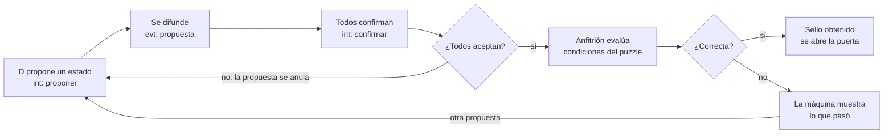

# La Última Prueba — Especificación técnica

12 de noviembre de 2026 · Versión 1.2 · Documento vivo: https://claude.ai/artifact/HqKa6YbWbcB8g8ryk55ixB

**Versión 1.1** (enmienda del 5 de noviembre de 2026): agrega el laboratorio de assets, el modo `?lab=1`, el panel de métricas y la prueba de estrés, el registro de créditos, las reglas de audio y los riesgos de licencia, con base en `docs/investigacion-assets.md`. El diseño, las salas, el presupuesto, el protocolo y la numeración T01–T102 no cambian; las tareas nuevas son T11a–T11z.

**Versión 1.2** (enmienda del 12 de noviembre de 2026, con base en `docs/salas-y-puzzles.md`): el juego no tiene relación con el ICFES ni con el Saber 11; el público es grado 9 en adelante, con foco en grado 10; la premisa es recuperar la memoria USB con el proyecto de la feria de ciencias; cada sala es un puzzle de tres etapas en lugar de una pregunta con cuatro opciones (sección 2), con `proceso` de los Estándares del MEN y `grado` en lugar de `competencia`. Cambian las descripciones de T21–T23, T26, T27, T34, T37, T38, T45, T52, T58, T64, T70, T75 y T100; la numeración y el orden de las fases no cambian.

## Alcance y decisiones de arquitectura

El juego es un sitio estático en Astro con una sola isla de juego a pantalla completa: Three.js dibuja el mundo, Preact con Signals dibuja HUD y menús, y Supabase Realtime solo entra en el modo cooperativo. La meta es 30 fps estables en un Android de gama baja con 2 GB de RAM y 60 fps en gama alta.

| Decisión | Elección | Motivo |
| --- | --- | --- |
| Páginas | Astro estático: `/`, `/jugar`, `/creditos`, `/docentes` | Cloudflare Pages sin servidor; el juego es una isla `client:only` |
| Unirse a partida | `/jugar?codigo=K7MP` (parámetro, no ruta dinámica) | Un sitio estático no puede pre-generar rutas para códigos arbitrarios |
| Lógica de juego | Módulo TypeScript puro, sin DOM ni Three | Se prueba con tests unitarios y la usan igual el modo individual y el anfitrión del cooperativo |
| Puente motor ↔ interfaz | Signals de Preact como único estado observable | El HUD y la escena reaccionan al mismo estado sin acoplarse |
| Render | Three.js con WebGL2 obligatorio | Three.js actual ya no soporta WebGL1; se muestra aviso en equipos sin WebGL2 |
| Contenido | Salas, puzzles, diálogos y finales en JSON validado en build | El equipo pedagógico edita datos sin tocar código |
| Lectura de datos | Al inspeccionar un objeto con datos, se abre una vista 2D nítida en el HUD | Texto legible en pantallas pequeñas, compatible con lector de pantalla y sin texturas grandes |
| Mecanismos de respuesta | Entrada en un panel 2D (Preact); el objeto 3D solo anima | Tocar ruedas o teclas 3D pequeñas es impreciso en celular |
| Cooperativo | Anfitrión autoritativo sobre Broadcast + Presence; sin servidor de juego | Encaja con hosting estático y con partidas de 2 a 4 jugadores |
| Comunicación entre jugadores | Señalar (ping) y frases rápidas; sin chat libre ni voz | Usuarios menores de edad, normalmente en la misma aula |

Controles táctiles: joystick virtual en la mitad izquierda, arrastre para mirar en la mitad derecha, toque sobre un objeto para seleccionarlo y un botón contextual «Usar». Hay modo zurdo que invierte los lados. Teclado y ratón (WASD + bloqueo de puntero) quedan como soporte secundario en escritorio.

Supuesto clave: el dispositivo de referencia es un Android de 2 GB de RAM (a menudo con Android Go), GPU de la clase Mali-G52 MC2 / PowerVR GE8320 y Chrome actualizado. Con tan poca memoria, el límite de memoria manda sobre la calidad visual.

## 0) Presupuesto 3D para celular

Cada sala cabe en 60.000 triángulos visibles, 40 draw calls, 16 MB de texturas en GPU y 2 MB descargados; la primera sala jugable llega con menos de 3 MB en total. Un script de build rechaza cualquier sala que se pase (tarea T09).

### Por cuadro (lo que se dibuja a la vez)

| Métrica | Límite | Objetivo | Cómo se logra |
| --- | --- | --- | --- |
| Triángulos visibles | 60.000 | 40.000 | Salas cerradas, LOD en props, sin geometría fuera de cámara |
| Draw calls | 40 | 30 | Atlas de materiales, `InstancedMesh` para sillas, libros y fichas |
| Luces dinámicas | 2 | 2 | Hemisférica + linterna (`SpotLight`); sin luz horneada (ola 6) |
| Sombras en tiempo real | 0 | 0 | Sin sombras horneadas: si hace falta, un plano oscuro bajo los muebles grandes; las «sombras misteriosas» son planos con textura alfa animada |
| Materiales | Lambert en entorno; Standard solo en objetos interactivos | — | Menos costo de shader en GPU móvil |
| Resolución interna | DPR máx. 1,25; escala dinámica 0,5–1,0 | 30 fps sostenidos | Se ajusta según los fps medidos cada 2 s |
| Post-proceso | Ninguno en calidad baja y media | — | FXAA solo en calidad alta |

### Por sala

| Recurso | Límite | Notas |
| --- | --- | --- |
| Triángulos en escena | 90.000 | Arquitectura 15k · ambientación 35k · objetos interactivos 20k (máx. 6k c/u) · avatares 4 × 2k · margen 12k |
| Texturas (cantidad) | Hasta 2 atlas 1024² + texturas de objetos 512² + las texturas de ambientCG (piso, paredes y techo) | Los kits de Kenney comparten una paleta pequeña (`colormap`) |
| Texturas en GPU | 16 MB con mipmaps | KTX2: ETC1S para color; UASTC solo para mapas normales de objetos clave, que se omiten en calidad baja |
| Peso descargado | 2 MB | GLB con `EXT_meshopt_compression` + KTX2; audio aparte |
| Audio de la sala | 0,6 MB | AAC mono 48 kbps para voz, 64 kbps para ambiente en bucle |

### Carga total

| Paquete | Límite (gzip/brotli) | Cuándo se descarga |
| --- | --- | --- |
| Página de inicio y menús (Astro + Preact + Signals) | 100 KB | Al abrir el sitio |
| Núcleo de juego (Three.js recortado, cargadores, lógica) | 250 KB | Al tocar «Jugar» |
| Decodificadores meshopt y Basis (wasm) | 300 KB | Junto con el núcleo; caché inmutable |
| Portería + sala 1 + audio inicial | 2,3 MB | Antes del primer control |
| **Primera sala jugable, total** | **3 MB** | Unos 5 s en 4G de 5 Mbps |
| Salas 2 a 5 | 4 × 2,6 MB | La siguiente se descarga a la caché mientras se juega la actual; no sube a la GPU hasta entrar |
| **Juego completo** | **14 MB** | Queda en caché del service worker para volver a salas anteriores |

Memoria: la pestaña no debe superar unos 180 MB entre JavaScript y GPU. En GPU solo quedan la portería y la sala actual; la siguiente espera descargada en la caché, sin decodificar. Al volver a una sala anterior se recarga desde la caché local, sin red.

Pipeline de compresión (glTF-Transform + meshoptimizer), ajustado en v1.1: perfil de limpieza por fuente, con `simplify` si hace falta → `dedup` → `prune` → `weld` → `quantize` → `meshopt` → `ktx2` (requiere KTX-Software 4.4.0 o superior en la máquina de build) → `asset.copyright` → informe de triángulos, draw calls estimados y bytes por sala. `instance` y el LOD al 50 % se aplican solo a props instanciados. Desde la ola 6 no hay rehorneado en Blender ni lightmap. El detalle está en «Laboratorio de assets».

## Laboratorio de assets (v1.1)

**Ola 6 (16 de noviembre de 2026): el arte final usa solo modelos CC0 ya hechos, en un solo estilo low-poly.** KayKit primero y Kenney donde KayKit no alcanza (T19i: con solo Kenney se veía muy simple); texturas de ambientCG para piso, paredes y techo. Sin Meshy, Sketchfab ni Poly Haven, sin Blender y sin luz horneada. Qué modelo reemplaza a cada objeto, de qué paquete y cuánto pesa cada sala está en `docs/arte-cc0.md`. **Sin Quaternius** (decisión de Alex, 16 de noviembre de 2026): desde el 28 de agosto de 2026 su sitio publica una licencia propia (QAL v1.0) que no es CC0 y prohíbe redistribuir los assets sueltos, y este repositorio es público. Lo que Kenney no tiene se queda como primitiva. La comparación entre fuentes de la v1.1 queda descartada; el modo `?lab=1` sigue comparando cada original con su versión optimizada.

Todas las salas terminan en GLB con meshopt y KTX2 de 1024 px y cumplen el mismo presupuesto. Paredes, piso y techo usan texturas CC0 de ambientCG, solo canal de color.

| Sala | Fuente | Qué aporta | Qué medimos sobre todo |
| --- | --- | --- | --- |
| Portería y salas 1 a 4 | KayKit (CC0), Kenney (CC0) y primitivas | Muebles, estanterías, puertas, máquinas y objetos de ambiente (alfombras, lámparas, cuadros, plantas) | Draw calls antes y después de `join`, `instance` y `palette` |
| 5 · Rectoría | Lo mismo, más geometría por código | Muebles CC0; urna, fichas y mano mecánica generadas en Three.js; efectos con Web Audio | Costo cero de descarga en la geometría por código |

Los objetos planos que muestran datos (pizarras, carteles, el graficador, el marcador) siguen siendo primitivas: su contenido se lee en la vista 2D de inspección.

El presupuesto de la sección 0 manda sobre las cifras de la investigación (100.000 triángulos, 15 MB, \~100 draw calls), que quedan descartadas para este juego.

### Limpieza por fuente en `optimize-models`

`npm run optimize-models -- --lista [--sala <carpeta>]` (T11a) arma lo que dice `art/modelos.json`: cada modelo con sus piezas (un archivo dentro de un zip de `art/`, con posición y giro), un giro y un `estirar` por eje o una `caja` en metros opcionales (con `caja`, el modelo calza justo en el `tam` del objeto y lo que va encima no flota); cada textura con su imagen. Lee la `fuente` de cada archivo en `art/credits.json`, aplica su perfil (`scripts/perfiles/`) antes de la etapa común y escribe en `public/assets/salas/`; después, `npm run build-manifest` le pone el hash. Los zips se leen sin descomprimirlos en el repositorio, así que no hay carpeta `limpios/`. Ningún perfil sube un límite: si un asset no cabe, se simplifica o se cambia.

| Perfil | Pasos específicos | Trampa principal |
| --- | --- | --- |
| `kenney` | Factor de escala por pack a metros (`ESCALA_PAQUETE`); piezas y transformaciones horneadas en los vértices; `dedup`, `palette` para fundir materiales planos en una textura y `join`: una draw call por modelo; pivote en el centro de la base. Los objetos repetidos de una sala los instancia el motor (T19e) | Muchas piezas sueltas = muchas draw calls |
| `ambientcg` | Material a 1K; solo color para paredes, piso y techo; `repeat` ajustado en Three.js | Repetición visible de la textura |
| `ia-imagen` | Redimensionar a potencia de 2 (1024² máx.); KTX2 ETC1S. Sin uso planeado desde la ola 6 | Logos, texto o caras que no deben aparecer |
| `codigo` | Sin archivo: la geometría se crea al cargar la sala y se mide en el panel de métricas | Triángulos que no ve `check-budget` |

Después del perfil, la etapa común es la misma para todos: `dedup` → `prune` → `weld` → `quantize` → `meshopt` → `ktx2` → escribir `asset.copyright` → informe.

### Luz sin hornear (ola 6)

Ya no hay rehorneado en Blender ni lightmap: los modelos de Kenney no traen luz propia y sus colores planos se ven bien con la luz de la sala. Los materiales son Lambert y los iluminan la luz hemisférica de la sala y la linterna; si un mueble grande parece flotar, lleva una sombra falsa (un plano oscuro) bajo su base. Las colisiones salen de las primitivas de `src/content/salas.json`, y el campo `modelo` de cada objeto (T19d) dice qué GLB se ve en su lugar. Las tareas de Blender (T11f, T16) y de lightmap (T48, T55, T61, T67, T73) quedan canceladas.

### Modo `?lab=1`

Carga el asset original y su versión optimizada en la misma escena y con la misma cámara, para compararlos. Es la única parte del proyecto donde se permite pasar el presupuesto.

- **Dónde existe:** en `astro dev` y en la rama `lab` de Cloudflare Pages (`npm run build:lab`, con cabecera `X-Robots-Tag: noindex`). En el build de producción, `PUBLIC_LAB` es falso, el módulo se elimina del bundle y `?lab=1` no hace nada.
- **Originales:** solo el build de lab copia a `lab-originales/` los archivos de `art/` que se van a comparar. Producción nunca los publica.
- **Presupuesto:** en lab, `check-budget` informa sobre los originales sin fallar; los optimizados deben cumplir igual que en producción. El build de `main` falla ante cualquier exceso.
- **Interfaz:** botón A/B para alternar original y optimizado (pantalla dividida en escritorio), modo alambre y una tabla de diferencias: triángulos, draw calls, MB descargados, MB de texturas en GPU, tiempo de carga y p95 del tiempo de cuadro.
- **Acceso:** el enlace de la rama `lab` se comparte solo con el equipo; si hace falta, se protege con Cloudflare Access, que es un servicio gestionado y no un servidor propio.

## Panel de métricas y prueba de estrés (v1.1)

Un panel oculto mide cada sala contra el presupuesto, y una prueba de estrés sube la carga en un solo eje por corrida hasta encontrar el límite de cada teléfono. Los resultados se exportan en JSON; no se guardan en Supabase por ahora.

### Panel `?debug=1`

Se abre con `?debug=1` o con 3 toques en la esquina superior izquierda. Es un componente Preact sobre el canvas que solo captura toques en sus botones. Las métricas viven en signals de `src/debug/metricas.ts` y el bucle de render las escribe como máximo cada 500 ms.

| Métrica | Cómo se mide | Verde hasta |
| --- | --- | --- |
| Tiempo de cuadro | Mediana, p95 y 1 % más lento en ventana de 5 s, desde `setAnimationLoop` | p95 33 ms |
| Triángulos | `renderer.info.render.triangles` con `info.autoReset = false` y `info.reset()` una vez por cuadro | 60.000 |
| Draw calls | `renderer.info.render.calls`, igual que arriba | 40 |
| Memoria de texturas | Ancho × alto × bytes por píxel × 1,33 con mipmaps: 0,5 B en ETC2 RGB, 1 B en ASTC 4×4 o ETC2 RGBA, 4 B sin comprimir | 16 MB |
| Geometrías y texturas activas | `renderer.info.memory`; si crecen al cambiar de sala, falta un `dispose()` | Igual al volver |
| MB descargados | `PerformanceObserver` de tipo `resource`, suma de `transferSize` bajo `/assets/salas/<sala>/`; cuenta aparte lo que vino de caché | 2,6 MB |
| Tiempo de carga | `performance.measure` entre `sala:inicio` y `sala:primer-cuadro` | 5 s en 4G |
| Contexto | Perfil de calidad, `devicePixelRatio`, pixel ratio usado, `userAgent` | — |

Cada valor se pinta en verde, ámbar (más del 85 % del límite) o rojo. Con el panel cerrado no hay asignaciones por cuadro; con el panel abierto, la mediana del tiempo de cuadro no sube más de 1 ms.

### Prueba de estrés por ejes

| Eje | Cada escalón agrega | Qué aísla |
| --- | --- | --- |
| Triángulos | +10.000 con un `InstancedMesh` del asset más pesado de la sala | Geometría, en una sola draw call |
| Draw calls | +10 mallas pequeñas con material propio | Costo de CPU por llamada |
| Texturas | +4 texturas KTX2 de 1024 px en planos visibles | Memoria, el límite que hace recargar Safari |
| Píxeles | Pixel ratio de 0,5 a `devicePixelRatio` en pasos de 0,25; luego +1 plano transparente a pantalla completa | Costo por píxel, el que más pesa en teléfonos baratos |

Los escalones son más finos que los de la investigación porque el presupuesto aquí es de 60.000 triángulos y 40 draw calls. No hay eje de sombras: el juego no usa sombras en tiempo real.

Cada escalón sigue el mismo ciclo:

1. **Guardar antes de subir:** escribir `{ eje, escalon, estado: "en-curso" }` en `localStorage` (dentro de `try/catch`). Safari en iPhone recarga la pestaña sin aviso cuando se queda sin memoria; la marca es lo único que sobrevive.
2. **Calentar 1 s** sin medir: compilación de shaders y subida de texturas.
3. **Medir 5 s:** mediana, p95 y 1 % más lento, más triángulos, draw calls y MB de texturas.
4. **Decidir:** parar si el p95 pasa de 33 ms dos escalones seguidos o si llega `webglcontextlost`; si no, siguiente escalón.
5. **Al terminar:** borrar la marca, liberar todo con `dispose()` y comprobar que `renderer.info.memory` vuelve a los valores previos.

Si al abrir la página existe una marca «en-curso», ese escalón se registra como «recarga por memoria» y el panel lo muestra. Después de hallar el límite, la sala real se deja 3 minutos al 70 % de la carga límite para medir el efecto del calor (p95 del primer minuto frente al último). Los límites alimentan los perfiles de calidad bajo, medio y alto. Dispositivos mínimos: un Android de 2 GB real y un iPhone real; el simulador de iOS no reproduce el límite de memoria.

### Exportación en JSON

El botón «Exportar JSON» descarga un archivo (o abre el menú de compartir en iPhone) con este formato:

```json
{
  "version": 1,
  "fecha": "2026-11-05T15:00:00-05:00",
  "dispositivo": { "userAgent": "…", "devicePixelRatio": 2, "pantalla": [720, 1600], "perfil": "bajo", "ahorro_energia": null },
  "sala": "s1-cooperativa",
  "metricas": { "mediana_ms": 24.1, "p95_ms": 31.0, "p1_ms": 38.2, "triangulos": 52000, "draw_calls": 34, "mb_texturas": 12.4, "mb_descargados": 2.3, "carga_ms": 4100 },
  "estres": {
    "eje": "texturas",
    "escalones": [
      { "escalon": 1, "carga": "+4 texturas", "mediana_ms": 24.5, "p95_ms": 31.8, "mb_texturas": 15.2, "estado": "estable" },
      { "escalon": 2, "carga": "+8 texturas", "estado": "recarga-por-memoria" }
    ],
    "ultimo_estable": 1
  }
}
```

Los números del ejemplo son ilustrativos, no medidos. `estado` puede ser `estable`, `lento`, `recarga-por-memoria` o `contexto-perdido`.

## Créditos y licencias (v1.1)

Anotar la licencia sigue siendo manual, un minuto por asset al descargarlo; lo automático es impedir que algo se publique sin ella y generar los créditos. Nada llega a `public/assets/` sin una entrada válida en `art/credits.json`.

### Manifiesto `art/credits.json`

Una entrada por archivo publicado, más una captura de la página de licencia del día de la descarga en `art/evidencia/`:

```json
{
  "archivo": "public/assets/salas/s1-cooperativa/mostrador.glb",
  "sala": "s1-cooperativa",
  "tipo": "modelo",
  "titulo": "Furniture Kit: kitchenBar",
  "autor": "Kenney",
  "fuente": "kenney",
  "url": "https://kenney.nl/assets/furniture-kit",
  "licencia": "CC0-1.0",
  "licencia_url": "https://creativecommons.org/publicdomain/zero/1.0/",
  "cambios": "escalado a metros, unido con la paleta de la sala, texturas KTX2 1024, meshopt",
  "fecha": "2026-11-17",
  "plan": null,
  "evidencia": "art/evidencia/kenney-furniture-kit.png"
}
```

- `tipo`: `modelo`, `textura`, `imagen`, `audio` o `voz`.
- `fuente`: `kenney`, `quaternius`, `ambientcg`, `meshy`, `tripo`, `sketchfab`, `polyhaven`, `ia-imagen`, `freesound`, `elevenlabs`, `codigo` o `propio`. Elige el perfil de limpieza de `optimize-models`. Desde la ola 6, los modelos solo vienen de `kenney` y las texturas de `ambientcg`; `quaternius` y las demás quedan en el esquema para el audio y para rechazar con un mensaje claro lo que no se debe publicar.
- `plan`: obligatorio (`gratis` o `pago`) para Meshy, Tripo y ElevenLabs, porque la licencia depende del plan activo el día de la generación, no del plan actual. Para la IA se anota también el prompt.
- `evidencia`: obligatoria para Sketchfab, Meshy y ElevenLabs. Sketchfab cambió de dueño este año; la captura prueba la licencia que tenía el modelo al bajarlo. Para los paquetes de Kenney y ambientCG también se guarda una captura de la página del paquete con su licencia el día de la descarga (lista en `docs/arte-cc0.md`), aunque el script no la exija.

### `check-credits` en cada build

`scripts/check-credits.ts` corre antes de `astro build`, también en la rama `lab`. El build falla si:

- Un archivo bajo `public/assets/salas/` o `public/assets/audio/` no tiene entrada en el manifiesto.
- La licencia no está en la lista permitida: `CC0-1.0`, `CC-BY-4.0`, `CC-BY-3.0`, `propio`, `meshy-pago`, `tripo-pago`, `elevenlabs-pago`, `openai`.
- La licencia contiene `NC` o `ND`, o es un Freesound con Sampling+.
- Es Tripo o ElevenLabs con `plan: "gratis"`.
- Es CC BY sin `autor`, `url` o `cambios`: CC BY 4.0 exige indicar las modificaciones.
- Falta `evidencia` donde es obligatoria.

Meshy con plan gratis pasa como `CC-BY-4.0`, pero el script exige `autor: "Meshy"` para que el crédito aparezca.

### Dónde se publican los créditos

- **Página `/creditos`**, generada en build desde el manifiesto y agrupada por sala: título, autor, enlace a la fuente, licencia con enlace y cambios. Se enlaza desde el menú y desde la pantalla de créditos del juego (T40).
- **Dentro de cada GLB**, en `asset.copyright`, escrito por la etapa común de `optimize-models` (por ejemplo, «“Bleachers”, autor, CC BY 4.0, modificado»). Así el crédito viaja con el archivo aunque alguien lo descargue suelto.

Los metadatos de Poly Haven se anotan a mano desde la web: su API requiere una licencia aparte para uso comercial.

## Audio (v1.1)

Todo el audio publicado es AAC en `.m4a`, normalizado a −16 LUFS; nunca Ogg, porque Safari en iPhone no lo reproduce. Las tasas de la sección 0 no cambian: voz mono a 48 kbps y ambiente a 64 kbps.

| Fuente | Regla |
| --- | --- |
| Kenney (CC0) | Llega en OGG o WAV: se convierte siempre desde el WAV a AAC |
| Freesound | Solo CC0 y CC BY; nada NC ni Sampling+. Se descarga el original (WAV o FLAC), no la vista previa |
| Web Audio por código | Efectos de la rectoría generados al vuelo: no pesan ni tienen licencia; `AudioContext` se reanuda en el primer toque (T43) |
| ElevenLabs | Voz final de La Voz solo con plan de pago activo el día de la generación; todo lo generado en plan gratis se regenera. Se genera en MP3 de 128 kbps con `npm run voz` (T42b) y se comprime con el pipeline propio |

`optimize-audio` normaliza con EBU R128 a −16 LUFS integrados y pico real de −1,5 dBTP, a 48 kHz, y luego codifica a AAC. El build falla si encuentra un `.ogg` en `public/` o si un archivo se desvía más de 1 LU del objetivo. El −16 LUFS es una convención habitual en móviles, no una norma de juegos; lo importante es que todas las fuentes suenen parejas.

La clave de ElevenLabs nunca va en el repositorio ni en el sitio: la voz se genera desde su web o con un script local que lee la clave de una variable de entorno, y solo el `.m4a` resultante entra al proyecto.

## 1) Estructura de carpetas

El código se separa en cuatro capas que no se importan en círculo: `game/` (reglas puras) ← `engine/` (Three.js) y `ui/` (Preact), unidas por `signals/`; `net/` solo habla con `game/`. Las fuentes de arte viven fuera de `public/` y solo el pipeline escribe en `public/assets/`.

```
la-ultima-prueba/
├─ astro.config.mjs
├─ package.json
├─ tsconfig.json
├─ AGENTS.md  CLAUDE.md          # reglas para agentes de código
├─ docs/
│  ├─ diseno.md                  # documento de diseño (fuente)
│  ├─ investigacion-assets.md    # base de la enmienda v1.1
│  └─ especificacion-tecnica.md  # este documento, exportado
├─ art/                          # fuentes de arte (Git LFS), nunca se publican
│  ├─ credits.json               # v1.1: una entrada por archivo publicado
│  ├─ modelos.json               # ola 6: de qué piezas de qué zip sale cada archivo publicado
│  ├─ evidencia/                 # v1.1: capturas de licencia del día de descarga
│  ├─ porteria/
│  ├─ s1-cooperativa/  s2-laboratorio/  s3-gimnasio/  s4-biblioteca/  s5-rectoria/
│  │  ├─ originales/              # paquetes CC0 sin tocar (Kenney, ambientCG)
│  │  └─ texturas/
│  ├─ compartido/originales/     # ola 6: paquetes CC0 y texturas que usan varias salas
│  └─ audio/                     # WAV originales de La Voz y ambientes
├─ scripts/
│  ├─ optimize-models.ts         # limpieza por fuente + etapa común + asset.copyright
│  ├─ perfiles/                  # kenney y ambientcg (ola 6)
│  ├─ optimize-audio.ts          # WAV → AAC mono a −16 LUFS
│  ├─ build-manifest.ts          # hash, bytes y triángulos por sala
│  ├─ check-budget.ts            # falla el build si se excede el presupuesto (informa en lab)
│  ├─ check-credits.ts           # v1.1: falla el build sin licencia válida
│  ├─ check-audio.ts             # v1.1: sin .ogg y −16 LUFS ± 1 LU
│  └─ hash-answers.ts            # T23: hash del estado resuelto de cada etapa
├─ public/
│  ├─ _headers                   # Cloudflare Pages: caché inmutable en /assets y /decoders
│  ├─ manifest.webmanifest       # PWA: pantalla completa en iPhone vía «Añadir a inicio»
│  ├─ decoders/                  # meshopt_decoder, basis_transcoder (.js + .wasm)
│  └─ assets/                    # SALIDA del pipeline, no se edita a mano
│     ├─ salas/<sala>/escena.<hash>.glb
│     ├─ audio/es-CO/<sala>/*.m4a
│     └─ manifest.json
├─ supabase/
│  ├─ config.toml
│  └─ migrations/                # políticas RLS de canales privados en realtime.messages
├─ src/
│  ├─ pages/                     # index, jugar, creditos (generada desde credits.json), docentes
│  ├─ layouts/
│  ├─ content.config.ts          # v1.2: colecciones de Astro 7 (usa los esquemas de content/)
│  ├─ content/                   # datos validados en build (Astro content collections)
│  │  ├─ esquema.ts               # v1.2: esquemas zod de puzzles (y luego salas, diálogos, finales)
│  │  ├─ puzzles/                 # v1.2: s1-etiquetadora.json … s5-urna.json
│  │  ├─ respuestas.json          # T23: hashes del estado resuelto; lo escribe hash-answers
│  │  ├─ salas/                   # objetos por rol A–D y escondite de la grabación
│  │  ├─ guion.json               # T34a: líneas de La Voz con id, momento y duración
│  │  └─ finales/
│  ├─ game/                      # REGLAS PURAS: sin DOM, sin Three, sin red
│  │  ├─ partida.ts               # máquina de estados: portería → salas → final
│  │  ├─ reloj.ts                 # 40 min activos, pausa
│  │  ├─ puzzles/                 # v1.2: una función pura por puzzle: estado → condiciones cumplidas
│  │  ├─ pistas.ts                # pistas graduales por tiempo en la etapa o intentos
│  │  ├─ intentos.ts              # T27b: qué cuenta como intento en cada etapa
│  │  ├─ reparto.ts               # roles A–D por número de jugadores y rotación
│  │  ├─ finales.ts
│  │  └─ tipos.ts
│  ├─ engine/                    # Three.js
│  │  ├─ renderer.ts  loop.ts  calidad.ts
│  │  ├─ carga/                   # GLTFLoader + Meshopt + KTX2, caché, dispose, precarga
│  │  ├─ jugador/                 # cámara primera persona y colisiones
│  │  ├─ interaccion/             # raycast, resaltado, inspección
│  │  ├─ avatares/                # otros jugadores interpolados
│  │  ├─ audio/                   # incluye efectos Web Audio por código (rectoría)
│  │  └─ salas/                   # un módulo por sala; s5 crea urna, fichas y mano mecánica por código
│  ├─ debug/                     # v1.1: solo se carga con ?debug=1 o ?lab=1
│  │  ├─ metricas.ts              # signals de métricas, escritas cada 500 ms
│  │  ├─ panel/                   # panel Preact y exportación JSON
│  │  ├─ estres/                  # ejes, escalones, marca en localStorage
│  │  └─ lab/                     # comparación original/optimizado (eliminado en producción)
│  ├─ input/                     # táctil (joystick, mirada, toque), teclado y ratón
│  ├─ ui/                        # Preact
│  │  ├─ hud/                     # reloj, sellos, subtítulos, inventario, botón Usar
│  │  ├─ menus/                   # inicio, pausa, ajustes, sala de espera cooperativa
│  │  ├─ cuaderno/
│  │  ├─ inspeccion/              # vista 2D de objetos con datos
│  │  ├─ mecanismos/              # v1.2: etiquetadora, tanques, reflector, carritos, urna
│  │  └─ finales/                 # pantallas de final y créditos
│  ├─ signals/                   # estado observable compartido por engine/ y ui/
│  ├─ net/                       # Supabase: cliente, canal, protocolo, anfitrión, reconexión
│  ├─ i18n/es-CO.ts
│  └─ styles/
└─ tests/
   ├─ unit/                      # game/, net/protocolo y scripts/check-*
   └─ e2e/                       # Playwright con emulación de celular
```

## 2) Esquema JSON de un puzzle

v1.2: reemplaza el esquema de «pregunta» con cuatro opciones. Cada sala tiene un puzzle: una máquina con una regla matemática que el jugador descubre manipulándola (ver `docs/salas-y-puzzles.md`). No hay opciones ni distractores, y la máquina nunca dice «incorrecto»: muestra lo que pasó.

Cada puzzle es un archivo JSON en `src/content/puzzles/` validado en build con el esquema zod de `src/content/esquema.ts` (la colección se declara en `src/content.config.ts`, como pide Astro 7). Todos los controles son discretos (rodillos, perillas de 1 en 1, muescas, metros enteros, libros, fichas), así que cada estado se compara de forma exacta.

### Campos comunes

| Campo | Tipo | Qué es |
| --- | --- | --- |
| `id` | `s1-etiquetadora` … `s5-urna` | `^s[1-5]-[a-z0-9-]+$`; el número coincide con `sala` |
| `version` | entero ≥ 1 | Sube al cambiar el contenido (`version_contenido` del cooperativo) |
| `sala` | 1 a 5 | Cada sala tiene un mecanismo fijo: 1 etiquetadora, 2 tanques, 3 reflector, 4 carritos, 5 urna |
| `titulo` | texto ≤ 60 | Nombre de la máquina en el juego |
| `tema` | `porcentajes`, `funciones_lineales`, `semejanza_tangente`, `medidas_estadisticas`, `probabilidad_sin_reemplazo` | Concepto que nombra el cuaderno |
| `proceso` | `formular_resolver`, `modelar`, `comunicar`, `razonar`, `procedimientos` | Proceso general principal de los Estándares Básicos de Competencias en Matemáticas del MEN (2006): formular y resolver problemas; modelar procesos y fenómenos de la realidad; comunicar; razonar; formular, comparar y ejercitar procedimientos |
| `grado` | 9, 10 u 11 | Grado en que se estudia el concepto que nombra el cuaderno |
| `dificultad` | 1 a 3 | 1 básica, 2 media, 3 alta |
| `concepto` | texto ≤ 200 | Lo que se descubre |
| `intuicion` | texto ≤ 160 | La intuición común que la etapa «torcer» pone a prueba |
| `mecanismo` | `etiquetadora`, `tanques`, `reflector`, `carritos`, `urna` | Decide la forma de `estado_inicial`, `controles`, `exito` y `solucion` |
| `etapas` | exactamente 3 | `presentar`, `torcer` y `dominar`, en ese orden |
| `pistas` | exactamente 3 | `{ nivel: 1 \| 2 \| 3, tras_segundos, tras_intentos?, texto ≤ 160 }`; se ofrecen por tiempo en la etapa actual o por intentos fallidos en ella |
| `cuaderno` | `{ concepto ≤ 80, texto ≤ 300 }` | Lo que el cuaderno escribe al resolver la sala: «Lo que acabas de descubrir se llama…» |
| `pista_por_jugador` | `{ A, B, C, D }` | `{ objeto, texto ≤ 160 }`; el objeto empieza por `s<sala>-`. En individual el jugador las reúne todas; en cooperativo cada una llega a su rol |

Cada etapa tiene:

| Campo | Qué es |
| --- | --- |
| `id` | `presentar`, `torcer` o `dominar` |
| `situacion` | Lo que el jugador ve al empezar la etapa (≤ 280) |
| `aja` | El momento «ajá» de la etapa, para el docente y el modo práctica (≤ 200) |
| `estado_inicial` | Estado completo de la máquina al empezar la etapa |
| `controles` | Lo que el jugador puede cambiar en esa etapa y con qué valores |
| `exito` | La condición de éxito; se descompone en condiciones con id |
| `solucion` | Un estado que resuelve la etapa, con la misma forma de `estado_inicial` |
| `intento` | Qué cuenta como «intento» en la etapa, para las pistas por intentos (T27b): `{ tipo: "accionar", objeto }` o `{ tipo: "reposo", segundos }` |

### Por mecanismo

| Mecanismo | `estado_inicial` y `solucion` | `controles` | `exito` → condiciones |
| --- | --- | --- | --- |
| `etiquetadora` | `{ producto, precio, rodillos: [] }` | `{ rodillos: [-20, 20, 25, -50, 50], max_rodillos: 2 }` | `{ precio }` → `precio`: el precio impreso, `precio × Π(1 + p/100)`, es el de la pizarra |
| `tanques` | `{ a, b \| null }`, cada tanque `{ nivel, caudal, visible, registro? }` en cm y cm/s | `{ perillas: ["a"], caudal_min, caudal_max, altura_cm }` | `{ campana_s, objetivo: { tipo: "linea", nivel } \| { tipo: "cruce" } }` → `nivel`: al sonar la campana, A está en la línea o A y B tienen la misma altura |
| `reflector` | `{ muesca, postes: [{ id, altura, distancia \| null }], polea \| null }` en grados y metros | `{ muescas, girar, postes_moviles, distancia_min, distancia_max, polea: { min, max } \| null }` | `{ sensores: [ids de poste], marcador: { altura } \| null }` → una condición por poste (su sombra toca su sensor) y `polea` (la longitud es la altura del marcador) |
| `carritos` | `{ carritos: [5 enteros] }` | `{ carritos: 5, libros: 20 }` | `{ lamparas: { media?, mediana?, moda?, rango? } }` → una condición por lámpara encendida |
| `urna` | `{ azules, amarillas }` | `{ max_por_color }` | `{ fichas, juego: "siempre_gana" \| "justo" }` → `fichas` (total pedido) y `juego` (parejas iguales = parejas distintas, o solo iguales) |

En el reflector, la sombra usa razones idealizadas por muesca (sombra ÷ altura: 27° → 2, 37° → 4/3, 45° → 1, 53° → 3/4, 63° → 1/2) para que todo dé en metros enteros o medios. Los tanques se llenan hasta `altura_cm` y no bajan de 0.

### Qué cuenta como intento (T27b)

Las pistas se ofrecen por tiempo o por intentos fallidos en la etapa (`tras_intentos`). Un intento es el momento en que la máquina le muestra al jugador un resultado que no es el buscado. Cada etapa lo declara en `intento`, y `src/game/intentos.ts` lo aplica:

| Sala | Etapas | Regla | Cuenta un intento cuando… |
| --- | --- | --- | --- |
| 1 · Etiquetadora | las tres | `accionar` `s1-palanca` | se baja la palanca y el precio impreso no es el de la pizarra (también sin rodillos) |
| 2 · Tanques | las tres | `accionar` `s2-palanca` | se arranca una corrida que no abre la incubadora; cuenta al arrancar, no al sonar la campana |
| 3 · Reflector | presentar y torcer | `reposo` 5 s | tras mover la muesca o un poste, todo queda quieto 5 s y algún sensor no suena |
| 3 · Reflector | dominar | `accionar` `s3-polea` | se suelta la polea con una longitud que no es la altura del marcador |
| 4 · Carritos | las tres | `reposo` 5 s | con la pila vacía, los libros quedan quietos 5 s y falta alguna lámpara |
| 5 · Urna | las tres | `accionar` `s5-caja-fuerte` | se tira de la manija y la urna no cumple la placa; el simulador y «ver parejas» no cuentan |

Reglas comunes:

- Solo cuenta un estado válido que no resuelve la etapa. Resolver nunca es un intento.
- **`accionar`:** cuenta cada vez que se acciona el objeto, aunque el estado sea el mismo de la vez anterior.
- **`reposo`** (máquinas que responden en vivo y no tienen nada que accionar): el panel avisa cada cambio del mecanismo (`alCambiarEstado`) y suma el tiempo de reloj activo (`avanzarReposo`). Al cumplirse los segundos sin cambios se cuenta un intento, una sola vez; el mismo estado no vuelve a contar hasta que el jugador mueva algo. Con el reloj en pausa (cuaderno abierto) el reposo no avanza.
- **Sala 4:** además, la pila debe estar vacía. Con libros sin repartir el jugador todavía está armando el reparto, y ninguna etapa se puede resolver así (la media 4 exige los 20 libros).
- El contador vuelve a cero al cambiar de etapa (`nuevaEtapa` en `pistas.ts`).
- **Cooperativo:** un intento es cada `resultado` con `resuelta: false`, es decir, cada propuesta aceptada por todos que no resuelve. Lo cuenta el anfitrión; la regla `intento` del JSON vale para el modo individual.

### Sala 2: la corrida dura hasta la campana (T27b)

Una corrida dura exactamente `exito.campana_s` segundos (10, 8 y 12 en las tres etapas); no existe otra duración. Para quien haga el panel (T52):

1. Al bajar la palanca, el panel anima de 0 a `duracionCorridaS(etapa)` en tiempo real: 1 s de juego es 1 s de reloj. Las perillas quedan bloqueadas durante la corrida.
2. La campana suena al final, en el segundo `campana_s`, y en ese instante se evalúa la etapa. El resultado ya se conoce al arrancar (`evaluar`), pero se muestra al sonar la campana.
3. Los niveles quedan quietos unos 2 s para que se vea dónde quedó cada tanque. Luego los tanques se vacían y vuelven al `estado_inicial`, con la perilla donde la dejó el jugador.
4. El eje de tiempo del graficador llega al menos hasta `campana_s`. Se recomienda un eje fijo de 0 a 15 s en las tres etapas, que es el máximo que acepta el esquema.
5. El trazo de la corrida anterior queda dibujado, más tenue, hasta la siguiente: es lo que permite «prolongar la recta».

### Validaciones cruzadas

`esquema.ts` revisa en build lo que zod no expresa por campo:

- el número del `id` coincide con `sala` y el `mecanismo` es el de esa sala;
- las etapas van en orden `presentar`, `torcer`, `dominar`; las pistas en niveles 1, 2, 3 con `tras_segundos` creciente (y `tras_intentos` creciente si existe);
- `estado_inicial` y `solucion` respetan los `controles` (rodillos de la caja y sin repetir, caudales en rango, muescas existentes, libros que alcanzan, fichas por color), y `solucion` solo cambia lo que los controles permiten cambiar;
- `solucion` cumple todas las condiciones de éxito y `estado_inicial` no (con las funciones de `src/game/puzzles/`, T26);
- los objetos de `pista_por_jugador` son de la sala;
- `intento` es `accionar` con un objeto de la sala en la etiquetadora, los tanques, la urna y la etapa del reflector que tiene polea, y `reposo` (de 2 a 30 s) en los carritos y en las etapas del reflector sin polea;
- en los tanques, `campana_s` no pasa de 15.

Las funciones de `src/game/puzzles/` son puras: reciben la etapa y el estado, y devuelven qué condiciones se cumplen. Las usan el panel de cada mecanismo (por ejemplo, para encender las lámparas de la biblioteca en vivo), el modo individual y el anfitrión del cooperativo.

### Hash del estado resuelto (T23)

`npm run hash-answers` recorre todos los estados que se pueden armar en cada etapa (`src/game/puzzles/estados.ts`), se queda con los que la resuelven y guarda el hash de cada uno en `src/content/respuestas.json`. Ese archivo se genera; no se edita a mano.

- **Hash:** los primeros 16 caracteres hexadecimales del SHA-256 de `<id>@<version>#<etapa>|<estado canónico>`. El estado canónico es el JSON del estado con las claves ordenadas; en la etiquetadora los rodillos van ordenados y en los carritos los libros por día van de menor a mayor, porque la máquina no distingue esos órdenes.
- **Validador:** `estaResuelta(RESPUESTAS, puzzle, etapa, estado)` en `src/game/respuestas.ts` devuelve `true` o `false` comparando hashes, sin leer `exito` ni `solucion`. Devuelve `null` si el estado no es válido para la etapa o si los hashes son de otra `version` del puzzle.
- **Cuándo correrlo:** cada vez que cambie un puzzle (y suba su `version`). Un test de unidad falla si `respuestas.json` quedó viejo, y otro comprueba, estado por estado, que el validador y las reglas de `src/game/puzzles/` dicen lo mismo.
- **Qué no hace todavía:** los JSON de los puzzles siguen llevando `solucion` y `exito`, y entran al bundle si el juego importa `src/content/puzzles.ts`. Los paneles necesitan `exito` para las lámparas y sensores en vivo. Quitar `solucion` del bundle es un paso aparte, que este validador ya permite.

Ejemplo con la sala 4. La etapa «torcer» empieza con los libros repartidos parejos (la media ya está verde) y la «dominar» con la solución de la anterior, para que el jugador vea qué lámparas se apagan.

```json
{
  "id": "s4-carritos",
  "version": 1,
  "sala": 4,
  "titulo": "Los carritos de préstamo",
  "tema": "medidas_estadisticas",
  "proceso": "razonar",
  "grado": 9,
  "dificultad": 3,
  "concepto": "Media, mediana, moda y rango miran cosas distintas de un conjunto de datos; juntas pueden determinarlo por completo.",
  "intuicion": "La media y la mediana son más o menos lo mismo.",
  "mecanismo": "carritos",
  "etapas": [
    {
      "id": "presentar",
      "situacion": "Solo está encendida la lámpara MEDIA 4. Reparte los 20 libros en los cinco carritos.",
      "aja": "Hay muchas respuestas: mover un libro de un carrito a otro no apaga la media.",
      "estado_inicial": { "carritos": [0, 0, 0, 0, 0] },
      "controles": { "carritos": 5, "libros": 20 },
      "exito": { "lamparas": { "media": 4 } },
      "solucion": { "carritos": [4, 4, 4, 4, 4] },
      "intento": { "tipo": "reposo", "segundos": 5 }
    },
    {
      "id": "torcer",
      "situacion": "Se encendió la lámpara MEDIANA 3.",
      "aja": "Puedes poner 11 libros en un día y la mediana no se entera: solo mira el del medio.",
      "estado_inicial": { "carritos": [4, 4, 4, 4, 4] },
      "controles": { "carritos": 5, "libros": 20 },
      "exito": { "lamparas": { "media": 4, "mediana": 3 } },
      "solucion": { "carritos": [1, 2, 3, 3, 11] },
      "intento": { "tipo": "reposo", "segundos": 5 }
    },
    {
      "id": "dominar",
      "situacion": "Las cuatro lámparas están encendidas: MEDIA 4, MEDIANA 3, MODA 2 y RANGO 7.",
      "aja": "Con cuatro pistas solo hay una semana posible, salvo el orden de los días.",
      "estado_inicial": { "carritos": [1, 2, 3, 3, 11] },
      "controles": { "carritos": 5, "libros": 20 },
      "exito": { "lamparas": { "media": 4, "mediana": 3, "moda": 2, "rango": 7 } },
      "solucion": { "carritos": [2, 2, 3, 4, 9] },
      "intento": { "tipo": "reposo", "segundos": 5 }
    }
  ],
  "pistas": [
    { "nivel": 1, "tras_segundos": 120, "tras_intentos": 3, "texto": "Mueve un libro de un carrito a otro. ¿Se apagó la lámpara de la media?" },
    { "nivel": 2, "tras_segundos": 240, "tras_intentos": 6, "texto": "Ordena los carritos de menor a mayor. ¿Cuál mira la mediana?" },
    { "nivel": 3, "tras_segundos": 360, "tras_intentos": 9, "texto": "Si la moda es 2, al menos dos días tuvieron 2 libros. ¿Y dónde queda el mayor si el rango es 7?" }
  ],
  "cuaderno": {
    "concepto": "Medidas de tendencia central y de dispersión",
    "texto": "Media, mediana, moda y rango miran cosas distintas. El rango es una medida de dispersión: dice qué tan separados están los datos. En 10° conocerás otra, la desviación estándar."
  },
  "pista_por_jugador": {
    "A": { "objeto": "s4-pila-libros", "texto": "La pila tiene exactamente 20 libros: ni uno más ni uno menos." },
    "B": { "objeto": "s4-mostrador", "texto": "Desde el mostrador se ven las cuatro lámparas del resumen semanal." },
    "C": { "objeto": "s4-ficha-rota", "texto": "En el pedazo de ficha se lee «moda» subrayada dos veces." },
    "D": { "objeto": "s4-carritos", "texto": "Los carritos van de lunes a viernes; el orden de los días no importa." }
  }
}
```

### Fichas de inspección (T35c)

`src/content/fichas.json` trae el texto legible de cada objeto que se examina: una ficha por objeto, validada en build con `src/content/esquema-fichas.ts` (colección `fichas`). El título de la ficha es el `nombre` del objeto en `salas.json`; no se repite.

| Campo | Qué es |
| --- | --- |
| `id` | Id del objeto en `salas.json`. Debe tener acción `examinar` o `recoger` (los papeles que se recogen también se leen). |
| `descripcion` | Qué es el objeto, en una frase. |
| `bloques` | Lo que se lee siempre. Cada bloque es `texto`, `nota` (algo escrito a mano), `lista` o `tabla`, los mismos de `src/signals/contenido.ts`. |
| `por_etapa` | Opcional, solo en las salas 1 a 5: cuatro listas de bloques que se agregan después de `bloques`, una por momento de la sala (presentar, torcer, dominar y sala resuelta). Sirve para lo que cambia con el avance: la etiqueta de un producto, el temporizador de la campana, las lámparas destapadas. |

- **Cómo se usa:** `fichaDeObjeto(id, etapa)` (`src/content/fichas.ts`) devuelve `{ titulo, descripcion, bloques }` o `null`. `etapa` es lo que devuelve `etapaActual()` para la sala del objeto: 0, 1, 2 o `null` si la sala ya tiene su sello. `fichasDeLugar(lugar, etapa)` devuelve todas las de un lugar, listas para el signal `fichas`. Conectar ese signal es tarea de quien lleva `src/signals/`.
- **Qué dice una ficha:** lo que se ve o está escrito en el objeto, con los números del puzzle (precios, niveles, temporizador). Nunca pasos de cálculo, nunca el nombre del concepto y nunca lo que el jugador debe deducir (por ejemplo, dónde empezó el tanque tapado o la altura del marcador). Lo que cambia en vivo mientras se mueve la máquina (sombras, lámparas en verde) lo muestra el panel del mecanismo, no la ficha.
- **Tamaño:** como máximo 6 bloques por ficha, textos de 280 caracteres y tablas de 4 columnas y 8 filas, para que se lea en un celular sin perderse.
- **Tests** (`tests/unit/fichas.test.ts`): todo objeto con acción `examinar` tiene ficha en los cuatro momentos; ninguna ficha usa las palabras del cuaderno ni signos de una cuenta hecha; y los números de las fichas coinciden con los de los puzzles (si cambia un precio en el puzzle y no en la ficha, el test falla).

### Sala 3: el panel del reflector y su animación (T58)

**Panel 2D** (`src/ui/mecanismos/reflector/`), dentro del marco de T37:

- Tres controles discretos: la muesca del reflector (cinco botones en una fila), la distancia del poste que se desliza (de 1 en 1 m) y la cuerda de la polea (de 1 en 1 m).
- Un dibujo de lado, a escala, con cada poste, su sombra, el rayo que pasa por su punta y el sensor. Con dos postes se ve que los triángulos tienen la misma forma. Es de apoyo: lo mismo se lee en las frases, y el lector de pantalla lo salta.
- «Lo que se ve ahora»: una frase por poste («su sombra mide 4 m. La punta pasa de largo del sensor, que está a 2 m») y, en la etapa de la polea, hasta qué metro de la cinta llega la sombra del marcador. Cambia con cada toque.
- La polea responde al soltarla: «el gancho subió 5 m. Quedó colgando por debajo del marcador». Dice de qué lado quedó, no cuánto falta.
- Las etapas 1 y 2 se resuelven solas tras 5 s quietas (lo hace el controlador, T31d); la 3, con «Soltar la polea».

Los cálculos están en `src/game/puzzles/reflector.ts` (`lecturaPostes`, `sombraMarcador`, `lecturaPolea`), con enteros, y los textos en `src/ui/mecanismos/reflector/textos.ts`. Los dos tienen tests.

**Animación 3D.** Usa el enganche de T45 (`src/engine/mecanismos/`): cada sala registra su animación en `index.ts` y el motor la crea al entrar, la llama una vez por cuadro y la libera al salir. La del gimnasio (`reflector.ts`) lee los signals de `src/signals/mecanismo.ts`, crea sus mallas una sola vez colgadas de la sala y no reserva memoria por cuadro. Inclina el reflector, muestra solo los postes de la etapa, desliza el poste móvil, estira la sombra de cada poste, enciende un disco por sensor y sube el gancho de la polea. Agrega 8 mallas (la sala queda muy por debajo de las 40), que no reciben toques (`sinRayo`, en `comunes.ts`). Es un blockout: una sombra que no cabe en la cancha se corta en la pared.

### Sala 4: el panel de los carritos y su animación (T64)

**Panel 2D** (`src/ui/mecanismos/carritos/`), dentro del marco de T37:

- **Mover libros, pensado para el pulgar.** La pila y los cinco carritos son botones grandes (cada carrito mide al menos 48 px de ancho en un celular de 320 px). Un libro se mueve con dos toques: primero de dónde sale y después a dónde va. El origen se queda elegido, así que repartir es un toque por libro. Al llegar ya está elegida la pila, si tiene libros. Tocar el origen otra vez lo suelta.
- **Un movimiento, un solo cambio.** Pasar un libro de un carrito a otro es una sola orden `ajustar` (`moverLibro` en `src/game/puzzles/carritos.ts`): el libro no pasa por la pila, y por eso la lámpara de la media no se apaga a medio camino. Es justo lo que la primera etapa quiere que se note.
- **Lámparas en vivo y siempre a la vista.** Las cuatro lámparas quedan pegadas arriba del panel mientras se mueven los libros. Las que no cuentan en la etapa se ven «tapadas». El panel no muestra la media ni la mediana que hay: solo si cada lámpara se enciende. Qué mira cada una se descubre moviendo.
- «Devolver todo a la pila» deja los 20 libros listos para repartir otra vez.
- Las tres etapas se resuelven solas tras 5 s quietas con los 20 libros repartidos (lo hace el controlador, T31d). No hay nada que accionar.

**Animación 3D** (`src/engine/mecanismos/carritos.ts`, con el enganche de T45): sobre cada carrito crece un montón de libros tan alto como los que tiene, la pila del mostrador baja a medida que se reparte, y en la pared hay cuatro lámparas: apagada si está tapada, tenue si cuenta y verde si se cumple. Son 9 mallas más. El atributo `data-maquina` del canvas dice cuántas lámparas están en verde (`lamparas-2`), para las e2e.

## 3) Protocolo del modo cooperativo

Cada partida usa un canal privado de Supabase Realtime (`partida:K7MP`) y un anfitrión autoritativo: quien crea la partida decide reloj, objetos, etapas resueltas y finales; los demás envían intenciones y reciben eventos numerados. Los mensajes llevan identificadores, nunca textos, porque cada cliente ya tiene el contenido.



*Un estado del mecanismo solo se acciona cuando todo el grupo lo acepta. int = intención al anfitrión · evt = evento para todos.*

Un rechazo anula la propuesta y el rol D vuelve a proponer. Si la etapa no queda resuelta, la máquina muestra lo que pasó (sin mensaje de «incorrecto») y el intento cuenta para las pistas. v1.2: `estado` es el estado discreto del mecanismo (solo números e ids, nunca texto), con la forma de `solucion` en la sección 2.

### Canal y presencia

- Sesión anónima de Supabase; el alias se elige de una lista, sin nombres reales.
- Código de 4 caracteres de un alfabeto sin símbolos confusos (sin 0, O, 1, I, L). Máximo 4 jugadores; el quinto recibe `rechazo { motivo: "llena" }`.
- Tres nombres de evento Broadcast: `int` (intenciones, con `ack`), `evt` (eventos del anfitrión) y `dir` (poses y señales, sin `ack`). `self: false` desde T92b: el servidor no devuelve nada a quien envía. `int` y `evt` se entregan a uno mismo en el navegador cuando el servidor confirma, para que el anfitrión procese sus propias intenciones por la misma ruta; `dir` no vuelve a quien lo envía.
- Presence guarda solo identidad: `{ jugador, alias, color, unido_en, version_contenido }`. Se escribe una vez al unirse, porque Supabase permite 5 llamadas de Presence por cliente cada 30 s; el estado «listo» va por Broadcast. El alias y el color de Presence son solo lo que el jugador pidió al unirse: los que valen son los que el anfitrión aceptó, en `apariencias` de la foto (T81b, protocolo v2), y un cambio en la sala de espera viaja con la intención `elegir`, no con Presence.
- T79 y T78: el transporte está en `src/net/supabase.ts` (con `@supabase/supabase-js` 2.118.0, cargado con `import()` solo en el cooperativo) y las políticas RLS en `supabase/migrations/`: solo usuarios con sesión (la anónima cuenta), solo canales `partida:` con un código válido y solo Broadcast y Presence. Los pasos para crear el proyecto y poner las variables en Cloudflare Pages están en `docs/supabase.md`.

### Sobre de cada mensaje

```json
{ "v": 1, "t": "proponer", "de": "j_3f9a", "cid": "j_3f9a-12", "n": null, "p": { } }
```

`v` versión del protocolo · `t` tipo · `de` emisor · `cid` id de la intención, para descartar duplicados · `n` número de secuencia (solo en eventos del anfitrión) · `p` contenido. Máximo 1 KB por mensaje; el `estado` completo, máximo 8 KB.

T80: el sobre y la validación están en `src/net/protocolo.ts`; los tipos de `p`, en `src/game/coop/mensajes.ts`. Todo mensaje que llega se revisa entero y se descarta si algo sobra, falta o no está en una lista conocida: `cid` es `<de>-<número>` (nadie firma por otro), las intenciones llevan `n: null` y los eventos `cid: null`, los ids de objetos, puzzles, lugares, grabaciones y finales salen del contenido, y el `estado` de `proponer` debe tener la forma exacta de los controles de la etapa. El alias y el color de Presence también son ids de una lista. El transporte es una interfaz propia (`src/net/transporte.ts`) con dos implementaciones de prueba: la red en memoria para Vitest (varios clientes, retraso y pérdida) y BroadcastChannel entre pestañas para las e2e, que solo se usa sin variables de Supabase o con `?red=pestanas`.

### Intenciones: jugador → anfitrión (`int`)

| `t` | `p` | El anfitrión acepta si… |
| --- | --- | --- |
| `listo` | `{ listo }` | La partida no ha empezado |
| `recoger` | `{ objeto }` | El objeto está libre y en la sala del jugador |
| `pasar` | `{ objeto, a }` | El emisor lo tiene y el destino está en la misma sala |
| `usar` | `{ herramienta \| null, objetivo }` | El emisor tiene la herramienta (o no hace falta) y el objetivo está en su sala; emite `revelado` o `grabacion` |
| `proponer` | `{ puzzle, etapa, estado }` | El emisor tiene el rol D en esa sala |
| `confirmar` | `{ propuesta, acepta }` | La propuesta sigue abierta; un voto por jugador |
| `pedir_pista` | `{ puzzle }` | El siguiente nivel ya está habilitado por intentos o tiempo |
| `votar` | `{ asunto: pausa \| reanudar \| sala \| final \| ayuda, opcion \| null, acepta }` | Siempre; se resuelve por unanimidad. `opcion` es un lugar en `sala` y `salir \| restaurar` en `final`; `acepta: false` retira el voto |
| `pedir_estado` | `{ desde_n }` | Siempre; responde con `estado` |

### Eventos: anfitrión → todos (`evt`)

| `t` | `p` | Cuándo |
| --- | --- | --- |
| `estado` | Foto completa: fase, reloj, sellos, grabaciones, portadores, roles, propuesta abierta, pistas, datos encontrados (`revelados`), votos abiertos y ausentes | Al unirse alguien, tras un hueco de secuencia, cada 15 s y al cambiar de anfitrión |
| `inicio` | `{ orden, restante_ms }` | Al empezar; con `orden` cada cliente recalcula el reparto (T29) |
| `roles` | `{ sala, A, B, C, D }` | Al entrar el grupo a una sala; rotan según la tabla del diseño |
| `objeto` | `{ objeto, portador \| null, sala }` | Tras recoger, pasar o soltar |
| `revelado` | `{ objeto, por }` | Tras usar una herramienta sobre un objeto con datos |
| `propuesta` | `{ id, puzzle, etapa, por, estado }` | Tras `proponer`; anula la propuesta anterior |
| `confirmacion` | `{ propuesta, jugador, acepta }` | Tras cada `confirmar` |
| `resultado` | `{ puzzle, etapa, condiciones, resuelta, sello? }` | Cuando todos los conectados aceptaron |
| `pista` | `{ puzzle, nivel }` | Tras `pedir_pista` aceptada |
| `voto` | `{ asunto, votos, resuelto }` | Tras cada `votar` |
| `reloj` | `{ restante_ms, pausado }` | Solo al pausar o reanudar; no hay ticks |
| `grabacion` | `{ fragmento, por }` | Al encontrar un fragmento |
| `final` | `{ final }` | Al resolverse el voto de final, la ayuda o el tiempo |
| `anfitrion` | `{ jugador }` | Al migrar el anfitrión |
| `rechazo` | `{ a, motivo: llena \| version \| empezada }` | Al intentar unirse un quinto jugador, con otra versión o a una partida empezada por alguien que no estaba |

### Directos: jugador → todos, sin autoridad (`dir`)

| `t` | `p` | Frecuencia |
| --- | --- | --- |
| `pose` | `{ s: sala, x, y, z: cm enteros, yaw: centésimas de grado }` | 2 Hz solo en movimiento (T82b, `POSES_POR_SEGUNDO`), más una al detenerse; los demás interpolan con 620 ms de retraso y un suavizado de 120 ms |
| `senal` | `{ s, x, y, z, frase \| null }` | Máximo 1 por segundo; `frase` es el id de una frase rápida predefinida |

**Las notas del cuaderno no viajan por la red** (decisión de la ola 4): no hay intención ni evento `nota`, porque sería chat libre entre menores. Cada jugador escribe sus notas solo en su cuaderno. Lo que sí se comparte es lo que encuentra el grupo: los datos (`revelado`, que llega al cuaderno de todos), las pistas abiertas (`pista`), los resultados de la máquina y las grabaciones.

### El anfitrión (T84, T85, T87)

Las reglas están en `src/game/coop/sesion.ts` (puras, con las mismas funciones del modo individual: `partida.ts`, `pistas.ts`, `reparto.ts` y `evaluar()`); `src/net/anfitrion.ts` solo escucha `int` y Presence, numera los eventos y los difunde. Cada cliente (`src/net/cliente.ts`) guarda una copia con `aplicarEvento()` de `src/game/coop/replica.ts`. Decisiones de la ola 4:

- **Inicio:** la partida empieza sola cuando hay al menos 2 jugadores conectados y todos marcaron «listo». El orden queda fijo con los conectados en ese momento y el grupo arranca en la portería.
- **Objetos:** se recoge lo que en `salas.json` tiene la acción «recoger» y está en el lugar del grupo; lo que lleva un jugador viaja con el grupo al cambiar de lugar. Usar un objeto sin herramienta revela un dato (si se examina) o abre un escondite (grabación); la pizarra de la sala 1 pide la linterna (`src/game/coop/mundo.ts`).
- **Propuestas:** quien propone (D) cuenta como que acepta. Con todos los conectados de acuerdo, el anfitrión evalúa; si no queda resuelta, el intento cuenta para las pistas. Nadie propone mientras el grupo espera a quien tiene D.
- **Pistas:** el tiempo activo de la etapa lo suma el anfitrión en cada `tick` (1 s); `pedir_pista` abre la siguiente ya ofrecida y la ven todos.
- **Votos:** un voto por jugador y asunto; votar otra opción del mismo asunto reinicia la cuenta. Si alguien sale de Presence, lo que ya tenía el acuerdo de los que quedan se resuelve.

### Reglas de consistencia

- **Orden:** los eventos llevan `n` creciente. Si un cliente detecta un hueco, envía `pedir_estado` y aplica la foto completa. Las intenciones repetidas con el mismo `cid` se ignoran. T88: mientras espera la foto, el cliente no aplica eventos (la foto ya los trae) y repite el pedido a los 2 s si no llega; un evento con `n` ya aplicado se ignora. El anfitrión responde un `pedir_estado` por jugador por segundo como máximo, recuerda los últimos 512 `cid` y difunde la foto cada 15 s aunque nadie la pida, para corregir a quien perdió el último evento sin notarlo. El reparto no viaja en la foto: cada cliente lo recalcula con `orden`, `lugar` y `ausentes`.
- **Reloj:** el anfitrión guarda el tiempo restante; cada cliente descuenta con su reloj local desde que recibe `reloj` o `estado`, y cada `estado` corrige la deriva. La pausa exige que todos voten a favor.
- **Avance en grupo:** todo el grupo está siempre en la misma sala. Para pasar a la siguiente, o volver a una anterior a buscar grabaciones, se vota `sala` por unanimidad; el anfitrión emite `roles` de la nueva sala y todos los clientes la cargan.
- **Confirmar una etapa:** una propuesta solo se acciona cuando todos los conectados aceptan; un rechazo o una propuesta nueva la anula. Elegir final y usar el intercomunicador siguen la misma unanimidad, para que nadie termine la partida por los demás.
- **Desconexión:** al salir de Presence, los objetos del jugador quedan reservados 60 s y luego quedan en el piso de la sala; si tenía el rol D, el grupo lo espera esos mismos 60 s y, si no vuelve, D pasa al siguiente jugador conectado (ver «Reparto y rotación de encargos»). Al volver con el mismo `jugador` (guardado en el navegador), recupera rol y objetos. T89: el id se guarda en `localStorage` (`src/net/identidad.ts`, validado al leerlo); el anfitrión suelta los objetos vencidos en su `tick()` con un evento `objeto` por cada uno, y al volver el jugador recibe la foto y, si le tocaba, `roles` con D.
- **Migración de anfitrión:** si el anfitrión falta 5 s, asume el jugador con `unido_en` más antiguo; pausa el reloj, emite `anfitrion` y `estado` desde su última copia, y reanuda a los 3 s. T90 (`src/net/cliente.ts`): cada cliente vigila Presence en su `tick()`; el sucesor rearma la sesión con `sesionDesdeFoto()` y sigue la numeración desde su último `n`. Los demás aceptan el cambio si lo anuncia el propio jugador (`anfitrion` o una foto que lo dice) y su anfitrión anterior ya no está. Un anfitrión que vuelve espera 2 s: si otro asumió, pasa a ser jugador y se pone al día con la foto; si nadie asumió (volvió antes de 5 s), retoma el puesto y difunde la foto.
- **Versiones:** si `v` o `version_contenido` no coinciden, se rechaza la unión con el mensaje «Actualiza la página».

### Reparto y rotación de encargos (T29)

`src/game/reparto.ts` calcula quién tiene cada encargo. Es una función pura de la lista de jugadores, en el orden en que se unieron (`unido_en`), y del número de la sala: el anfitrión la usa para emitir `inicio` y `roles`, y cualquier cliente puede recalcularla.

| Jugadores | Sala 1 | Sala 2 | Sala 3 | Sala 4 | Sala 5 |
| --- | --- | --- | --- | --- | --- |
| 1 (individual) | ABCD | ABCD | ABCD | ABCD | ABCD |
| 2 | AB · CD | CD · AB | AB · CD | CD · AB | AB · CD |
| 3 | A · BC · D | BC · D · A | D · A · BC | A · BC · D | BC · D · A |
| 4 | A · B · C · D | B · C · D · A | C · D · A · B | D · A · B · C | A · B · C · D |

Cada celda lista los encargos del jugador 1, del 2, y así en orden. La sala 1 es la tabla de `docs/diseno.md`. En cada sala siguiente, cada jugador recibe el grupo de encargos que tenía el jugador siguiente, así que D (quien acciona la máquina) pasa por todo el grupo y nadie lo repite en dos salas seguidas. Los grupos no se parten: con 3 jugadores, B y C siempre van juntos.

- El reparto depende de la sala, no de cuántas veces se entró: volver a una sala anterior devuelve el mismo reparto.
- El orden de los jugadores queda fijo al empezar la partida, aunque alguien se desconecte.
- **Si quien tiene D se desconecta** (`repartirConAusencias`): el grupo lo espera hasta 60 s (`ESPERA_RECONEXION_MS`). En ese tiempo D sigue siendo suyo y nadie puede accionar la máquina; la interfaz debe decir a quién se espera y cuánto falta (`esperandoA`, `faltanMs`). Si no vuelve, D pasa al siguiente jugador conectado en ese orden; A, B y C no se mueven. Cuando el ausente vuelve, recupera D.
- Durante la espera el reloj de la partida sigue corriendo, salvo que el grupo vote una pausa.
- Con 4 jugadores y 5 salas, la sala 5 repite el reparto de la sala 1.

### Costo frente a los límites de Supabase

Supabase cuenta un evento por cada mensaje enviado o entregado, así que una pose que reciben tres compañeros cuesta 4 eventos. Con la mitad del grupo moviéndose a 4 Hz, una partida de 4 gasta unos 32 eventos/s y un salón de 10 grupos, unos 320/s.

| Plan | Eventos por segundo | Conexiones simultáneas | Partidas de 4 a la vez (aprox.) |
| --- | --- | --- | --- |
| Free | 100 | 200 | 3 |
| Pro | 500 | 500 | 15 |
| Pro sin tope de gasto | 2.500 | 10.000 | 75 |

Con el máximo previsto de 2 partidas simultáneas, el plan Free alcanza con las poses a 2 Hz (T82b) y sin eco (T92b): la prueba de carga da picos de 60 eventos/s (75 con el eco de antes). Con `self: true` cada mensaje costaba 1 + 4 eventos; sin eco cuesta 1 + 3. Tres partidas quedan en 96 eventos/s, al borde del límite, así que el máximo sigue en 2. Fuente: [Realtime Limits, Supabase](https://supabase.com/docs/guides/realtime/limits), consultada el 5 de noviembre de 2026.

## 4) Lista de tareas en orden

Son 128 tareas de 20 a 55 minutos, unas 99 horas en total: las 102 originales (79 h) más 26 de la enmienda v1.1 (T11a–T11z, 20 h). El orden prioriza un recorte vertical jugable en celular (portería + sala 1, modo individual) antes de producir las otras salas y el cooperativo. Cada tarea termina con algo verificable: un test, una medición o una prueba en el celular de referencia.

### Fase 0 · Base del proyecto

- [ ] **T01** Crear el repositorio con Astro, TypeScript estricto, Preact, Signals, ESLint y Prettier — 40 min
- [ ] **T02** Conectar Cloudflare Pages con vistas previas por rama y `_headers` de caché — 30 min
- [x] **T02b** (nueva, ola 5b) CSP en `public/_headers` sin `'unsafe-inline'` ni `'unsafe-eval'` (`'wasm-unsafe-eval'` para los decodificadores, `blob:` para el worker de KTX2, Supabase en `connect-src`). La integración `scripts/csp/` agrega al terminar el build los hashes de los scripts y estilos que Astro deja en línea (`dist/_headers`), falla si hay algo en línea que un hash no cubre y hace que `astro preview` envíe la misma cabecera, así todas las e2e corren con ella (`csp.spec.ts`). El transcodificador Basis de three crea funciones con `new Function`: se usa una copia sin eso (`npm run basis-sin-eval`, probada contra el original). `LUGARES` pasa a `src/content/lugares.ts` para que zod no entre al bundle — 60 min
- [ ] **T03** Página `/jugar` con isla `client:only`, canvas a pantalla completa, viewport y safe-area — 45 min
- [x] **T03b** (nueva) La portada `/` deja de ser la demo de T01: título, la historia en una frase, botón grande «Jugar» que lleva a `/jugar` y enlace a `/docentes`. Pensada para celular en horizontal: todo cabe sin desplazarse. Se borran `src/ui/Contador.tsx` y `src/signals/demo.ts` — 30 min
- [ ] **T04** Detectar WebGL2 y mostrar la pantalla de equipo no compatible — 20 min
- [ ] **T05** Configurar Vitest y Playwright con perfiles de celular y una prueba de humo — 45 min
- [x] **T05b** (nueva) Pruebas e2e confiables con varias sesiones en el mismo equipo: Playwright nunca reutiliza un servidor que ya esté escuchando (`reuseExistingServer: false`, cada sesión con su `PUERTO_E2E`), espera 4 minutos al servidor y da más tiempo a cada prueba (90 s) y a cada espera (15 s). Las pruebas no dependen del reloj: el toque simulado dura siempre 50 ms (`tests/e2e/toque.ts`) y se camina hasta llegar, no un tiempo fijo — 30 min
- [x] **T05c** (nueva, ola 5b) Dos e2e inestables con el equipo ocupado. `caminarHasta` (`tests/e2e/escena.ts`) lee la posición cada 50 ms (antes, con la espera creciente de `expect.poll`, cada segundo, y el jugador se pasaba hasta 2 m) y termina también cuando algo sólido detiene al jugador 3 s; falla con un mensaje claro si no arranca o camina 45 s sin llegar. Después de caminar y antes de tocar se espera a que la cámara quede quieta (`esperarQuieto`). `tocarObjeto` vuelve a apuntar y toca hasta 4 veces, también en escritorio (suelta antes el ratón bloqueado). Los tanques se abren caminando hacia el tablero y repitiendo el toque a «Usar» si el panel no aparece — 40 min
- [x] **T05d** (nueva, ola 6) `coop-presupuesto.spec.ts` ya no exige que los cuatro «¡Aquí!» quepan en los 5 s que dura una señal: con cuatro pestañas de WebGL por software, la de Jaguar dibuja un cuadro cada pocos segundos y a veces solo se veían 2 a la vez. Ahora cada jugador habla por turno (se espera a que la escena quede sin señales, su marcador aparece y el panel se lee mientras se ve) y después los cuatro a la vez, anotando cuántos se vieron juntos. Que 4 u 8 señales sean una sola draw call lo vigila `presupuesto-coop.test.ts` — 30 min
- [x] **T05e** (nueva, ola 6) `coop-sala1.spec.ts` y `coop-pista.spec.ts` fallaban más o menos la mitad de las veces (también en `main`) al cruzar la puerta 1: `cruzar` esperaba la sala nueva 15 s desde que Jaguar usaba la puerta, y ese tiempo incluía el toque de Búho en «Aceptar», que con dos pestañas de WebGL por software tarda de 2 a 7 s y a veces más. Medido: la propuesta llega a Búho en menos de 1 s y la sala cambia menos de 1 s después de aceptar. Ahora `cruzar` (`tests/e2e/recorrido.ts`) recibe un `votar` opcional que se corre después de usar la puerta, y la espera de la sala empieza al terminar el voto, con el mismo límite de 15 s. El juego no cambia; el modo individual tampoco — 30 min

### Fase 1 · Pipeline de modelos, presupuesto y laboratorio de assets (v1.1: T11a–T11z)

- [ ] **T06** Script `optimize-models`: dedup, prune, weld, instance, quantize y meshopt — 50 min
- [x] **T07** Añadir KTX2 (ETC1S y UASTC) y el límite de 1024² al pipeline — 50 min
- [x] **T08** Script `build-manifest`: hash, bytes y triángulos por sala — 40 min
- [x] **T09** Script `check-budget`: falla el build si una sala excede el presupuesto — 40 min
- [x] **T10** Servir los decodificadores y cargar un GLB de prueba con Meshopt + KTX2 — 40 min
- [x] **T10b** (ola 6) Prueba de la taza: `npm run optimize-models -- art/prueba-assets/originales public/assets/salas/porteria` y `npm run build-manifest` llevan el original hasta `public/assets/` con su entrada en `art/credits.json`, y `/jugar?prueba=asset` lo muestra sobre el escritorio de la portería (`src/engine/salas/prueba-asset.ts`). Mientras Alex no traiga la taza de Kenney (Food Kit, `mug.glb`), el original es una taza low-poly hecha por código (`npm run taza-prueba`, 256 triángulos, textura de color ETC1S): crédito `propio`, fuente `codigo`. E2e `prueba-asset.spec.ts` — 45 min
- [ ] **T11** Medir una escena de estrés (60k triángulos, 40 draw calls) en el celular de referencia — 45 min
- [x] **T11a** (v1.1) `optimize-models` lee la `fuente` en `art/credits.json` y aplica su perfil de limpieza. Ola 6: `--lista` arma lo que dice `art/modelos.json` (piezas dentro de los zips de `art/`, sacadas a una carpeta temporal con el fflate de three.js), revisa antes de escribir que cada archivo tenga crédito, una fuente con perfil y el tipo correcto, e imprime triángulos, draw calls y tamaño en metros. Pruebas en `tests/unit/perfiles.test.ts` — 45 min
- [x] **T11b** (v1.1) Perfil Kenney: escala por pack, `join`, `instance` y `palette`. Furniture Kit ×2, Mini Shop ×2,1 y Factory Kit ×1 a metros; piezas, giro y `estirar` horneados en los vértices; `dedup` → `palette` → `join` → pivote en la base. El `instance` de objetos repetidos lo hace el motor (T19e). Con el estante de Mini Shop: 22 draw calls → 1 — 45 min
- [ ] ~~**T11c** (v1.1) Perfil Sketchfab: quitar cámaras, luces y nodos vacíos; eje +Y, escala, pivote y `simplify` a 6k — 50 min~~ Cancelada en la ola 6: sin Sketchfab
- [ ] ~~**T11d** (v1.1) Perfil Meshy: pivote en la base, escala a metros, `simplify` y revisión de luz horneada — 40 min~~ Cancelada en la ola 6: sin Meshy
- [x] **T11e** (ola 6) Perfil ambientCG: texturas a 1024 px, solo color (sin Quaternius desde T11sc). Solo acepta `<Id>_..._Color.jpg`; KTX2 ETC1S en sRGB con mipmaps — 30 min
- [ ] ~~**T11f** (v1.1) Plantilla de Blender para rehornear assets externos con el lightmap de la sala (UV2, Cycles, exportación) — 55 min~~ Cancelada en la ola 6: sin Blender ni luz horneada
- [x] **T11g** (v1.1) Esquema de `art/credits.json`, carpeta de evidencias y escritura de `asset.copyright` en cada GLB — 50 min. Esquema en `scripts/creditos/esquema.ts`; `optimize-models` escribe el crédito con `textoCopyright()` y no escribe en `public/assets/salas/` un modelo sin entrada
- [x] **T11h** (v1.1) Script `check-credits` con todas las reglas de licencia y sus tests — 50 min. Reglas en `scripts/creditos/reglas.ts`; corre en `build` y `verify` antes de `astro build`. Además de las de la lista: CC BY exige el enlace a la licencia, lo generado con IA exige el prompt y la captura anotada debe existir
- [ ] **T11i** (v1.1) Página `/creditos` generada desde el manifiesto y agrupada por sala — 45 min
- [x] **T11j** (v1.1) Script `check-audio`: sin `.ogg` en `public/` y −16 LUFS ± 1 LU — 35 min
- [ ] **T11k** (v1.1) Bandera `PUBLIC_LAB`, `build:lab` con originales y `noindex`, y exclusión total en producción — 45 min
- [ ] **T11l** (v1.1) Modo `?lab=1`: alternar original y optimizado con la misma cámara, alambre y tabla de diferencias — 55 min
- [x] **T11m** (v1.1) Módulo `debug/metricas.ts`: tiempo de cuadro, `renderer.info`, memoria estimada, `transferSize` y carga — 55 min. El motor carga el medidor (`src/debug/medidor.ts`) solo con el panel abierto; con el panel cerrado no hay nada por cuadro
- [x] **T11n** (v1.1) Panel `?debug=1` y 3 toques: colores contra el presupuesto y exportación JSON — 50 min. Los toques sobre un botón no cuentan (en la esquina está «Salir»): en la partida se toca justo debajo de él. El JSON agrega `metricas.pixel_ratio_usado`
- [x] **T11o** (v1.1) Motor de estrés: marca en `localStorage`, calentamiento, medición de 5 s y criterio de parada — 55 min. En `src/debug/estres/`; durante la prueba el pixel ratio lo fija la prueba (signal `pixelRatioForzado`) y la escala dinámica no actúa. Incluye la prueba de calor (3 min al 70 %)
- [x] **T11p** (v1.1) Ejes de estrés: triángulos y draw calls — 45 min
- [x] **T11q** (v1.1) Ejes de estrés: texturas y píxeles — 45 min. Textura propia de 1024 px en KTX2 ETC1S: `npm run textura-estres` escribe `public/assets/pruebas/estres-1024.ktx2`
- [x] **T11r** (v1.1) Detección de recarga por memoria, `dispose()` al detener y verificación de `renderer.info.memory` — 40 min
- [x] **T11s** (ola 6) Elegir los modelos CC0: `docs/arte-cc0.md` lista cada objeto visible de la portería y las cinco salas con su modelo de Kenney (paquete y archivo exacto) o «primitiva», las texturas de ambientCG, la estimación de presupuesto por sala y qué bajar. Quaternius queda en pausa por su licencia QAL — 30 min
- [x] **T11sa** (ola 6) Descargar los 3 paquetes de Kenney y las 5 texturas de ambientCG a `art/compartido/originales/`, con su captura en `art/evidencia/` (lista en `docs/arte-cc0.md`); hecho el 16-11-2026 con permiso de Alex: los zips van por Git LFS y las capturas llevan la fecha y la URL — 30 min. Lo hace Alex
- [x] **T11sb** (ola 6) Reglas al día con el arte CC0: tabla de fuentes y pipeline sin Blender ni lightmap en `AGENTS.md` y en esta especificación, perfil `quaternius` en lugar de `meshy`, `sketchfab` y `polyhaven`, fuente `quaternius` en `scripts/creditos/esquema.ts`, y Git LFS para los zips, modelos, imágenes y audio de `art/` en `.gitattributes`, con su prueba (`tests/unit/gitattributes.test.ts`) — 40 min
- [x] **T11sc** (ola 6) Sin Quaternius (decisión de Alex, 16-11-2026): fuera de `AGENTS.md`, de esta especificación y de `docs/arte-cc0.md`, y `check-credits` rechaza la fuente `quaternius` con un mensaje claro — 20 min
- [ ] ~~**T11t** (v1.1) Laboratorio: generar instrumentos en Meshy (plan gratis, límite de caras) y registrarlos con evidencia — 50 min~~ Cancelada en la ola 6: el laboratorio usa modelos CC0 de `docs/arte-cc0.md`
- [ ] ~~**T11u** (v1.1) Gimnasio: elegir modelos CC BY de Sketchfab y guardar captura de su licencia — 45 min~~ Cancelada en la ola 6: el gimnasio usa modelos CC0 de `docs/arte-cc0.md`
- [ ] ~~**T11v** (v1.1) Biblioteca: descargar a mano modelos de Poly Haven en 1k y registrarlos — 40 min~~ Cancelada en la ola 6: la biblioteca usa modelos CC0 de `docs/arte-cc0.md`
- [ ] **T11w** (v1.1) Rectoría: urna, fichas y mano mecánica generadas por código dentro del presupuesto — 50 min
- [ ] **T11x** (v1.1) Rectoría: imágenes de IA a KTX2 y efectos con Web Audio, registrados en el manifiesto — 45 min
- [ ] **T11y** (v1.1) Correr el estrés en un Android de 2 GB y un iPhone reales; fijar perfiles bajo, medio y alto — 55 min
- [ ] **T11z** (v1.1) Tabla comparativa por fuente y dispositivo; decidir qué fuentes siguen en las salas definitivas — 40 min

### Fase 2 · Motor y controles táctiles

- [x] **T12** Renderer y bucle con DPR limitado; pausa al ocultar la pestaña — 40 min
- [x] **T13** Escala dinámica de resolución según los fps medidos — 45 min
- [x] **T14** Cámara en primera persona y mirada por arrastre en la mitad derecha — 50 min
- [x] **T15** Joystick virtual multitáctil en la mitad izquierda — 50 min
- [x] **T15b** (nueva) Dibujar el joystick (signal `joystick`) y la mira con el aviso «Esc para soltar el ratón» (signal `punteroBloqueado`), en `src/ui/controles/` — 40 min
- [ ] ~~**T16** Exportar cajas de colisión desde Blender y cargarlas — 30 min~~ Cancelada en la ola 6: las colisiones salen de las primitivas de `salas.json`
- [x] **T17** Colisión de cápsula contra cajas, sin atravesar paredes — 50 min
- [x] **T18** Toque sobre objetos: raycast, resaltado y botón «Usar» — 50 min
- [x] **T19** Teclado y ratón con bloqueo de puntero en escritorio — 30 min
- [x] **T19b** (nueva) Salas por código: portería y 5 salas con primitivas de Three.js según `docs/salas-y-puzzles.md`, con su distribución en `src/content/salas.json` — 55 min
- [x] **T19c** (nueva) Ids de objetos únicos: los objetos de `src/content/salas.json` son la fuente de verdad, y un test falla si un puzzle o el código de `src/` nombra un objeto que no existe en su sala — 30 min
- [x] **T19d** (nueva, ola 6) Campo opcional `modelo` en cada objeto de `src/content/salas.json`: el id de un GLB del manifiesto (nombre en `public/assets/salas/<sala>/` sin hash ni extensión, en minúsculas con guiones). Si está, el motor muestra el modelo CC0; la primitiva sigue siendo la caja de colisión y el respaldo si el modelo no carga. Esquema en `src/content/esquema-salas.ts`, pruebas en `tests/unit/salas.test.ts` — 20 min
- [x] **T19e** (nueva, ola 6) El motor carga el `modelo` de cada objeto: GLB del manifiesto en `salas/<sala>/` con el cargador de T10 (meshopt y KTX2), ajustado a `tam` sin deformarse (centrado y con la base en el piso del objeto) y con materiales Lambert. La primitiva queda invisible en su sitio: sigue siendo la caja que choca y la que se toca. Lo que se toca lleva su propia copia (el resaltado no se contagia); los objetos fijos que repiten modelo van en una malla instanciada por malla del modelo. Si el modelo no está o no carga, queda la primitiva. `src/engine/salas/modelos.ts` y `vestir.ts`; atributo `data-modelos` del canvas para las e2e — 55 min
- [x] **T19f** (nueva, ola 6) Luz sin horneado: una hemisférica y una direccional, sin sombras en tiempo real (`crearLuces` en `src/engine/salas/construir.ts`), y una sombra de contacto falsa bajo cada mueble sólido apoyado en el piso (`src/engine/salas/sombras.ts`): un plano oscuro de bordes difusos con una textura de 64 × 32 hecha por código, todos en UNA malla (una draw call). Sin sombra: lo que se recoge, los planos y los grupos que se usan (sus piezas se animan) — 40 min
- [x] **T19g** (nueva, ola 6) Texturas opcionales por sala para piso, paredes y techo: campo `texturas` de cada sala en `salas.json` con ids del manifiesto `<carpeta>/<nombre>` (la carpeta es un lugar o `compartido`, para las de ambientCG) y `metros` por repetición (2 por defecto). Solo color, KTX2 de 1024, repetidas con UV en metros. La superficie con textura va en su propia malla (hasta 3 draw calls más); la sala se ve con sus colores hasta que la textura carga y se queda con ellos si no está en el manifiesto o falla. El motor pide `manifest.json` y el cargador KTX2 con import dinámico solo si una sala los usa (`src/engine/salas/vestir.ts`, `src/engine/carga/manifiesto.ts`); la precarga deja los archivos en la caché sin decodificar — 50 min
- [x] **T19h** (nueva, ola 6) Portería y sala 1 con modelos de Kenney y texturas de ambientCG: 14 GLB y 3 KTX2 en `art/modelos.json` y `art/credits.json`, armados con `optimize-models --lista` (cada modelo con `caja` = su `tam`, una draw call salvo las dos con vidrio), `modelo` en 17 objetos y `texturas` en las dos salas de `salas.json`. E2e `arte-cc0.spec.ts`. Las salas 2 a 5 esperan la revisión de estilo de Alex — 55 min
- [x] **T19i** (nueva, ola 6) Estilo de la portería y la sala 1 (Alex: «muy simple»): fuente `kaykit` (Furniture Bits y Restaurant Bits, CC0, con su captura) con la escala y la textura de 256 px en el perfil; los modelos de las dos salas pasan a KayKit (queda la registradora de Kenney); 14 objetos de ambiente nuevos en `salas.json` (alfombra, lámparas, cactus, cuadros, libros, huacales, frascos, menú); tono neutro de Khronos y luz más cálida y con más contraste. Las salas 2 a 5 esperan la revisión de Alex — 55 min
- [x] **T19j** (nueva, ola 6) Acabados por código (Alex: «ha mejorado considerablemente, pero necesito que mejore más»): campo opcional `acabados` de cada sala en `salas.json` (colores de zócalo, franja y marcos). `src/engine/salas/acabados.ts` agrega zócalo pintado de 1,05 m con franja, rodapié y cornisa; marcos en puertas y tableros grandes; lámparas de techo con halo y charco de luz (dos mallas sin luz propia, el toque las atraviesa) y oclusión falsa en piso, techo y esquinas dentro de la malla de sombras. Lo de color plano se une a la malla fija: hasta 3 draw calls más por sala. Viñeta CSS en `IslaJuego`. La sala 1 pasa a parqué (WoodFloor071). Portería y sala 1 con acabados; las salas 2 a 5 esperan la revisión de Alex — 55 min
- [x] **T19k** (nueva, ola 6) Medianoche en la portería y la sala 1 (Alex: «necesito que mejore más»; paquete 1 de las sugerencias): campo opcional `luz` por sala en `salas.json` (colores y fuerza de la hemisférica y la direccional, de dónde viene la direccional y exposición; siempre las mismas dos luces para no recompilar al cambiar de sala); pasillo frío y en penumbra, cooperativa cálida. Ajuste «Brillo de la imagen» (0,85 / 1 / 1,2 de la exposición). `texturas.tinte` por superficie (las paredes de cada sala con su color) y la textura de pared deja de verse estirada. `acabados.lamparas` (encendida, apagada o titila; el titileo nunca llega a negro, a lo sumo dos bajadas por segundo y nada con «reducir movimiento») y `acabados.ventanas` (cielo de noche por código, con cerros, casitas y luna; marco con lo fijo, cielo con los difusores). Viñeta con el tono de cada sala. Sin draw calls nuevas — 55 min
- [x] **T19l** (nueva, ola 6) Arte y medianoche del laboratorio (sala 2), con el estilo que Alex aprobó en T19k: 8 GLB de KayKit Restaurant Bits (puerta, tablero, incubadora, gabinete, mesón instanciado, poceta, repisa con frascos y taburetes), 10 objetos de ambiente (6 de primitivas en la malla fija: computador, tuberías, microscopio, gradilla, tabla periódica sin texto y extintor), texturas con tinte, `luz` fría, zócalo verde petróleo, lámparas apagada, encendida y titilando, dos ventanas de noche y su viñeta. `CON_ARTE` en `tests/unit/sin-arte.ts` dice qué salas tienen arte. 3.172 triángulos, 138 KB; prueba del cooperativo 36 de 40 — 55 min
- [x] **T19m** (nueva, ola 6) Arte y medianoche del gimnasio (sala 3): 5 GLB (puerta grande, banca, cajón de balones con tapa y sillas de KayKit; conos de Kenney Factory Kit), textura nueva `compartido/piso-gimnasio` (WoodFloor051, ya descargada), 9 objetos de ambiente (aro, tablas de las gradas, vigas, colchonetas, extintor y cuerda de primitivas en la malla fija), seis lámparas (tres dan luz, una titila), seis ventanas altas y luz de luna fría. Las pruebas de ventanas revisan cada pared y aceptan lo que queda del todo encima. 1.882 triángulos, 93 KB; prueba del cooperativo 37 de 40 — 55 min
- [x] **T19n** (nueva, ola 6) Arte y medianoche de la biblioteca (sala 4): 10 GLB de KayKit (puerta, tres estantes llenos de libros de 16 piezas como máximo, libro M que sobresale, casilleros, mostrador, caja de devoluciones, mesa de lectura con sillas y lámpara, y un rincón de lectura con sillón), alfombra de primitivas, texturas con tinte, tres lámparas (una titila, otra encendida y otra apagada), dos ventanas de noche, luz y viñeta. La pila sigue como caja (un modelo dejaría contar 10 de sus 20 libros); los libros de los carritos pasan a su naranja (`COLOR_LIBROS` en `carritos.ts`) y la e2e de grabaciones toca el libro en su nueva posición. 17.748 triángulos, 0,44 MB; prueba del cooperativo 39 de 40 — 55 min
- [x] **T19o** (nueva, ola 6) Arte y medianoche de la rectoría (sala 5): 10 GLB (puerta, mesa de juntas, escritorio, aparador con repisa, silla, sofá y diplomas de KayKit; televisor del simulador, computador y matera de Kenney Furniture Kit, que KayKit no tiene), el parlante de La Voz con primitivas, texturas con tinte, dos lámparas (una encendida sobre la urna y otra que titila), una ventana grande al norte y otra al este, luz y viñeta. El simulador y el computador cambian su caja a la forma del aparato. 3.832 triángulos, 145 KB; prueba del cooperativo 38 de 40. Con esta tarea, las seis salas tienen su arte — 55 min
- [x] **T19p** (nueva, ola 6) Productos de la cooperativa con Kenney Food Kit (Alex, 20 de noviembre de 2026; pedida como T19n, que ya era la biblioteca): zip y captura de la licencia CC0, crédito, `ESCALA_PAQUETE` 0,3 y una fila en «Qué se bajó» de `docs/arte-cc0.md`. `s1-productos` pasa a un modelo con la cajita de jugo (`carton-small`) y la bolsa del combo (`bag`); la empanada, las etiquetas y una repisa de exhibición siguen por código en `s1-productos-detalle`, unido a la malla fija, porque el paquete no tiene empanada. Todo queda dentro de las cajas de toque (`tests/unit/productos-s1.test.ts`). Sin draw calls nuevas — 55 min
- [x] **T20** Cargador de salas: `compileAsync`, liberación de memoria y precarga de la siguiente — 55 min
- [x] **T20b** (nueva) El motor no dibuja mientras `fase` no sea `jugando` (menú y finales) y la interfaz muestra «Cargando sala…» mientras el signal `carga` está activo — 45 min
- [x] **T20d** (nueva) El cargador compila la sala nueva solo con sus luces: mientras corre la parte síncrona de `compileAsync` se apagan las luces de la sala actual, que sigue en la escena. Antes three veía dos hemisféricas y dos direccionales, guardaba esos programas sin usarlos y en el primer cuadro (una de cada una) compilaba lo que faltara, como la registradora de doble cara de la sala 1. Prueba en `tests/unit/cargador-salas.test.ts` — 30 min

### Fase 3 · Lógica de juego (sin gráficos)

- [x] **T21** (v1.2) Tipos y esquema de puzzle en content collections: etapas, estado inicial, controles, condición de éxito, pistas, cuaderno y pistas por rol, con validaciones cruzadas — 45 min
- [x] **T22** (v1.2) Escribir los 5 puzzles en JSON con sus tres etapas, soluciones, pistas y pistas por rol — 50 min
- [x] **T23** (v1.2) Script `hash-answers`: hash del estado resuelto de cada etapa y validador que compara hashes — 45 min
- [x] **T24** Máquina de estados de la partida: portería, salas y final — 50 min
- [x] **T25** Reloj de 40 minutos activos con pausa, con tests — 40 min
- [x] **T26** (v1.2) Una función pura por puzzle en `src/game/puzzles/` que recibe el estado y dice qué condiciones se cumplen, con tests — 50 min
- [x] **T27** Pistas graduales por intentos o tiempo en la etapa — 35 min
- [x] **T27b** (nueva) Qué cuenta como «intento» en cada puzzle (`intento` por etapa y `src/game/intentos.ts`) y duración de la corrida de la sala 2 atada a la campana — 45 min
- [x] **T28** Sellos, grabaciones y reglas de los cuatro finales, con un test por final — 50 min
- [x] **T29** Reparto de roles A–D por número de jugadores y rotación entre salas, con tests — 40 min
- [x] **T30** Guardar y reanudar la partida individual tras recargar — 40 min

### Fase 4 · HUD y menús (Preact + Signals)

- [x] **T31** Store de signals y puente con el motor — 40 min
- [x] **T31b** (nueva) Controlador real de la partida individual (`src/signals/controlador.ts`): reemplaza al provisional y aplica `game/partida.ts`, `game/reloj.ts` y `game/pistas.ts`. Puertas en orden, elección de final en la puerta de salida, intercomunicador con confirmación, pausa del reloj con la pestaña oculta, linterna y cuaderno que se recogen en la portería, y signals para los paneles de mecanismo (`src/signals/mecanismo.ts`: etapa, estado, condiciones y pistas) — 60 min
- [x] **T31c** (nueva) Conectar `game/guardado.ts`: guardar en cada acción aceptada, al pausar y al ocultar la pestaña; «Continuar partida» en el menú; las notas siguen la numeración guardada; sin fallar en una pestaña privada — 50 min
- [x] **T31d** (nueva) Órdenes de los mecanismos en el controlador: `ajustar` (ajustes nuevos, validados con las reglas) y `accionar` (palanca, polea o manija). Las etapas `accionar` responden al accionar; las etapas `reposo` se resuelven o cuentan un intento cuando los ajustes quedan quietos los segundos de la regla. Signal `resultado` con lo último que respondió la máquina — 50 min
- [x] **T32** Menú de inicio: jugar solo, crear partida, unirse con código — 45 min. Ola 4: «Crear partida» y «Unirse con código» ya están en el menú; `/jugar?codigo=XXXX` abre «Unirse» con el código, validado con la regla del protocolo; alias y color se eligen de las listas de `net/protocolo.ts`. El id del jugador va en `sessionStorage` (uno por pestaña: sobrevive a recargar y deja probar con dos pestañas)
- [x] **T33** HUD: reloj, sellos, inventario y botón «Usar» — 50 min
- [x] **T34** Subtítulos de La Voz sincronizados con el audio (guion de `docs/salas-y-puzzles.md`). Sin audio todavía, cada línea se ve su `duracion_s` estimada; seguir al audio real queda para T43 — 45 min
- [x] **T34a** (nueva) El guion de La Voz como contenido: `src/content/guion.json` con cada línea (portería, entrada y sello de cada sala, espera, fallo, cinco sellos, las tres grabaciones y los cuatro finales) con `id`, `texto`, `sala`, `momento` y `duracion_s` estimada, validado en build (colección `guion`, esquema en `src/content/esquema-guion.ts`). El id es el nombre del audio (`public/assets/audio/es-CO/<sala>/<id>.m4a`) y lo único que viaja por la red. `npm run exportar-guion` escribe `docs/guion-la-voz.csv` para revisarlo y grabarlo; un test falla si el CSV queda desactualizado. Reemplaza la carpeta `src/content/dialogos/` de la sección 1 — 45 min
- [x] **T35** Vista de inspección 2D para objetos con datos — 50 min
- [x] **T35b** (nueva) Al cerrar un panel, el foco vuelve a un lugar útil: el botón «Examinar» del mismo objeto, el botón «Cuaderno» o el encabezado del HUD, nunca al principio de la página — 30 min
- [x] **T35c** (nueva) Contenido de las fichas de inspección de todas las salas: `src/content/fichas.json` validado en build, `fichaDeObjeto()` en `src/content/fichas.ts` y un test que falla si un objeto examinable no tiene ficha — 50 min
- [x] **T35d** (nueva) Conectar las fichas reales: el controlador llena el signal `fichas` con `src/content/fichas.ts` (todas las salas, según la etapa de cada una) y los papeles recogidos quedan en los datos del cuaderno. Se borran `?ejemplo=1` y `src/signals/ejemplo.ts`; las e2e que lo usaban pasan a objetos y finales reales — 60 min
- [x] **T36** Cuaderno: datos encontrados, notas y pausa del reloj — 55 min
- [x] **T37** (v1.2) Marco común de los paneles de mecanismo: controles discretos, botón de accionar y respuesta visible de la máquina — 50 min
- [x] **T38** (v1.2) Panel de pistas graduales y texto del cuaderno al resolver — 35 min
- [x] **T39** Ajustes: sensibilidad, modo zurdo, tamaño de texto y volumen — 45 min
- [x] **T40** Pantallas de final, créditos y poscréditos — 45 min
- [x] **T40b** (nueva) Resumen de aprendizaje de los finales, parte de contenido (punto 15 del hito 1): `src/content/resumenes.json` con el tema, la máquina y cómo funcionaba cada sala en una o dos frases, validado en build (colección `resumenes`), y `resumenDeAprendizaje()` en `src/game/aprendizaje.ts`, que a partir de la partida y las pistas dice qué salas se resolvieron y cuáles sin abrir pistas. Todo final muestra las cinco salas. Sin modo práctica por ahora; la pantalla es otra tarea — 40 min
- [x] **T40c** (nueva) Resumen de aprendizaje de los finales, la pantalla (punto 15 del hito 1): todo final muestra las cinco salas con su tema, su máquina, el concepto, si se resolvió sin pistas, con pistas o no se resolvió, y cómo funcionaba. El controlador publica `aprendizaje` al llegar a un final. Se quita la mención al modo práctica de los textos de los finales — 40 min
- [x] **T41** Accesibilidad: objetivos táctiles de 44 px, contraste, foco y lector de pantalla — 50 min
- [x] **T41b** (nueva) En celular el juego se juega solo en horizontal. En vertical, un aviso a pantalla completa pide girar el teléfono (signal `girarTelefono`, escrito por `engine/pantalla.ts`), el reloj se pausa y el motor no dibuja. En Android se intenta `screen.orientation.lock('landscape')` (con el botón «Pantalla completa», porque Chrome solo lo permite así); en iPhone basta el aviso. Los paneles caben en poca altura: el pie con los botones queda siempre a la vista y lo que se desplaza es el cuerpo. El perfil celular de las e2e pasa a horizontal (Pixel 5 landscape, 802 × 293) — 45 min
- [x] **T41c** (nueva, ola 6) Tema «Archivo del colegio de noche» y menú de inicio: `src/ui/tema.css` (colores, letras, papel, sellos, bordes, sombras y luz de linterna; texturas en SVG propio, clases con prefijo `tema-`), componentes `tema/Ficha.tsx` y `tema/Sello.tsx`, fuentes OFL autoalojadas en `public/fonts/` con la pila del sistema de respaldo. Lo usan el menú de inicio (portada a la izquierda y ficha a la derecha en horizontal), crear y unirse, la sala de espera (sello «listo») y el aviso de carga. Animaciones cortas sin movimiento si se pide `prefers-reduced-motion`; texto de 14 px o más, contraste AA, botones de 48 px — 55 min
- [x] **T41d** (nueva, ola 6) Pausa, ajustes y barra del grupo con el tema del archivo: `Dialogo` acepta `tema="archivo"` (ficha de papel que entra deslizándose). El botón «Pausa» del HUD abre `paneles/Pausa.tsx` (el reloj se detiene en la partida individual; «Seguir jugando», «Ajustes» y «Salir de la partida» con confirmación y el sello «Expediente cerrado» al confirmar); reemplaza al `window.confirm`. En grupo el botón sigue siendo «Salir» y abre solo la confirmación (la pausa se vota). Los ajustes pasan a tinta sobre papel; los avisos y votos de la barra del grupo son notas de papel y las señales, etiquetas ámbar — 50 min
- [x] **T41e** (nueva, ola 6) Finales con el tema del archivo: el final, los créditos y la escena poscréditos son fichas de papel; el final lleva el sello de su resultado (SALIDA AUTORIZADA, ARCHIVO RESTAURADO, AYUDA RECIBIDA o ARCHIVO BORRADO), los números van a máquina y el resumen de aprendizaje muestra una ficha por sala con un sello de cómo terminó (texto real, no solo color). La elección de final frente a la puerta usa `Dialogo` con `tema="archivo"`. Reporte en `docs/reportes/ola-6-menus-sesion-C.md`, con las fuentes para Alex y cómo usar el tema en `/` y `/docentes` — 45 min
- [x] **T41f** (nueva, ola 6) Los demás paneles con el tema del archivo: todo `Dialogo` es una carpeta de noche (fondo cálido con grano, luz ámbar arriba, títulos a máquina, botones del tema y entrada deslizada); con `tema="archivo"` sigue siendo ficha de papel. Las cinco máquinas, el cuaderno, la inspección, las pistas, el intercomunicador y las grabaciones pasan a los colores del tema (`--tema-noche-3` y `--tema-noche-linea` nuevos) y a 14 px como mínimo, salvo los rótulos dentro de los SVG de los tanques y del reflector, que se escalan con el panel — 40 min
- [x] **T41g** (nueva, ola 6) Fuentes del tema autoalojadas, con permiso de Alex: Courier Prime y Atkinson Hyperlegible (SIL OFL 1.1, subconjunto latino en WOFF2, 400 y 700, unos 73 KB) en `public/fonts/` con su `OFL-*.txt`, y la captura de cada licencia en `art/evidencia/` — 20 min

- [x] **T41h** (nueva, ola 6) Portada nueva con el tema del archivo: fondo con la portería real (`scripts/capturar-portada.ts` la fotografía con Playwright y escribe con sharp `public/portada/porteria-960.webp`, `porteria-1600.webp` y la imagen para compartir `compartir-1200x630.jpg`), linterna y grano encima, el reloj 23:59 con los segundos avanzando, el título a máquina, la historia, tres datos (40 minutos · solo o en grupo · en el celular sin instalar) y la ficha «Expediente 00:40» con el sello «Confidencial», «Jugar» (64 px) y la guía para docentes. Dos columnas en horizontal, una en vertical con «Jugar» a la vista; la imagen cubre el computador ancho. Quieta con `prefers-reduced-motion`. `Base.astro` acepta `description`, imagen de Open Graph y Twitter (URL absoluta con `site` en `astro.config.mjs`) y `theme-color`; las demás páginas solo ganan la descripción por defecto. Sin isla de Preact: Ficha y Sello se dibujan en el build — 55 min

### Fase 5 · Audio

- [x] **T42** Script `optimize-audio`: WAV a AAC mono normalizado a −16 LUFS (v1.1) — 40 min
- [x] **T43** Desbloqueo de audio en iOS tras el primer toque y mezcla de voz y ambiente — 40 min
- [x] **T42b** (nueva, ola 6) Voz de La Voz con ElevenLabs (plan de pago): `npm run voz` lee `src/content/guion.json` y la voz elegida en `art/audio/voz/voz.json` (modelo multilingüe), dice cuántos caracteres va a gastar, salta las líneas que ya existen salvo con `--forzar` y guarda `art/audio/voz/originales/<id>.mp3` (Git LFS); `--muestras` compara voces con `voz-intro-1`. `optimize-audio` las pasa a `public/assets/audio/es-CO/<sala>/<id>.m4a` (las de cualquier sala, a `compartido/`). En el juego, la línea que se ve (subtítulo, grabación o final) suena por el canal de voz y el subtítulo sigue al audio; si no carga, sale su duración estimada — 50 min
- [x] **T42b′** (ola 6) Entonación de la bienvenida: `voz.json` admite `lineas` con modelo, ajustes, semilla y un `texto_voz` con marcas de entonación por línea; `npm run voz` revisa que `texto_voz` diga las mismas palabras que el subtítulo. `voz-intro-1` va con `eleven_v3` en tono seco e irónico (decisión de Alex, 19 de noviembre de 2026) — 30 min
- [x] **T42c** (nueva, ola 6) Más efectos de sonido: la puerta que se abre al cambiar de sala, el pomo de una puerta que sigue cerrada, el pestillo al empezar a usar una máquina (las teclas en la registradora y un zumbido en el intercomunicador), un clic al mover un control (un libro en los carritos, una ficha en la urna), un bip cuando una lámpara o un sensor se enciende en las etapas que responden solas, el sonido de recoger algo, la imprenta de la etiquetadora y lo que se abre con cada sello (la campanita de la registradora, la incubadora y la pared de casilleros). Las reglas están en `src/engine/audio/momentos.ts` y leen los signals de siempre, así que suenan igual en cooperativo. Nuevo ajuste «Volumen de los efectos» (0–100, inicial 100). Los efectos de objetos y máquinas (19, también los de T43) se graban con ElevenLabs en plan de pago con `npm run efectos` (`art/audio/efectos/efectos.json`), se publican en `compartido/efecto-*.m4a` normalizados por pico (decisión de Alex del 18 de noviembre de 2026) y, mientras no llegan, suena el mismo efecto hecho con Web Audio; el clic, el bip y el sello siguen con código — 50 min

### Fase 6 · Recorte vertical: portería y sala 1

- [ ] **T44** Blockout de portería y sala 1 con cajas de colisión — 55 min
- [x] **T45** (v1.2) Sala 1: etiquetadora con rodillos y palanca, pizarra de precios y registradora, en tres etapas — 50 min
- [ ] **T46** Props de la sala 1, lote 1: caja, registradora, menú — 55 min
- [ ] **T47** Props de la sala 1, lote 2: estanterías y ambientación — 55 min
- [ ] ~~**T48** Hornear el lightmap de la sala 1 y exportar — 45 min~~ Cancelada en la ola 6: sin luz horneada
- [ ] **T49** Pasar el pipeline, verificar presupuesto y probar en el celular de referencia — 40 min
- [ ] **T50** Prueba de juego de portería + sala 1 con dos estudiantes — 45 min

### Fase 7 · Salas 2 a 5

- [ ] **T51** Sala 2: blockout del laboratorio con colisiones — 55 min
- [x] **T52** (v1.2) Sala 2: tanques con perillas, graficador, campana y hoja de ayer, en tres etapas — 50 min
- [ ] **T53** Sala 2: props, lote 1 — 55 min
- [ ] **T54** Sala 2: props, lote 2 — 55 min
- [ ] ~~**T55** Sala 2: lightmap y exportación — 45 min~~ Cancelada en la ola 6: sin luz horneada
- [ ] **T56** Sala 2: presupuesto y prueba en celular — 40 min
- [ ] **T57** Sala 3: blockout del gimnasio con colisiones — 55 min
- [x] **T58** (v1.2) Sala 3: reflector con muescas, postes, sensores y polea, en tres etapas — 50 min
- [ ] **T59** Sala 3: props, lote 1 — 55 min
- [ ] **T60** Sala 3: props, lote 2 — 55 min
- [ ] ~~**T61** Sala 3: lightmap y exportación — 45 min~~ Cancelada en la ola 6: sin luz horneada
- [ ] **T62** Sala 3: presupuesto y prueba en celular — 40 min
- [ ] **T63** Sala 4: blockout de la biblioteca con colisiones — 55 min
- [x] **T64** (v1.2) Sala 4: carritos, pila de 20 libros y lámparas en vivo, en tres etapas — 50 min
- [ ] **T65** Sala 4: props, lote 1 — 55 min
- [ ] **T66** Sala 4: props, lote 2 — 55 min
- [ ] ~~**T67** Sala 4: lightmap y exportación — 45 min~~ Cancelada en la ola 6: sin luz horneada
- [ ] **T68** Sala 4: presupuesto y prueba en celular — 40 min
- [ ] **T69** Sala 5: blockout de la rectoría con colisiones — 55 min
- [x] **T70** (v1.2) Sala 5: urna, simulador de 100 extracciones y «ver parejas», en tres etapas — 50 min
- [ ] **T71** Sala 5: props, lote 1 — 55 min
- [ ] **T72** Sala 5: props, lote 2 — 55 min
- [ ] ~~**T73** Sala 5: lightmap y exportación — 45 min~~ Cancelada en la ola 6: sin luz horneada
- [ ] **T74** Sala 5: presupuesto y prueba en celular — 40 min
- [x] **T75** Esconder las tres grabaciones en las salas 2, 3 y 4 (escondites de `docs/salas-y-puzzles.md`): se recogen con `recoger_grabacion` y su texto queda en el cuaderno. El audio queda para la Ola 3 — 45 min
- [x] **T76** Volver a salas anteriores: recarga desde caché y estado conservado. Al volver a una sala con sello, la máquina se ve como quedó (signal `maquinaResuelta`), el sello y el avance no cambian y ya no se ofrecen pistas nuevas — 45 min
- [x] **T77** Elección de final en la portería y prueba individual de punta a punta. La elección ya existía (T31b, T40 y T76) y no necesitó cambios en `src/`; se agregan las e2e que juegan la partida completa desde el menú, sin partida guardada (`tests/e2e/partida-completa.spec.ts` y `tests/e2e/recorrido.ts`): las cinco máquinas con el campo `solucion` de sus JSON hasta «Justo a tiempo», lo mismo con las tres grabaciones hasta «El legado», «Pedir ayuda» a mitad de partida y «Tiempo cumplido» a los 40 minutos — 40 min

### Fase 8 · Cooperativo

- [x] **T78** Proyecto Supabase: sesión anónima y canal privado con políticas RLS — 45 min
- [x] **T79** Módulo `net`: conexión, canal y Presence — 50 min
- [x] **T80** Sobre de mensajes y validación de versión, tipo y tamaño — 40 min
- [x] **T81** Sala de espera: código, lista de jugadores, «listo» e iniciar — 50 min. Solo el anfitrión ve «Iniciar», activo con 2 o más conectados y todos los demás listos; iniciar es marcarse listo él también (la sesión empieza sola cuando todos lo están). Avisos de partida llena, otra versión, ya empezada, no encontrada (10 s sin foto) y sin conexión
- [x] **T81b** (nueva, ola 6) Alias y color sin repetir en la sala de espera. El anfitrión decide (`src/game/coop/apariencia.ts`): al ver llegar a alguien acepta el alias y el color con que se unió si nadie más los tiene; si no, ese campo queda vacío y el jugador debe elegir de nuevo. En la sala de espera, «Cambiar alias o color» muestra lo que ya tienen los demás como «ocupado» y deshabilitado, y envía la intención `elegir`; el anfitrión las atiende por orden de llegada, así que si dos piden lo mismo a la vez gana la primera y al otro se le avisa («Otro jugador eligió … antes que tú»). Nadie puede marcarse listo ni empezar sin alias y color propios. La foto lleva `apariencias` y el protocolo sube a v2. Pruebas `coop-apariencia.test.ts` y e2e `coop-alias.spec.ts` con dos pestañas — 50 min
- [x] **T82** Poses a 4 Hz e interpolación de los demás jugadores — 55 min. Lógica pura en `src/engine/coop/poses.ts`; el motor escribe `poseParaEnviar` y `miPosicion`, y el controlador cooperativo envía y recibe por `dir` (`src/signals/poses.ts`). «Detenido» es sin cambios durante 120 ms; la propia sale de nuevo cuando alguien llega al grupo
- [x] **T82b** (nueva, ola 5b) Poses a 2 Hz en una sola constante (`POSES_POR_SEGUNDO` en `src/engine/coop/poses.ts`; de ella salen el intervalo, el retraso y la prueba de carga). El compañero se dibuja 620 ms en el pasado (un intervalo más 120 ms de margen para la red), así nunca se frena entre poses, y lo dibujado persigue la pose interpolada con un suavizado de 120 ms que redondea las esquinas. `npm run prueba-carga`: 2 partidas de 4 con picos de 75 eventos/s, bajo los 100/s del plan Free — 45 min
- [x] **T83** Avatares de bajo polígono con color y alias — 45 min. Cuerpo, cabeza y visera por código (unos 130 triángulos), los 3 en un `InstancedMesh` y el alias en un `Sprite` por compañero: 4 draw calls como máximo
- [x] **T83b** (nueva, ola 5b) Draw calls con 4 jugadores y señales: avatares, alias y marcadores suman 5 (1 malla instanciada, 3 alias y 1 malla de señales). La sala más cargada tiene 23 mallas aunque todo se viera a la vez, así que el peor caso son 28 de 40: no hace falta agrupar más. `tests/unit/presupuesto-coop.test.ts` lo vigila sala por sala y `coop-presupuesto.spec.ts` lo mide con `?debug=1` y 4 pestañas — 40 min
- [x] **T83c** (nueva, personajes, sesión A) Los compañeros pasan de la cápsula a estudiantes de Kenney Mini Characters (CC0), uno por color y siempre el mismo para el mismo jugador, con la camiseta y las mangas del color del jugador y el alias encima. Quieto, caminar con la rapidez que sale de las poses interpoladas (sin patinar) y saludo con el brazo cuando el jugador manda una frase rápida (no con `prefers-reduced-motion`). El mezclador solo corre si el personaje está a la vista. Para seguir en 40 draw calls en el peor caso, el pipeline une cuerpo y cabeza (1 por personaje) y las 3 etiquetas son una sola malla: el cooperativo sigue sumando 5. Perfil `personaje` en `optimize-models` (campo `animado` de `art/modelos.json`), personaje de prueba por código si el GLB no está, `data-animacion` y `data-saludos` en el canvas y e2e `coop-personajes.spec.ts`. Ver `docs/reportes/personajes-sesion-A.md` — 60 min
- [x] **T84** Anfitrión: recoger, pasar y usar objetos — 55 min
- [x] **T84b** (nueva) Controlador cooperativo del cliente (`src/signals/controlador-coop.ts` y `juego-coop.ts`): copia la foto y los eventos del anfitrión a los mismos signals del modo individual y convierte las órdenes de la interfaz en intenciones. Examinar anota el dato para todos (`usar` sin herramienta); la pizarra en penumbra pide la linterna a quien la lleve; cruzar una puerta abre el voto de sala; quien tiene D prueba los ajustes en su panel sin que viajen y la palanca los propone; elegir final y el intercomunicador son votos; las notas no salen del navegador; en grupo el cuaderno no pausa el reloj. El modo individual no cambia — 60 min
- [x] **T84c** (nueva, ola 5b) En grupo, la escena oculta lo que lleva cualquier jugador y lo vuelve a mostrar cuando queda sin portador en su sitio (al soltarlo o al vencer la reserva de 60 s). Signal `objetosFuera` (`src/signals/coop.ts`), que escribe el controlador cooperativo con la foto; el motor marca lo que oculta en el propio objeto, así una sala en caché lo recuerda. Lo que queda en el piso de otro lugar sigue oculto: no tiene modelo allá. Atributo `data-ocultos` del canvas para las e2e (`coop-objetos.spec.ts`) — 45 min
- [x] **T84d** (nueva, ola 5b) Botón «Pasar objeto» en la barra del grupo: aparece si llevas algo y hay un compañero conectado; eliges qué (si llevas más de uno) y a quién, por alias y color, y viaja la intención `pasar`. Comando `pasar` del puente; `JuegoCoop` solo lo envía si lo llevas y el destino es de la partida. Aviso a quien lo recibe («Búho te pasó: Linterna») y a quien lo dio. E2e `coop-pasar.spec.ts` con dos pestañas — 40 min
- [x] **T85** Flujo de propuesta, confirmación y resultado — 55 min. Pantallas (ola 4, sesión C): en el panel de la máquina solo quien tiene D mueve los controles y propone (la palanca o «Proponer al grupo»); los demás ven la propuesta con «Aceptar» y «Rechazar», quién falta y, fuera del panel, un aviso «Ver propuesta». Mientras se espera a quien tiene D, el panel y el HUD dicen a quién y cuánto falta
- [x] **T86** Pistas por rol y cuaderno compartido (datos encontrados y pistas; las notas son de cada jugador y no viajan) — 50 min. En grupo, el cuaderno abre con «Tu encargo en esta sala»: el objeto y el texto de `pista_por_jugador` de cada encargo propio (el botón de encargos del HUD lo abre). Los datos encontrados son los `revelados` del grupo y la sección nueva «Pistas que abrió el grupo» (signal `pistasVistas`; en individual, «Pistas abiertas») muestra las de cada sala. Las notas dicen que solo las ve quien las escribe
- [x] **T86b** (nueva, ola 5b) El comentario de `src/signals/cuaderno.ts` decía que el máximo de una nota era el de la «intención `nota` del protocolo», que ya no existe: el cuaderno no se comparte por la red. Solo comentarios — 10 min
- [x] **T87** Votos de pausa, cambio de sala, final y ayuda, con reloj sincronizado — 45 min. Pantallas (ola 4, sesión C): barra del grupo en el HUD con los encargos, «Pausar», «Reanudar» con el reloj en pausa y cada voto abierto con quién lo propuso, cuántos aceptaron y «Aceptar» o «Retirar mi voto». Cruzar una puerta, la puerta de salida y el intercomunicador abren su voto. No hay «rechazar» un voto: basta no aceptarlo
- [x] **T87b** (nueva, ola 5b) Barra del grupo en celulares pequeños en horizontal (500 px de alto o menos, como 740 × 360): la fila de botones va debajo del HUD; la lista abierta (frases o pasar objeto) a un lado, en una línea que se desliza, y los avisos al otro, en una columna con su propio deslizamiento. Queda libre el centro de la escena y no tapa el HUD, el aviso del HUD, el botón de acción ni la guía del joystick (en modo zurdo las columnas se invierten). Botones de 44 px y letra de 14 px. Los paneles quedan encima de la barra. E2e `coop-barra-pequena.spec.ts` en Pixel 5 horizontal a 740 × 360 y 851 × 393 — 45 min
- [x] **T88** Secuencia, foto periódica y resincronización — 50 min
- [x] **T88b** (nueva, ola 5b) Cuando el anfitrión ofrece una pista nueva (por tiempo o por intentos), difunde la foto en ese momento, sin esperar la de cada 15 s: todos ven el aviso a la vez. Sin pista nueva no sale ninguna foto extra. Pruebas en `coop-resincronizacion.test.ts` — 30 min
- [x] **T88c** (nueva, ola 5b) E2e `coop-pista.spec.ts`: en la sala 1 en grupo, quien tiene D (y no es anfitrión) baja la palanca tres veces sin resolver; la «Pista nueva» aparece en las dos pestañas a la vez y la foto con la pista llega a la otra pestaña menos de 0,5 s después del resultado (sin T88b llegaba con la foto de cada 15 s: la prueba falla, comprobado), y al abrirla una, deja de ser nueva para la otra — 30 min
- [x] **T89** Reconexión del mismo jugador con rol y objetos — 45 min
- [x] **T90** Migración de anfitrión — 55 min
- [x] **T91** Señalar y frases rápidas — 40 min. Botón «Frases» en la barra del grupo: «Señalar» el objeto enfocado y seis frases de la lista (`FRASES`); viaja `senal` con el id de la frase y el centro del objeto en cm, una por segundo como máximo. Los demás ven «Búho: ¡Aquí!» unos segundos (también por lector de pantalla). Las señales quedan en el signal `senales` para que el motor dibuje el punto (sesión A); sin objeto enfocado se usa `miPosicion`, que debe escribir el motor, y mientras no lo haga la señal va sin punto (0, 0, 0). E2e `coop-sala1.spec.ts`: dos pestañas juegan la sala 1 completa Parte 3D (sesión A): cada señal con punto se ve 5 s como un aro y una flecha del color de quien señaló, en un solo `InstancedMesh` (`src/engine/coop/marcadores.ts`); e2e `coop-senal.spec.ts`
- [x] **T92** Prueba de carga con partidas simuladas para medir eventos por segundo — 50 min. `npm run prueba-carga` (`--hz 2` para el respaldo): con `self: true` cada mensaje cuesta 1 + 4 eventos, y 2 partidas de 4 a 4 Hz llegan a picos de 140 eventos/s, sobre los 100/s del plan Free (ver `docs/reportes/ola-4-sesion-A.md`)
- [x] **T92b** (nueva, ola 5b) Las poses y señales (`dir`) no vuelven a quien las envía. El canal de Supabase pasa a `self: false` (Supabase no permite elegirlo por evento) y el transporte entrega `int` y `evt` a quien los envía cuando el servidor confirma, así el anfitrión y la réplica no cambian; la red en memoria y la de pestañas hacen lo mismo. `npm run prueba-carga`: 2 partidas de 4 bajan de 75 a 60 eventos/s de pico; la tabla muestra también la cuenta de antes y un test comprueba que ninguna pose vuelve — 40 min
- [ ] **T93** Prueba con cuatro celulares reales en datos móviles — 45 min

### Fase 9 · Rendimiento y lanzamiento

- [x] **T94** Service worker: precarga del núcleo y caché de salas visitadas — 50 min. Propio y sin librerías: plantilla en `scripts/pwa/sw.js` y `dist/sw.js` generado al terminar el build (integración `scripts/pwa/integracion.ts`) con la lista del núcleo (`/`, `/jugar/`, todo `/_astro/`, manifiesto e iconos) y una versión que es el hash de su contenido. Páginas: primero la red y, sin red, la copia (una versión nueva nunca queda tapada). `/_astro/` y los archivos con hash de `/assets/`: primero la caché. Una versión nueva espera a que se cierren las pestañas (sin `skipWaiting`), así una partida abierta conserva sus archivos; al activarse borra los núcleos viejos y las salas que ya no existen. Nunca toca `localStorage`: la partida guardada sobrevive. Solo se registra en el sitio construido; las e2e lo bloquean salvo `pwa.spec.ts`
- [x] **T95** Manifiesto PWA para pantalla completa en iPhone — 30 min. `public/manifest.webmanifest` (pantalla completa y horizontal en Android, abre `/jugar/`), iconos dibujados por código (`npm run iconos-pwa`, un test falla si los PNG quedan viejos), etiquetas `apple-mobile-web-app-*` en todas las páginas y, en iPhone sin instalar, el menú sugiere «Agregar a inicio»
- [ ] **T96** Pruebas en Safari de iOS: memoria, audio y gestos — 50 min
- [ ] **T97** Perfilar en el celular de referencia y corregir el mayor cuello de botella — 55 min
- [x] **T98** Analítica sin cookies ni datos personales — 30 min. Contadores agregados por día en Supabase (`supabase/migrations/20261116120000_analitica.sql`): una tabla que nadie lee desde el juego y la función `contar_evento`, que solo suma 1 si el evento está en la lista cerrada: `partida_iniciada`, `sala_resuelta` (con la sala) y `partida_terminada` (con el rango de minutos), cada uno en modo `solo` o `grupo`. Sin id de jugador, código de partida, IP ni texto libre; en grupo cuenta solo el anfitrión y continuar una partida guardada no cuenta otro inicio. `src/signals/analitica.ts` lo observa desde los signals; sin variables de Supabase no envía nada. Pasos en `docs/supabase.md` (paso 9) y datos en `/docentes`
- [x] **T99** Página de guía para docentes — 45 min. `/docentes`: qué es, para quién, cuánto dura, qué matemática trabaja cada sala (concepto, proceso y grado salen de los puzzles), cómo usarlo en clase y qué datos guarda
- [x] **T99b** (nueva, ola 6) `/docentes` deja de decir que el cooperativo está «en construcción»: explica cómo se juega en grupo (crear partida, unirse con código, votaciones). La e2e de `docentes.spec.ts` lo revisa — 10 min
- [ ] **T100** Piloto con un grupo de grado 10 (y algunos de grado 9) — 55 min
  - [x] **T100a** (nueva, ola 5b) Guía para correr el piloto: `docs/piloto.md` (antes, durante, hoja de observación y preguntas de cierre sin datos personales). El piloto mismo lo hace Alex con el colegio
- [ ] **T101** Convertir los hallazgos del piloto en tareas de menos de una hora — 40 min
- [ ] **T102** Publicación: dominio, versión de contenido y etiqueta en git — 30 min
  - [x] **T102a** (nueva, ola 5b) Guía de lanzamiento: `docs/lanzamiento.md` (dominio, versión de contenido, etiqueta `v1.0.0` y qué revisar en producción). La publicación la hace Alex después del piloto

## Riesgos y decisiones abiertas

| Riesgo | Efecto | Mitigación |
| --- | --- | --- |
| Crecer a más de 3 partidas simultáneas en el plan Free de Supabase | Desconexiones por exceso de eventos a partir de unas 3 partidas | Por ahora el límite es 2 partidas: el plan Free basta. Pasar a Pro antes de crecer; poses a 2 Hz como respaldo; medir en T92 |
| iPhone no admite la API de pantalla completa en Safari | Barras del navegador ocupan pantalla y gestos chocan con el joystick | PWA instalada (T95) y márgenes de gestos en el HUD |
| Las soluciones viajan en el cliente | Un estudiante puede leerlas con herramientas del navegador | Hash del estado resuelto en el bundle (T23); como los puzzles se resuelven experimentando, se acepta el riesgo restante |
| El arte supera el presupuesto | Bajan los fps en gama baja | `check-budget` rompe el build (T09) y prueba en celular al cerrar cada sala |
| Datos de menores de edad | Obligaciones de la Ley 1581 de 2012 | Sesión anónima, alias de lista, sin chat libre ni voz, analítica sin datos personales |
| Guion y voz de La Voz | Sin audio final no se cierran subtítulos ni tiempos | Producción de contenido fuera de esta lista; usar voz temporal desde T34 |
| Tripo en plan gratis (v1.1) | Su página de precios habla de CC BY 4.0, pero su ayuda oficial dice que Tripo conserva los derechos de lo generado en plan gratis | No usar Tripo en plan gratis; check-credits lo rechaza (T11h) |
| ElevenLabs en plan gratis (v1.1) | Sin licencia comercial; exige mencionar elevenlabs.io en el título, y la licencia sigue al archivo aunque se suba de plan después | Voz solo con plan de pago activo; regenerar todo lo hecho en plan gratis |
| Meshy en plan gratis (v1.1) | CC BY 4.0: uso comercial solo con crédito a Meshy | Ya no se usa (ola 6); si volviera, crédito obligatorio vía check-credits |
| Sketchfab: licencia por modelo (v1.1) | Conviven CC BY, NC y ND; KitBash compró Sketchfab en agosto de 2026 y los términos pueden cambiar | Ya no se usa (ola 6): solo CC0 de Kenney y Quaternius |
| Estilos que no casan (ola 6) | Los paquetes de Kenney son de años distintos (Furniture Kit de 2018; Mini Shop y Factory Kit, recientes): una sala mezclada puede verse dispareja | Revisar las vistas previas antes de bajar y llevar los colores a la paleta de la sala (`palette` en el perfil `kenney`) |
| Cuota de Git LFS (ola 6) | Los paquetes de `art/` cuentan contra el almacenamiento y la descarga gratis de LFS en GitHub | Subir solo los paquetes que se usan; Cloudflare no los descarga, porque `art/` no se publica |
| API de Poly Haven (v1.1) | Los assets son CC0, pero la API es solo para uso no comercial salvo licencia aparte | Descarga manual desde la web; ningún script llama a la API |
| Freesound con licencias mezcladas (v1.1) | Conviven CC0, CC BY, CC BY-NC y Sampling+ antiguo | Solo CC0 y CC BY; Sampling+ se trata como no comercial |
| Salidas de IA sin copyright (v1.1) | En EE. UU., el material generado totalmente por IA no tiene copyright: otros pueden copiarlo | Lo protegible es la selección, la edición y el juego completo; no depender de la exclusividad de esos assets |
| Marcas dentro de modelos o imágenes (v1.1) | Un modelo CC0 o CC BY puede mostrar logos o productos; esas licencias no cubren marcas (sin confirmar) | Revisar texturas y quitar logos, productos y personajes reconocibles |
| Nombres «Saber 11» e ICFES (v1.2) | El juego no tiene relación con ellos y podría parecer un aval oficial | No usar esos nombres ni sus logos en el juego, el sitio ni los assets |
| Parecido con personajes o personas (v1.1) | Una imagen o modelo de IA puede imitar personajes protegidos o la imagen de alguien | Prompts genéricos; revisar cada resultado antes de publicarlo |
| Safari en iPhone recarga la pestaña por memoria (v1.1) | Se pierde la partida sin aviso y el límite no se ve en las métricas | Marca en localStorage antes de cada escalón de estrés (T11o) y guardado local de la partida (T30) |

Decisiones abiertas:

- [ ] Conseguir un Android de 2 GB de un colegio objetivo para las pruebas de rendimiento.
- [x] Decidido: el grupo avanza junto de sala en sala.
- [x] Decidido: plan Free de Supabase, con un máximo de 2 partidas simultáneas por ahora.
