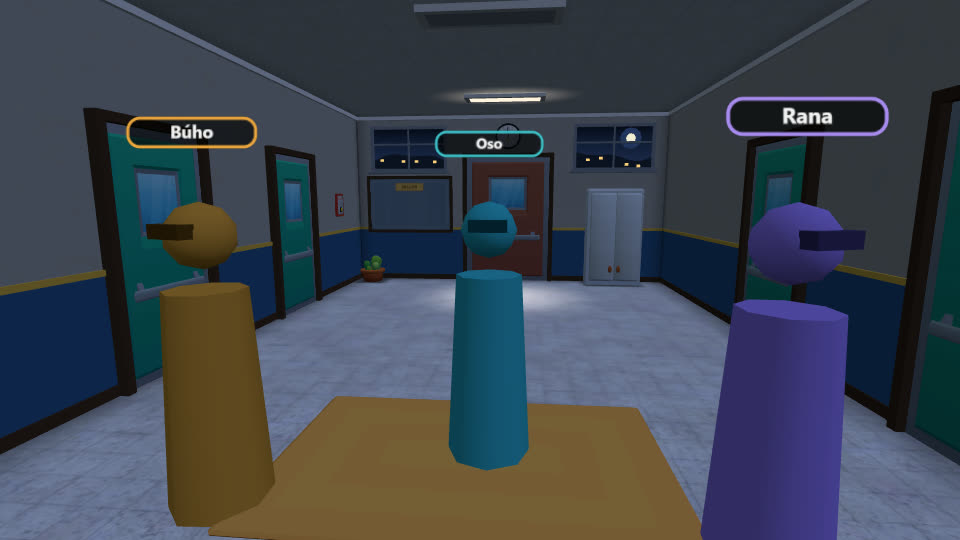
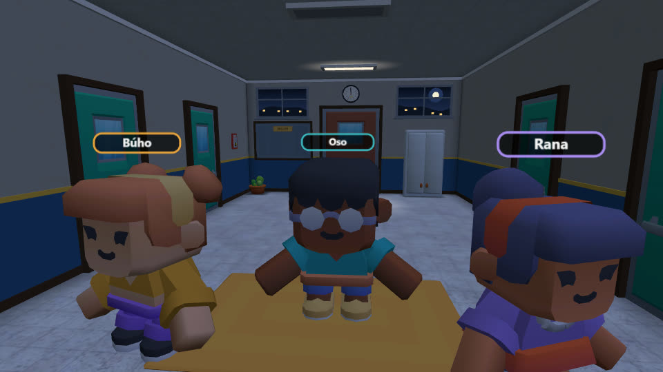
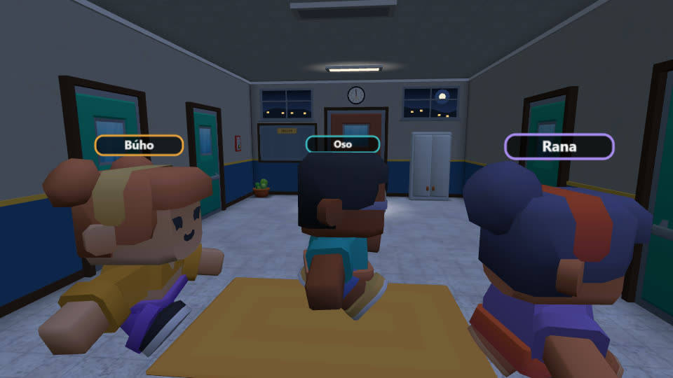
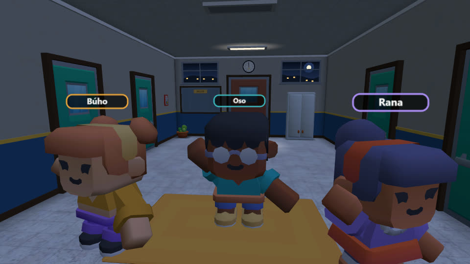

# Personajes del multijugador · Sesión A (T83c)

Decisión de Alex: los compañeros del cooperativo pasan de la cápsula de T83 a estudiantes low-poly CC0 animados, en el estilo de Kenney y KayKit de las salas. 21 de noviembre de 2026.

## Qué quedó

- **Paquete:** Kenney Mini Characters 2.0 (CC0), <https://kenney.nl/assets/mini-characters>. Alex lo bajó: el zip sin abrir en `art/compartido/originales/kenney-mini-characters/` (Git LFS) y la captura en `art/evidencia/kenney-mini-characters.png`. El `License.txt` del zip dice «Creative Commons Zero, CC0».
- **Cuatro estudiantes, uno por color:** `character-female-b` (ámbar), `male-a` (turquesa), `female-c` (violeta) y `male-f` (coral), publicados como `public/assets/salas/compartido/estudiante-a` a `-d`. Como el color de cada jugador es único en la partida y no cambia durante el juego, dos compañeros nunca son el mismo personaje y el mismo jugador es siempre el mismo, también al reconectarse.
- **Uniforme:** la camiseta y las mangas toman el color del jugador; la piel, el pelo, un cinturón, un collar o un overol no. El alias sigue encima de la cabeza.
- **Animación:** quieto cuando no se mueve; caminar mientras llegan sus poses, con el clip a la rapidez que sale de la velocidad interpolada (2 Hz) para que los pies no patinen; y un saludo con el brazo derecho cuando ese jugador manda «¡Aquí!» u otra frase rápida. El saludo se suma a lo que haga el brazo: sirve quieto o caminando.
- **Rendimiento:** el mezclador de animación solo corre si el personaje está a la vista; fuera de ella se oculta y no se anima. Con `prefers-reduced-motion` no hay saludo.
- **Sin el GLB** (si no carga o mientras llega) se ve un estudiante de prueba hecho por código, con las mismas animaciones y la camiseta del color del jugador.

## Capturas (portería, cámara fija, 4 jugadores)

| Antes (`main`) | Después |
| --- | --- |
|  |  |
| |  |
| |  |

Las tomó un visor fuera del repo que arma la portería con el código del juego (`construirSala` + `vestirSala`) y pone a los compañeros con el mismo código del cooperativo, con la misma cámara en las dos ramas.

## Cómo se eligió el paquete

| Paquete | Por qué sí o por qué no |
| --- | --- |
| **Kenney Mini Characters 2.0** | CC0, 14 personas comunes, `idle` y `walk` en cada GLB, un mismo esqueleto de 7 huesos y una paleta compartida. Unos 800 triángulos. **Elegido.** |
| Kenney Blocky Characters 2.0 | CC0, pero cada personaje son 6 piezas sin piel: unas 6 draw calls por compañero. Estilo tipo Minecraft. |
| Kenney Animated Characters 1 a 3 | Solo `idle`, `jump` y `run` (sin caminar), en FBX, y mezclan zombis, cyborgs y criminales. |
| KayKit (Adventurers, Series 4 a 6, Prototype Bits) | Fantasía con armas, series de pago o un muñeco con casco. El único `Waving` real es de KayKit, pero sin gente común gratis. |

Ningún paquete gratis de Kenney trae un saludo con la mano; el más parecido es `emote-yes` (asentir). Por eso el saludo es un clip hecho por código que gira el hueso `arm-right`.

## Cómo funciona

- **Pipeline** (`scripts/perfiles/personaje.ts`): una entrada de `art/modelos.json` con `animado` va por este perfil en lugar del de objetos, que hornea y aplana los nodos y rompería el esqueleto. Deja solo `idle` y `walk` (el paquete trae 32 clips), une cuerpo y cabeza en una sola malla con `joinPrimitives` (`join` se salta las mallas con piel), quita las tangentes, escala a 1,4 m y marca la camiseta (`_TINTE`). Para marcarla mira la paleta: es de bloques de 64 × 128 px con un degradado, uno por color; la camiseta es el bloque del torso que más se repite en el torso y en los brazos, sin contar el de la piel (el más común de la cabeza). Un lector PNG mínimo (`leerPng`, solo `node:zlib`) lee la paleta. Resultado: unos 94 KB, unos 770 triángulos y 1 draw call por personaje.
- **Motor** (`src/engine/coop/`): `personajes.ts` clona cada variante con su esqueleto (`SkeletonUtils.clone`), le pone un material con el tinte (un solo programa de shader para todos) y un `AnimationMixer` con quieto, caminar y el saludo aditivo. `animacion-personaje.ts` tiene las reglas puras: velocidad suavizada con margen entre quieto y caminar, rapidez del clip y quién saluda. `modelo-personajes.ts` carga los GLB del manifiesto. `companeros.ts` los une con las poses y las señales.
- **Para las e2e:** el canvas lleva `data-personajes` (`kenney-mini-characters` o `prueba`), `data-animacion` (`buho:caminar;oso:quieto+saludo;rana:quieto+fuera`) y `data-saludos`.

## Draw calls

Con la cápsula, los 3 cuerpos eran una sola malla instanciada; un personaje con piel no se puede instanciar, así que cada uno cuesta al menos una draw call. La portería ya estaba justo en 40 de 40 en el peor caso de `presupuesto-coop.test.ts` (todas las mallas de la sala a la vista, más el cooperativo). Para no subir el límite:

- El pipeline une cuerpo y cabeza: **1 draw call por personaje** (el GLB original trae 2).
- Las 3 etiquetas de alias pasan de 3 `Sprite` a **una sola malla** que mira a la cámara.

El cooperativo sigue sumando 5 (3 personajes, 1 de alias y 1 de señales), como en T83b, y ninguna sala pasa de 40 en ese peor caso.

**Medida con `?debug=1` en `coop-presupuesto.spec.ts`** (4 pestañas, la de Jaguar con el panel, en la portería): **21 draw calls con los 3 personajes a la vista y 22 con las 4 señales a la vez** (límite 40). Antes de este cambio, en la ola 6a, eran 10 y 11; la diferencia es del pasillo en U que entró a `main` justo antes (la portería sola da de 12 a 23 según hacia dónde se mire, `docs/reportes/pasillos-sesion-B.md`). Lo del cooperativo sigue sumando 5.

## Pruebas

- Unidades nuevas: `animacion-personaje.test.ts` (andar, umbrales, poses a 2 Hz interpoladas sin detenerse entre poses, saludos, variantes), `personajes.test.ts` (modelo de prueba, una draw call por compañero, solo se anima lo que se ve, caminar y detenerse, saludo y reducir movimiento, cambio de modelo, carga del paquete con y sin camiseta marcada), `perfil-personaje.test.ts` (perfil del pipeline, camiseta y mangas sí, cinturón y manos no, lector PNG, esquema de `animado` y los cuatro GLB publicados con 1 draw call y menos de 2.000 triángulos). `avatares.test.ts` y `presupuesto-coop.test.ts` cambian a las etiquetas en una malla.
- E2e nueva: `coop-personajes.spec.ts` (Búho camina y Jaguar lo ve caminar, se detiene y queda quieto, dice «¡Aquí!» y saluda; con reducir movimiento, «Mira esto» ya no lo hace saludar).
- Corrida final sobre la rama ya fusionada con `main` (con el candado A, un navegador, prioridad baja): formato, lint y **1.208 pruebas de unidad** en verde; build sin errores (`astro check`, `check-credits`, `check-budget`, `check-audio`); e2e **17 pasaron y 7 se saltaron** (las del cooperativo no corren en el perfil de escritorio): `coop-personajes`, `coop-presupuesto`, `coop-poses`, `coop-senal`, `coop-sala1`, `coop-objetos`, `coop-pasillo` y `csp`.
- La primera corrida no llegó a las e2e: con un juego abierto en el equipo (90 % de CPU y 1,5 GB libres) el build tardó 10 min y Playwright espera 4. Alex lo cerró y la corrida pasó.

## Lo que quedó pendiente

- **El objeto en la mano.** No se hizo: la escena no sabe qué lleva cada compañero (la foto del anfitrión lo dice, pero el signal `objetosFuera` solo trae los ids que se ocultan) y habría que clonar el modelo del objeto, que puede ser de otra sala. Se haría con un signal «qué lleva cada jugador» y el modelo colgado del hueso `arm-right`.
- **Medir en el celular de referencia** con `?debug=1` y 3 compañeros a la vista (Alex). En el equipo de pruebas el WebGL es por software y los tiempos no sirven.
- Los 4 personajes se descargan aunque haya menos compañeros (unos 375 KB y 4 paletas en la GPU). Si hiciera falta, se pueden pedir solo los de los colores de la partida.
- Accesorios del paquete (sillas de ruedas, bastones, gafas): no se usan; servirían si se quiere más variedad.
